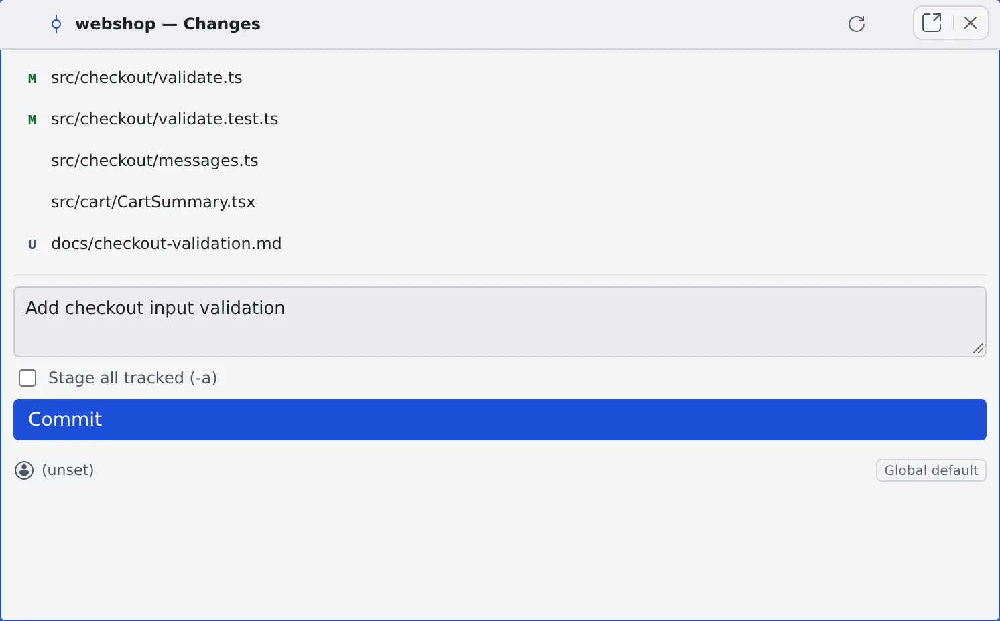

# Commit in the commit graph

English | [日本語](commit.ja.md)

Read the history and diffs in the commit graph, then stage files and commit in the Changes pane.
Use it to check an agent's changes and commit them without opening a terminal.

## How it works

| What you do | What happens |
|---|---|
| Open the commit graph | The branches and history appear. Click a commit for its diff |
| Stage files in "Changes", write a message and commit | The commit lands in the working copy |
| Press fetch or Fast-Forward | The remote is fetched, or the branch catches up with its upstream |

## Open the commit graph

Right-click a repository's row and choose "**Open commit graph**".

- Ctrl+click (⌘+click on a Mac) or middle-click the row to open it in a new pane
- A plain click on the row expands or collapses the sessions and worktrees under it

The header shows the current branch and these buttons. When space is tight they fold into **⋯**.

| Button | What it does |
|---|---|
| Changes | Opens the "Changes" pane for committing, in a separate pane |
| fetch | Fetches the remote (`git fetch --prune`) |
| Fast-Forward | Fast-forwards the current branch to its upstream (`pull --ff-only`) |
| Refresh | Refreshes the view |

- Click the branch name to open "**Switch branch**". It filters, and lists the newest commits first
- With a `.gitmodules`, the header's target selector lists the submodules. Pick a fetched one to see that submodule's commit graph. Unfetched ones are marked "(not fetched)" and cannot be picked

## Stage and commit changes

1. Press "**Changes**". The "{repository name} — Changes" pane lists the changed files
2. Use each row's buttons to "**Stage**" and "**Unstage**"
3. Write in "**Commit message**" below. To include every tracked file, tick "**Stage all tracked (-a)**"
4. Press "**Commit**"

- The "Stage" and "Unstage" buttons appear when you hover over a row
- Tracked files can also be "**Discard changes**"d. They go after a confirmation and cannot be brought back
- With an empty message you see "A commit message is required"

### Change the commit author

The Changes pane shows the current commit author. Click it for "**Change committer (override for this repo)**" and set a name and email for this repository only.

- The author is decided in the order "Repo override" → "Provider default" → "Global default"
- "**Clear**" goes back to the provider default
- The provider and global defaults are in **⚙ Settings → "Git hosting"** ([Connect a Git service](connect-git.md#choose-the-commit-author))

## Read the history and diffs

Click a row of the commit graph to see that commit's changed files and diff.

- Diffs fold per file. Change how they look with "**Expand all**", "**Collapse all**" and "**Wrap**"
- Right-click a commit for this menu

| Item | What it does |
|---|---|
| Show details | Opens that commit's diff |
| Start work on {branch}… | Starts work in a working copy of that branch's own |
| Switch branch: {branch} | Switches the current working copy to that branch |
| Switch to remote branch: {branch} | Switches to the remote branch |
| Check out (detached HEAD) | Checks out that commit |
| New branch from this commit… | Creates a branch from that commit and switches to it |

- A branch used by another working copy shows "{branch} is in use by {folder}; open it", which opens that working copy

## When it goes wrong

### "Check out commit" fails

It can fail when there are uncommitted changes. Commit them, or clear them away, first.

## Related

- [Launch a session from a repository](launch-from-repo.md): the rest of the right-click menu, and the row's badges
- [Connect a Git service](connect-git.md): pushing and the commit author
