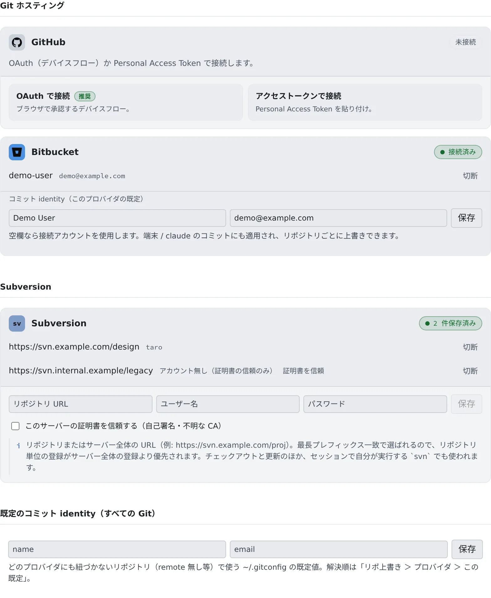

# Git のサービスを接続する

[English](connect-git.md) | 日本語

GitHub か Bitbucket を接続しておくと、private リポジトリをクローンでき、`git push` でトークンを聞かれなくなります。
エージェントも同じ接続で push します。

## 全体像

| あなたがやること | エージェントがやること |
|---|---|
| GitHub か Bitbucket を接続する | `git clone`・`git fetch`・`git push` を、トークンを聞かずに実行する |
| コミットに使う名前とメールを決める | その名前とメールでコミットする |

- 同じ接続で、セッションの `gh`（Bitbucket Cloud なら `bkt`）もログインなしで使えます。[GitHub の CLI を使う](../integrations/github-cli.ja.md)・[Bitbucket の CLI を使う](../integrations/bitbucket-cli.ja.md) を参照してください
- GitHub を接続すると、GitHub Copilot の接続も兼ねます

## 始める前に

**⚙設定 →「Git ホスティング」** で接続します。接続はワークスペースの中で行うので、ワークスペースを起動しておいてください。
停止中は「外部 Git 接続はワークスペース内で実行されます」と出ます。

## GitHub を接続する

1. GitHub のカードで「**OAuth で接続**」を押します
2. 「**コードをコピー**」でコードを控え、「**リンクを開いて貼り付け**」で GitHub に貼ります
3. GitHub で承認すると、カードが「**接続済み**」になり、あなたのアカウントとメールが出ます

OAuth を使わないときは「**アクセストークンで接続**」を選び、Personal Access Token を貼ります。

| トークンの種類 | 付ける権限 |
|---|---|
| クラシック | `repo`。パブリックのリポジトリだけなら `public_repo` |
| fine-grained | Repository permissions の `Contents: Read and write`。クローンだけなら Read-only |

- トークンで接続しても、OAuth より機能が劣ることはありません

### GitHub App で接続するテナント

テナントが GitHub App を使っていると、カードに「このテナントは GitHub App で接続します。…」と出ます。
GitHub App が届くのは、アプリをインストールしたリポジトリだけです。

- 「**アプリをインストール / リポジトリを選ぶ**」から、自分のアカウントや organization にインストールし、リポジトリを選びます
- 接続の前でも後でもかまいません。あとからリポジトリを足すときも、同じリンクを使います

## Bitbucket を接続する

1. Bitbucket のカードで「**OAuth で接続**」を押します
2. 別のタブで Atlassian の承認画面が開くので、承認します
3. カードが「**接続済み**」になります

OAuth を使わないときは「**アプリトークンで接続**」を選び、Atlassian のメールアドレスと API トークンを入れます。

- トークンは「スコープ付き API トークン」で作り、アプリには Bitbucket を選びます。スコープのないトークンは拒否されます
- 付けるスコープは次のとおりです

| 使いみち | スコープ |
|---|---|
| 一覧とクローン | `read:account`・`read:workspace:bitbucket`・`read:repository:bitbucket` |
| push | 上に加えて `write:repository:bitbucket` |
| セッションの `bkt pr create`・`bkt pipeline` と課題管理 | `read:pullrequest:bitbucket`・`write:pullrequest:bitbucket`・`read:pipeline:bitbucket`。パイプラインを開始・停止するなら `write:pipeline:bitbucket` も |

- OAuth の接続は、接続を始めた本人の Console でだけ完了します。ブラウザが別のアカウントでサインインしているときや、Console のセッションが切れているときは保存されません

## コミットの作者を決める

接続済みのカードには「**コミット identity（このプロバイダの既定）**」の欄があります。空欄なら、接続したアカウントの名前とメールを使います。

| どこで決めるか | 効く範囲 |
|---|---|
| コミットの画面の「**コミット者を変更（このリポの上書き）**」 | そのリポジトリだけ |
| カードの「コミット identity（このプロバイダの既定）」 | その GitHub か Bitbucket のリポジトリすべて |
| 「**既定のコミット identity（すべての Git）**」 | どのサービスにも紐づかないリポジトリ（リモートがないものなど） |

- 上の行ほど優先されます
- ターミナルやエージェントのコミットにも効きます

## push する

接続していれば、`git push` はターミナルからもエージェントからも、そのまま通ります。

- Bitbucket の OAuth のトークンは、期限が切れても自動で更新されます
- コミットしていない変更や、push していないブランチは、ワークスペースの中にしかありません。残したい作業はこまめに push してください

## 困ったとき

### 「OAuth で接続」が出ていない

そのサービスの OAuth アプリが、テナントに登録されていません。カードに「このテナントには OAuth アプリが登録されていないため、…」と出ます。

- テナント管理者に「**テナント設定 › 連携 › 連携アプリの OAuth**」での登録を頼んでください
- その間は、トークンで接続できます

### 「GitHub の接続を更新できませんでした。…」と出る

認可が期限切れになったか、取り消されています。「**切断**」してから、もう一度接続してください。

### GitHub App で接続したのに、リポジトリが出てこない

アプリがそのリポジトリにインストールされていません。「接続しましたが、GitHub App があなたから見えるどのアカウントにもインストールされていないため、…」と出たときも同じです。
「**アプリをインストール / リポジトリを選ぶ**」からインストールして、リポジトリを選んでください。

### 「…このワークスペースの Agent は古くて更新できません。…」と出る

GitHub App のトークンは約 8 時間で切れますが、ワークスペースの Agent が古く、更新できません。ワークスペースを再起動してから、GitHub に接続し直してください。

### Bitbucket がトークンを拒否する

| 出る文 | 直し方 |
|---|---|
| 「Bitbucket がトークンを拒否しました。…」 | スコープ付き API トークンを作り直し、ユーザー名に Atlassian のメールアドレスを入れる |
| 「トークンに read:repository:bitbucket スコープがありません。…」 | そのスコープを付けて作り直す |
| 「接続しました。ただし push には write:repository:bitbucket スコープが必要です…」 | クローンはできます。push するなら、そのスコープを付けて作り直す |

## 関連

- [リポジトリをクローンする](clone.ja.md)
- [内蔵の Git を使う](internal-git.ja.md)：外部のサービスを使わずに、テナントの中にリポジトリを置く
- [Subversion のリポジトリを使う](svn.ja.md)：保存した Subversion の認証情報も、同じタブにあります
- [GitHub の CLI を使う](../integrations/github-cli.ja.md)
- [Bitbucket の CLI を使う](../integrations/bitbucket-cli.ja.md)
