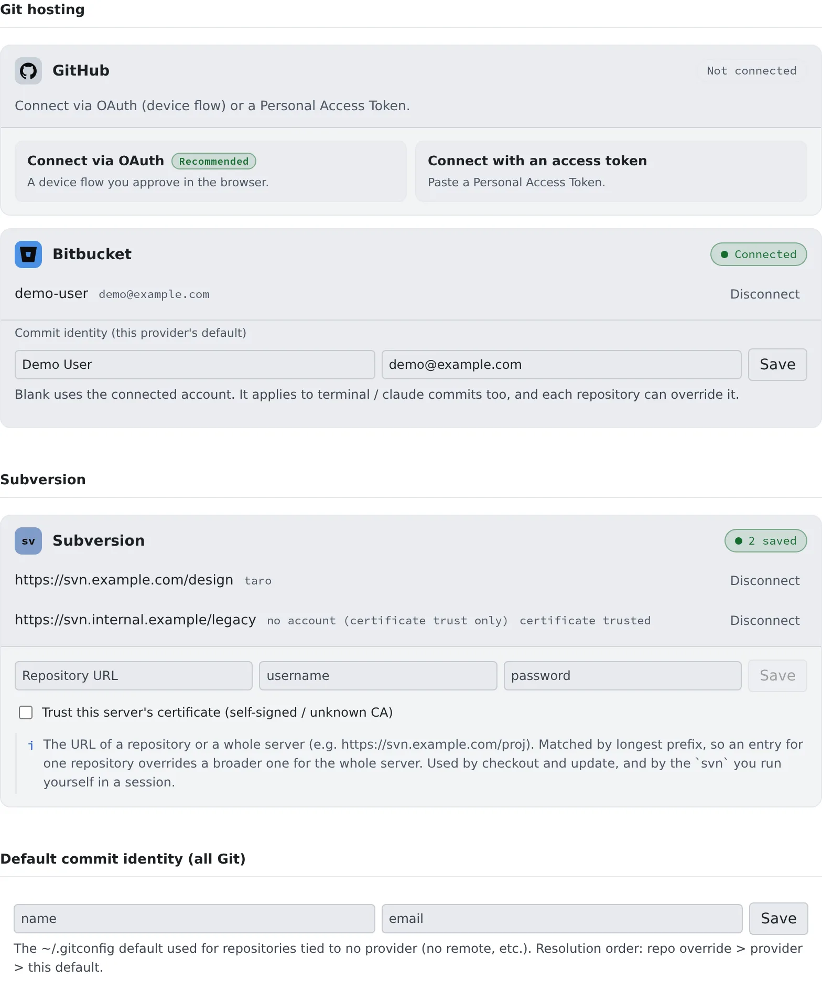

# Connect a Git service

English | [日本語](connect-git.ja.md)

Connect GitHub or Bitbucket and you can clone private repositories, and `git push` stops asking for a token.
Agents push through the same connection.

## How it works

| What you do | What the agent does |
|---|---|
| Connect GitHub or Bitbucket | Runs `git clone`, `git fetch` and `git push` without asking for a token |
| Choose the name and email for commits | Commits with that name and email |

- The same connection signs in `gh` in your sessions (and `bkt`, for Bitbucket Cloud). See [Use the GitHub CLI](../integrations/github-cli.md) and [Use the Bitbucket CLI](../integrations/bitbucket-cli.md)
- Connecting GitHub also connects GitHub Copilot

## Before you start

You connect in **⚙ Settings → "Git hosting"**. The connection is made inside the workspace, so start the workspace first.
While it is stopped the tab says "External Git connections run inside the workspace".

## Connect GitHub

1. On the GitHub card, press "**Connect via OAuth**"
2. Use "**Copy the code**", then "**Open the link and paste**" to paste it into GitHub
3. Approve on GitHub. The card turns "**Connected**" and shows your account and email

Without OAuth, choose "**Connect with an access token**" and paste a Personal Access Token.

| Token type | Permission to give it |
|---|---|
| Classic | `repo`, or `public_repo` for public repositories only |
| Fine-grained | `Contents: Read and write` under Repository permissions; Read-only to clone only |

- A token connection is not a lesser connection than OAuth

### A tenant that connects through a GitHub App

When your tenant uses a GitHub App, the card says "This tenant connects through a GitHub App, …".
A GitHub App reaches only the repositories it is installed on.

- Use "**Install the app / choose repositories**" to install it on your account or organization and choose the repositories
- Before or after connecting, either works. Use the same link to add repositories later

## Connect Bitbucket

1. On the Bitbucket card, press "**Connect via OAuth**"
2. Atlassian's approval page opens in another tab; approve it
3. The card turns "**Connected**"

Without OAuth, choose "**Connect with an app token**" and enter your Atlassian email address and an API token.

- Create the token as an "API token with scopes" and select Bitbucket as the app. A token without scopes is rejected
- Give it these scopes

| For | Scopes |
|---|---|
| Listing and cloning | `read:account`, `read:workspace:bitbucket`, `read:repository:bitbucket` |
| Pushing | `write:repository:bitbucket` as well |
| `bkt pr create`, `bkt pipeline` in sessions, and the issue tracker | `read:pullrequest:bitbucket`, `write:pullrequest:bitbucket`, `read:pipeline:bitbucket`; add `write:pipeline:bitbucket` to start and stop pipelines |

- An OAuth connection finishes only in the Console of the member who started it. If the browser is signed in as someone else, or the Console session has expired, nothing is saved

## Choose the commit author

A connected card has a "**Commit identity (this provider's default)**" field. Left blank, it uses the connected account's name and email.

| Where you set it | What it covers |
|---|---|
| "**Change committer (override for this repo)**" in the commit pane | That repository only |
| The card's "Commit identity (this provider's default)" | Every repository on that GitHub or Bitbucket |
| "**Default commit identity (all Git)**" | Repositories tied to no service (no remote, for example) |

- A higher row wins
- It applies to commits made in a terminal and by agents too

## Push

While you are connected, `git push` just works, from a terminal and from an agent.

- Bitbucket's OAuth token is renewed automatically, even after it expires
- Uncommitted changes and unpushed branches exist only inside the workspace. Push work you want to keep often

## When it goes wrong

### "Connect via OAuth" is not offered

Your tenant has no OAuth app registered for that service. The card says "Connecting with OAuth isn't offered because this tenant has no OAuth app registered. …".

- Ask a tenant administrator to register one under "**Tenant settings › Integrations › Integration OAuth apps**"
- Until then, connect with a token

### "GitHub could not renew this connection: …"

The authorization has expired or was revoked. Press "**Disconnect**" and connect again.

### Connected through a GitHub App, but the repository does not appear

The app is not installed on that repository. The same goes for "Connected, but the GitHub App is not installed on any account you can see, …".
Install it from "**Install the app / choose repositories**" and choose the repository.

### "… this workspace's Agent is too old to renew them. …"

GitHub App tokens expire in about eight hours, and the workspace's Agent is too old to renew them. Restart the workspace, then connect GitHub again.

### Bitbucket rejects the token

| Message | Fix |
|---|---|
| "Bitbucket rejected the token. …" | Create an API token with scopes again, and use your Atlassian email address as the username |
| "The token is missing the read:repository:bitbucket scope. …" | Create it again with that scope |
| "Connected, but pushing needs the write:repository:bitbucket scope, …" | Cloning works. To push, create it again with that scope |

## Related

- [Clone a repository](clone.md)
- [Use the built-in Git](internal-git.md): keep repositories inside the tenant, with no external service
- [Use a Subversion repository](svn.md): saved Subversion credentials live on the same tab
- [Use the GitHub CLI](../integrations/github-cli.md)
- [Use the Bitbucket CLI](../integrations/bitbucket-cli.md)
