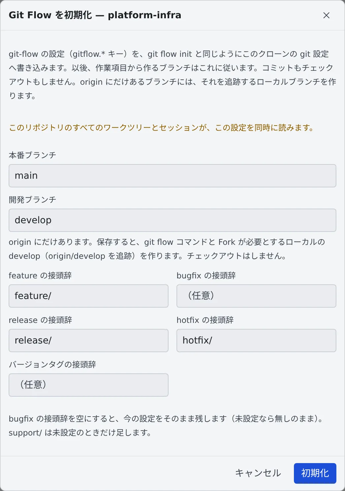

# Git Flow を初期化する

[English](git-flow.md) | 日本語

git-flow の設定をクローンに書き込むと、課題から作る新しいブランチが、開発ブランチから git-flow の接頭辞で始まるようになります。
`git flow init` と同じ設定を、Console から書けます。

## 全体像

| あなたがやること | エージェントがやること |
|---|---|
| 「Git Flow を初期化…」で、ブランチと接頭辞を確かめて保存する | — |
| 課題から作業を始める | 開発ブランチから、`feature/` などの接頭辞のついたブランチで作業する |

git-flow は設定を `.git/config` に置き、これはクローンでは写りません。だから git-flow で運用しているリポジトリでも、
Agent Fleet が作ったクローンには、ふつう何も設定がありません。

## 初期化する

1. 左ペイン **リポジトリ** で、リポジトリの行を右クリックします
2. 「**Git Flow を初期化…**」を選びます
3. 欄を確かめて、「**初期化**」を押します

| 欄 | 入れるもの |
|---|---|
| 本番ブランチ・開発ブランチ | `main` と `develop` など |
| feature の接頭辞・release の接頭辞・hotfix の接頭辞 | `feature/` など |
| バージョンタグの接頭辞 | 任意 |
| bugfix の接頭辞 | 任意。空にすると、今の設定をそのまま残す |

- 最初の値は、今ある設定、Bitbucket のブランチ設定（何か決めてあるとき）、`develop`・`main`・`master` のどれがあるか、から入ります
- 書くのは `gitflow.branch.*` と `gitflow.prefix.*` です。`support/` は、設定がないときだけ足します
- コミットもチェックアウトもしません
- この項目は、元の作業コピーの行にだけ出ます。worktree の行には出ません

## 書く前に知っておくこと

- このリポジトリのすべての worktree とセッションが、この設定を同時に読みます
- すでにあって値が変わる設定は、保存の前に一覧され、ボタンが「**上書きする**」になります
- リポジトリにコミットされた `.agent-fleet/branches` や `.gitflow` は、重なる項目ではこの設定より優先されます。ダイアログにもそう出ます
- クローンに git-flow-next 自身の設定（`gitflow.version`）があるときは、そちらが優先されます

### ブランチが origin にだけあるとき

`git flow` コマンドと Fork は、本番ブランチと開発ブランチをローカルに必要とします。そこで保存すると、
`origin` のブランチを追跡するローカルブランチを作ります（`git branch --track develop origin/develop` と同じです）。

- 欄の下に「origin にだけあります。…」と出て、保存のあとのメッセージが作ったブランチを示します
- チェックアウトはしません
- すでにあるローカルブランチは、`origin` と違っていても動かしません

## 課題から始めると勧められる

`origin` に `develop` があり、git-flow の設定が何もないリポジトリで課題から作業を始めると、起動の画面が「**Git Flow を初期化…**」を勧めます。
自分から初期化することはありません。

## 困ったとき

### 「… はローカルにも origin にもありません。…」と出る

本番ブランチか開発ブランチが、どこにもありません。先に push するか fetch してください。

### 「このダイアログを開いている間に設定が変わりました。…」と出る

ほかの人やセッションが設定を変えました。ダイアログが読み直したので、確かめてからもう一度保存します。

### 「… は作りましたが、origin を追跡する設定ができませんでした …」と出る

もう一度保存しても直りません。ダイアログに出る `git branch --set-upstream-to=…` を、リポジトリで実行してください。

### 「書き込みが途中で止まりました …」と出る

もう一度保存すると、すべて書き直します。

## 関連

- [リポジトリからセッションを起動する](launch-from-repo.ja.md)
- [課題管理サービスを接続する](../integrations/issue-tracker.ja.md)：課題から作業を始める
