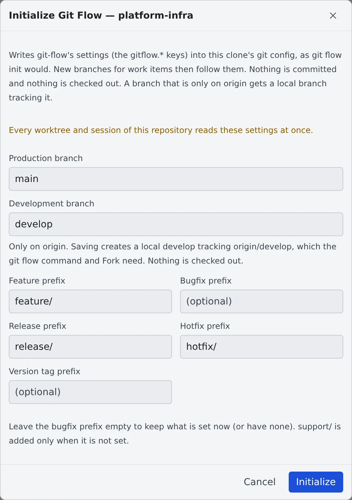

# Initialize Git Flow

English | [日本語](git-flow.ja.md)

Write the git-flow settings into a clone, and new branches for issues start from the development branch with git-flow's prefixes.
The Console writes the same settings `git flow init` would.

## How it works

| What you do | What the agent does |
|---|---|
| Check the branches and prefixes in "Initialize Git Flow" and save | — |
| Start work from an issue | Works on a branch cut from the development branch, with a prefix such as `feature/` |

git-flow keeps its settings in `.git/config`, which a clone does not copy. So even for a repository that runs git-flow,
the clone Agent Fleet made usually has no settings at all.

## Initialize

1. In the left pane's **Repositories**, right-click the repository's row
2. Choose "**Initialize Git Flow**"
3. Check the fields and press "**Initialize**"

| Field | What to enter |
|---|---|
| Production branch, Development branch | `main` and `develop`, for example |
| Feature prefix, Release prefix, Hotfix prefix | `feature/`, for example |
| Version tag prefix | Optional |
| Bugfix prefix | Optional. Left empty, the current setting stays as it is |

- The fields start from the settings already there, the repository's Bitbucket branching model (when it declares one), and which of `develop`, `main` and `master` exist
- It writes `gitflow.branch.*` and `gitflow.prefix.*`. `support/` is added only when it is not set
- Nothing is committed and nothing is checked out
- The item is offered on the base working copy's row only, not on a worktree's

## Before you write

- Every worktree and session of the repository reads these settings at once
- Settings that exist and would change are listed before you save, and the button reads "**Overwrite**"
- A committed `.agent-fleet/branches` or `.gitflow` takes precedence over these settings where they overlap. The dialog says so too
- If the clone has git-flow-next's own settings (`gitflow.version`), those take precedence

### When a branch exists only on origin

The `git flow` command and Fork want the production and development branches locally. So saving creates a local
branch tracking the one on `origin` (the same as `git branch --track develop origin/develop`).

- The field shows an "Only on origin. …" note, and the message after saving names the branches it created
- Nothing is checked out
- A local branch that already exists is never moved, even when it differs from `origin`'s

## Offered when you start from an issue

When you start work from an issue in a repository whose `origin` has `develop` and that has no git-flow settings, the launch screen offers "**Initialize Git Flow…**".
It never initializes on its own.

## When it goes wrong

### "… exists neither locally nor on origin. …"

The production or development branch exists nowhere. Push or fetch it first.

### "The settings changed while this dialog was open. …"

Someone else, or a session, changed the settings. The dialog has reloaded them; check and save again.

### "… was created but could not be set to track origin …"

Saving again will not fix it. Run the `git branch --set-upstream-to=…` command the dialog shows in the repository.

### "Writing stopped part-way …"

Save again and everything is written again.

## Related

- [Launch a session from a repository](launch-from-repo.md)
- [Connect an issue tracker](../integrations/issue-tracker.md): start work from issues
