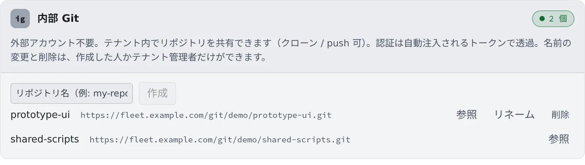

# 内蔵の Git を使う

[English](internal-git.md) | 日本語

GitHub や Bitbucket を使わずに、テナントの中に Git のリポジトリを作れます。外部のアカウントは要らず、
テナントのメンバーどうしでクローン・push できます。試作や、外に出せないコードの置き場に向いています。

## 全体像

| あなたがやること | エージェントがやること |
|---|---|
| 名前を入れてリポジトリを作る | — |
| クローン URL をコピーして、クローンする | そのリポジトリで `git push` や `git fetch` を、トークンを聞かずに実行する |
| いらなくなったら削除する | — |

- 認証は自動で行われるので、接続の手順はありません
- 設定の画面は Control Plane が直接扱うので、ワークスペースが停止中でも使えます

## リポジトリを作る

1. **⚙設定 →「内部リポジトリ」** を開きます
2. 「**リポジトリ名（例: my-repo）**」に名前を入れて、「**作成**」を押します

- 名前は英数字で始め、英数字と `.`・`_`・`-` で 64 文字までです
- 行には、名前とクローン URL が出ます

## クローンする

行のクローン URL を押すと、URL をコピーします。クローンのしかたは 2 つです。

- 左ペイン **リポジトリ** の「**追加**」で、「**接続から選ぶ**」の「**内部**」タブから選ぶ
- 「**URL 手入力**」に、コピーした URL を貼る

どちらも、手順は [リポジトリをクローンする](clone.ja.md) と同じです。

## 中身を見る

「**参照**」を押すと、クローンせずにブランチごとのファイルを見られます。

- 大きすぎるファイル、バイナリファイル、Git LFS のファイルは表示しません。クローンして見てください

## 名前を変える・削除する

行の「**リネーム**」で名前を変え、「**削除**」で消します。

- どちらも、作った人かテナント管理者だけができます。ほかの人の行には、このボタンが出ません
- 削除は取り消せません
- 名前を変えると、クローン URL も変わります。クローン済みの作業コピーは古い URL のままなので、`git remote set-url origin <新しい URL>` で直してください

## 困ったとき

### push が拒否される

push は、Git のオブジェクトの検査（`receive.fsckObjects`）を受けます。

| 見つかった不備 | 結果 |
|---|---|
| 取り込んだ履歴によくある見た目の不備（タイムゾーンや日付の不正、メールアドレスの前のスペースの欠け、ファイルモードの不正など） | 警告だけで、push は通ります |
| 危ない名前やパス（`../` を含む `.gitmodules` の名前、オプションに見えるパス、`.git` のような名前のツリーエントリ） | 拒否されます |
| そのほか、Git が見つけた不備 | ミラーした履歴でも拒否されます |

拒否されたら、Git が出す message id（`hasDotgit` など）を管理者に伝えてください。

### クローンの画面に「内部リポジトリは利用できません（この環境では無効）。」と出る

この配備では、内蔵の Git が使えません。管理者に確かめてください。

## 関連

- [リポジトリをクローンする](clone.ja.md)
- [Git のサービスを接続する](connect-git.ja.md)：GitHub や Bitbucket を使うとき
