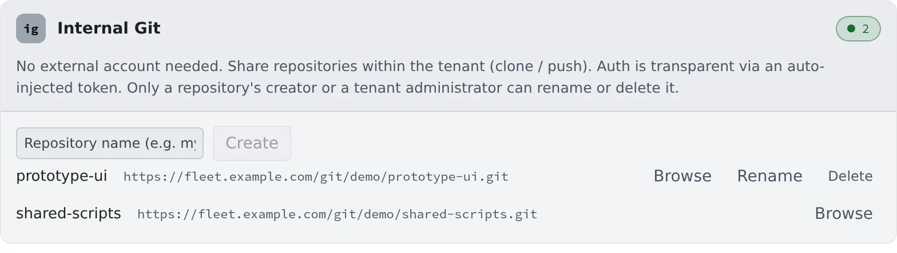

# Use the built-in Git

English | [日本語](internal-git.ja.md)

Create Git repositories inside your tenant, without GitHub or Bitbucket. No external account is needed, and members of
the tenant clone and push them between themselves. It suits prototypes, and code that must not leave the building.

## How it works

| What you do | What the agent does |
|---|---|
| Enter a name and create a repository | — |
| Copy the clone URL and clone it | Runs `git push` and `git fetch` on it without asking for a token |
| Delete it when you no longer need it | — |

- Authentication happens by itself, so there is no connect step
- The Control Plane handles the settings tab directly, so it works while the workspace is stopped

## Create a repository

1. Open **⚙ Settings → "Internal repos"**
2. Enter a name in "**Repository name (e.g. my-repo)**" and press "**Create**"

- A name starts with a letter or a digit, uses letters, digits, `.`, `_` and `-`, and is up to 64 characters
- Each row shows the name and the clone URL

## Clone it

Click a row's clone URL to copy it. There are two ways to clone.

- In "**Add**" of the left pane's **Repositories**, pick it from the "**Internal**" tab of "**Pick from connections**"
- Paste the copied URL into "**Enter URL**"

Either way, the steps are those of [Clone a repository](clone.md).

## Look inside

"**Browse**" shows each branch's files without cloning.

- Files that are too large, binary files and Git LFS files are not shown. Clone to see them

## Rename or delete

"**Rename**" on a row renames it, and "**Delete**" removes it.

- Only the person who created it, or a tenant administrator, can do either. Other people's rows do not show these buttons
- Deleting cannot be undone
- Renaming changes the clone URL. Existing working copies keep the old URL; fix them with `git remote set-url origin <new URL>`

## When it goes wrong

### A push is refused

Every push goes through Git's object check (`receive.fsckObjects`).

| What it finds | Result |
|---|---|
| Cosmetic defects common in imported history (a bad timezone or date, a missing space before the email, an odd file mode, and similar) | Only a warning; the push goes through |
| Dangerous names and paths (a `.gitmodules` name containing `../`, a path that looks like an option, a tree entry named like `.git`) | Refused |
| Any other defect Git finds | Refused, even for mirrored history |

If a push is refused, pass the message id Git prints (such as `hasDotgit`) to your administrator.

### The clone dialog says "Internal repositories are unavailable (disabled in this environment)."

The built-in Git is not available on this deployment. Check with your administrator.

## Related

- [Clone a repository](clone.md)
- [Connect a Git service](connect-git.md): for GitHub or Bitbucket
