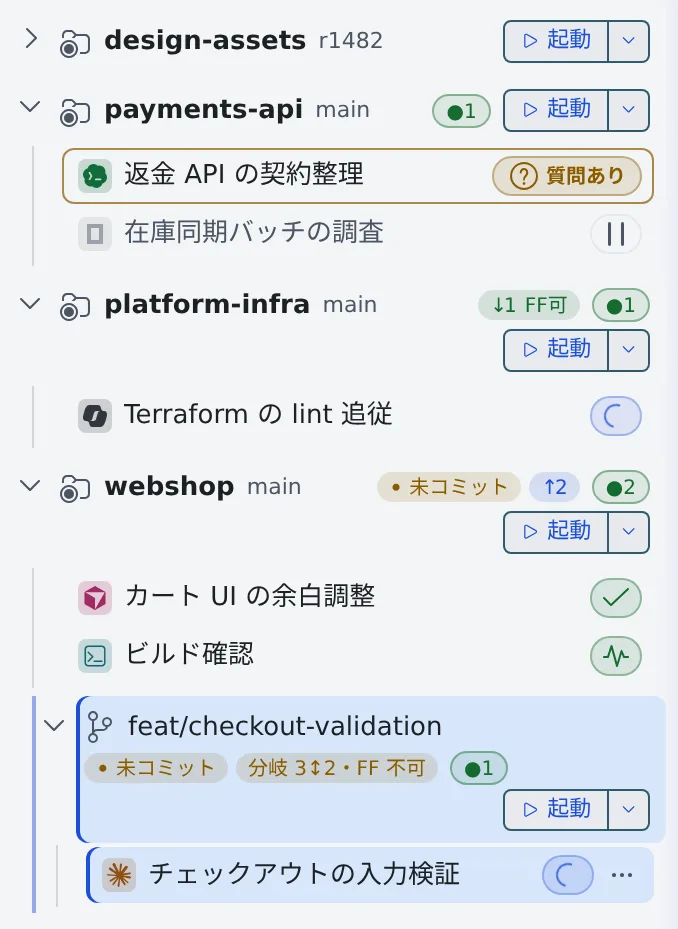
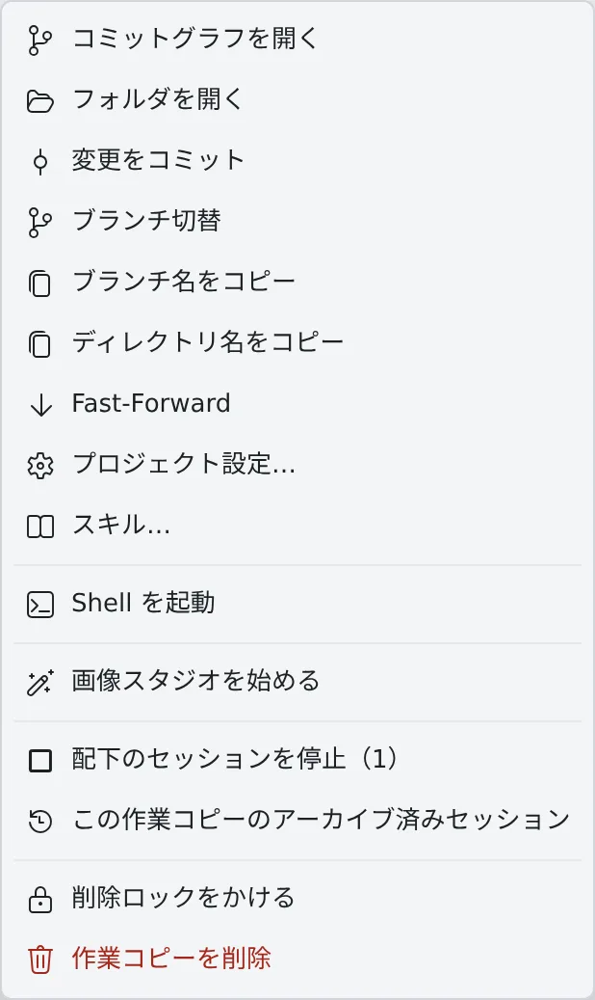

# リポジトリからセッションを起動する

[English](launch-from-repo.md) | 日本語

左ペイン **リポジトリ** の行から、そのリポジトリで作業するセッションを起動できます。
行のバッジを読めば、push していない変更や、取り込んでいない変更にも気づけます。

## 全体像

| あなたがやること | エージェントがやること |
|---|---|
| 行の「起動」で、エージェント・モデル・場所・最初のプロンプトを選ぶ | 既定では新しい worktree の中で、最初のプロンプトから作業を始める |
| よく使う最初のプロンプトをテンプレートにしておく | — |
| 行のバッジで、未コミット・未 push・親との差を確かめる | — |

## 起動する

1. 行の「**起動**」を押します。「**作業を始める**」の画面が開きます
2. エージェント・モデル・**場所**・最初のプロンプトを選びます
3. 起動します

- 場所の既定は、隔離された「**新しい worktree**」です。場所ごとの違い、基点のブランチとブランチ名は [worktree で並行して作業する](../sessions/worktrees.ja.md) にあります
- 「起動」の右の **▾** で種類（エージェントか shell）を選ぶと、画面を開かずにすぐ起動します。プロンプトは渡しません
- **▾** の一覧で Ctrl を押しながらクリックするか中クリックすると、新しいペインに起動します

## 最初のプロンプトのテンプレートを使う

最初のプロンプトの欄の上にある「**テンプレート**」を押すと、検索できる一覧が開きます。

| グループ | 中身 |
|---|---|
| マイテンプレート | 自分で作ったもの。「**新しいテンプレート**」で作り、「**編集**」「**削除**」で直す |
| このリポジトリ（.agent-fleet/launch-prompts.md） | リポジトリにコミットされたファイルの、`## 見出し` ごとの項目。クローンした全員で共有し、ここでは読むだけ |
| 履歴 | このリポジトリで最近起動したときの最初のプロンプト（最大 8 件）。「**削除**」で履歴から消し、「**テンプレートとして保存**」で自分のテンプレートにできる |

- 文字を打つと絞り込み、**↑ / ↓** で選び、**Enter** で挿入、**Esc** で閉じます
- 選んでいる項目の全文は、一覧の横のプレビューに出ます。スマホでは 1 回目のタップでプレビュー、「**挿入**」で挿入します
- `{{repo}}`・`{{branch}}`・`{{path}}` は、起動した行の値に置き換わります
- 欄に入力済みの文章があるときは、「**カーソル位置に挿入**」か「**全体を置き換え**」かを聞きます

テンプレートを作るときは、名前・プロンプトと「**表示する場所**」（「すべてのリポジトリ」かそのリポジトリだけ）を決めます。

- 自分のテンプレートと履歴は設定と一緒に保存され、別のブラウザや別のデバイスでも同じものが出ます
- テンプレートは 40 件・全体で 16 KB・1 件 8 KB までです
- 3 KB を超えるプロンプトは、履歴でもそのブラウザにだけ残ります
- リポジトリの `.claude` のコマンドやスキルは、「テンプレート」の隣のスキルボタン（**/**）から呼び出します

## 行のバッジを読む

| バッジ | 意味 |
|---|---|
| 未コミット | コミットしていない変更がある |
| ↑N | origin より N コミット進んでいる（push していない） |
| ↓N FF可 | origin が N コミット進んでいて、そのまま fast-forward できる |
| ↑N ↓N 要マージ | origin と分かれている。マージかリベースが要る |
| 親= | worktree が親と同じコミット |
| 未取込 N | 親にまだ入っていない、worktree だけのコミットが N 件ある |
| 親+N・FF 可 | 親のほうが N コミット進んでいて、worktree に fast-forward で取り込める |
| 分岐 N↕M・FF 不可 | worktree と親の両方に固有のコミットがある。マージかリベースが要る |
| 比較不可 | detached HEAD やコミットのないリポジトリなどで、関係がわからない |

- `↑`・`↓` は origin との比較です。worktree のバッジ（「親」と付くもの）は、親の作業コピーのブランチとの比較です
- 「親」は、親の作業コピーのブランチの upstream（`origin/develop` など）です。upstream がないときは、親の作業コピーの HEAD と比べます
- GitHub でプルリクエストをマージすると、親の作業コピーを fast-forward しなくても、次の fetch（自動で 10 分ごと）で反映されます
- 親の作業コピーにある、push していないコミットは比べません
- バッジにマウスを重ねると、比較先とそれぞれの固有のコミット数が出ます

行の右端の数字の意味は次のとおりです。

| 表示 | 意味 |
|---|---|
| `●N` | 稼働中のセッションの数 |
| 数字だけ | 停止中のセッションの数 |
| 色の付いた数字 | そのリポジトリのコミットグラフを表示しているペインの番号 |

- 折りたたんでいるリポジトリの数には、その下の worktree のセッションも入ります
- アイコンの一覧は [アイコン・バッジ・メニュー](../../ref/console-ui.ja.md) にあります

## 右クリックでできること

行を右クリックすると、次のメニューが出ます。状態や場所によって出ない項目もあります。

| 項目 | できること |
|---|---|
| コミットグラフを開く・フォルダを開く・変更をコミット | [コミットグラフでコミットする](commit.ja.md) |
| ブランチ切替・ブランチ名をコピー・ディレクトリ名をコピー | 名前のとおり |
| Fast-Forward | upstream へ fast-forward する。worktree では「origin/develop を Fast-Forward で取り込む」（upstream がないときは「親を Fast-Forward で取り込む」）になる |
| Git Flow を初期化… | [Git Flow を初期化する](git-flow.ja.md)。元の作業コピーにだけ出る |
| プロジェクト設定… | リポジトリにコミットされた MCP の定義を確かめる（[セッションに MCP サーバーを追加する](../integrations/mcp-servers.ja.md#どのエージェントに渡るか)） |
| スキル… | そのリポジトリが各エージェントに渡すスキルを確かめる（[手元の Claude Code の設定を持ち込む](../agents/bring-claude-setup.ja.md#スキルを確かめる)） |
| 共有する… | この作業コピーのセッションを、ほかのメンバーに共有する（[会話を共有する](../team/share.ja.md)） |
| Shell を起動 | その作業コピーで shell のセッションを開く |
| 画像スタジオを始める | その作業コピーで画像スタジオを始める（[スタジオで画像を仕上げる](../images/studio.ja.md)）。ワークスペースの起動中で、画像生成が使えるときだけ出る |
| 作業グループ | 作業グループに割り当てる（[作業グループで絞り込む](../fleet/working-sets.ja.md)） |
| 配下のセッションを停止 | その作業コピーと、その下の作業コピーで動いているセッションをまとめて止める（[セッションを止める・再開する](../sessions/stop-resume.ja.md#1-つの作業コピーで動いているセッションをまとめて止める)） |
| 停止中のセッションを全てアーカイブ | その作業コピーの停止中のセッションをまとめてアーカイブする |
| この作業コピーのアーカイブ済みセッション | その作業コピーに絞ったアーカイブの一覧を開く |
| 削除ロックをかける・削除ロックを解除する | 作業コピーを自動の整理から外し、削除できなくする。行にロックのアイコンが付き、解除するまで「作業コピーを削除」は押せない（[終わったセッションを片付ける](../sessions/cleanup.ja.md#削除ロックをかける)） |
| 作業コピーを削除 | [終わったセッションを片付ける](../sessions/cleanup.ja.md#1-つの仕事の作業コピーをまとめて削除する) |

- 「配下のセッションを停止」と「停止中のセッションを全てアーカイブ」は、対象があるときだけ件数つきで出ます

## 困ったとき

### プルリクエストをマージしたのに、「未取込」のまま

squash merge はコミットの祖先関係を残さないので、サービス上でマージ済みでも「親=」や「親+N・FF 可」になりません。

### 「起動」を押せない

ワークスペースが停止中か、使えるエージェントがありません。ボタンにマウスを重ねると、理由が出ます。

## 関連

- [リポジトリをクローンする](clone.ja.md)
- [コミットグラフでコミットする](commit.ja.md)
- [Git Flow を初期化する](git-flow.ja.md)
