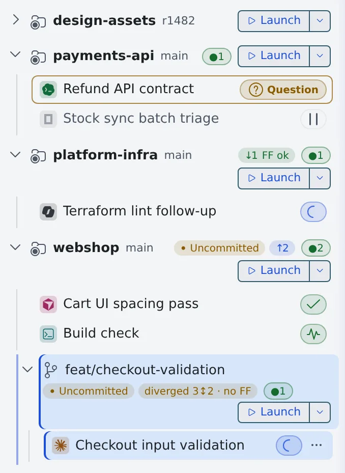
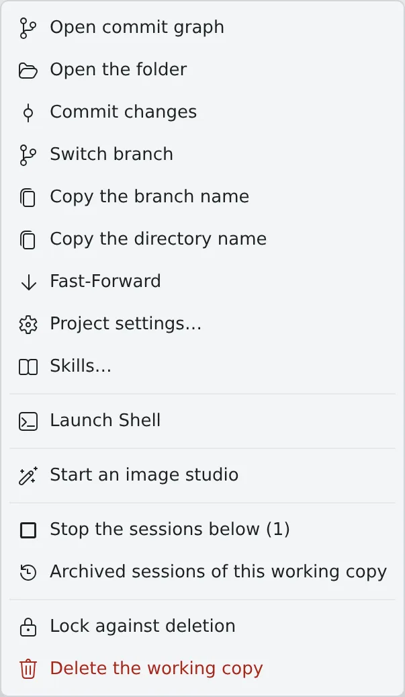

# Launch a session from a repository

English | [日本語](launch-from-repo.ja.md)

Launch a session that works in a repository straight from its row under **Repositories** in the left pane.
The row's badges also tell you about unpushed changes and changes you have not brought in.

## How it works

| What you do | What the agent does |
|---|---|
| Use the row's "Launch" to choose the agent, model, location and first prompt | Starts work from the first prompt, in a new worktree by default |
| Keep first prompts you use often as templates | — |
| Check the row's badges for uncommitted work, unpushed commits and the gap to the parent | — |

## Launch

1. Press "**Launch**" on the row. The "**Start working**" screen opens
2. Choose the agent, model, **location** and first prompt
3. Launch

- The location defaults to an isolated "**New worktree**". What each location does, and the base branch and branch name, are in [Work in parallel with worktrees](../sessions/worktrees.md)
- The **▾** next to "Launch" lets you pick a kind (an agent or a shell) and launch at once without the screen. No prompt is passed
- In the **▾** list, Ctrl+click or middle-click launches into a new pane

## Use first-prompt templates

"**Templates**" above the first prompt opens a searchable list.

| Group | Contents |
|---|---|
| My templates | Your own. Create one with "**New template**"; change it with "**Edit**" and "**Delete**" |
| This repository (.agent-fleet/launch-prompts.md) | One entry per `## heading` of that file committed in the repository. Shared with everyone who clones it, read-only here |
| History | The first prompts of your recent launches in this repository (8 at most). "**Delete**" forgets one; "**Save as template**" keeps one as yours |

- Type to filter, **↑ / ↓** to pick, **Enter** to insert, **Esc** to close
- The full text of the highlighted entry shows in the preview beside the list. On a phone, the first tap previews and "**Insert**" inserts
- `{{repo}}`, `{{branch}}` and `{{path}}` are filled in with the values of the row you launch from
- If the field already has text, you are asked whether to "**Insert at cursor**" or "**Replace all**"

A template has a name, a prompt and "**Show in**" ("Every repository" or only that repository).

- Your templates and history are saved with your settings, so other browsers and devices show the same ones
- Templates are limited to 40, 16 KB in total and 8 KB each
- A prompt larger than 3 KB stays in history on that device only
- Call the repository's `.claude` commands and skills from the skill button (**/**) next to "Templates"

## Read the row's badges

| Badge | Meaning |
|---|---|
| Uncommitted | There are changes not yet committed |
| ↑N | N commits ahead of origin (not pushed) |
| ↓N FF ok | origin is N commits ahead and can be fast-forwarded cleanly |
| ↑N ↓N needs merge | Diverged from origin. A merge or rebase is needed |
| = parent | The worktree is at the same commit as its parent |
| unmerged N | The worktree has N commits that are not in the parent yet |
| parent +N · FF ok | The parent is N commits ahead and the worktree can take them with a fast-forward |
| diverged N↕M · no FF | Both the worktree and the parent have their own commits. A merge or rebase is needed |
| n/a | The relationship cannot be told, for example with a detached HEAD or a repository with no commits |

- `↑` and `↓` compare with origin. A worktree's badges (the ones that say "parent") compare with the branch of the parent working copy
- "Parent" is the upstream of the parent working copy's branch (`origin/develop`, for example). Without an upstream, the badge compares with the parent working copy's HEAD
- A pull request merged on GitHub shows up after the next fetch (automatic, every 10 minutes), without fast-forwarding the parent working copy
- Commits the parent working copy has not pushed are not compared
- Hover over a badge to see what it compares with and each side's own commit count

The numbers at the end of a row mean this.

| Shown | Meaning |
|---|---|
| `●N` | The number of running sessions |
| A plain number | The number of stopped sessions |
| A coloured number | The pane number showing this repository's commit graph |

- For a collapsed repository, the counts include its worktrees' sessions
- Every icon is listed in [Icons, badges, and menus](../../member/badges-and-menus.md)

## What you can do with right-click

Right-click a row for this menu. Some items are hidden depending on state and location.

| Item | What it does |
|---|---|
| Open commit graph, Open the folder, Commit changes | [Commit in the commit graph](commit.md) |
| Switch branch, Copy the branch name, Copy the directory name | What they say |
| Fast-Forward | Fast-forwards to the upstream. On a worktree it becomes "Fast-forward from origin/develop" ("Fast-forward from parent" without an upstream) |
| Initialize Git Flow | [Initialize Git Flow](git-flow.md). Shown on the base working copy only |
| Project settings… | Check the MCP definitions committed in the repository ([Add an MCP server to your sessions](../integrations/mcp-servers.md#which-agents-get-it)) |
| Skills… | Check the skills the repository gives each agent ([09](../../member/09-agents.md)) |
| Share… | Share this working copy's sessions with other members ([Share a conversation](../team/share.md)) |
| Launch Shell | Opens a shell session in that working copy |
| Start an image studio | Starts an image studio in that working copy ([Finish an image in the studio](../images/studio.md)). Shown only while the workspace is running and image generation is available |
| Working sets | Assigns the copy to a working set ([11](../../member/11-many-sessions.md#narrowing-the-view-with-working-sets)) |
| Stop the sessions below | Stops the sessions running in that working copy and the ones under it, together ([Stop and resume a session](../sessions/stop-resume.md#stop-every-session-in-one-working-copy)) |
| Archive all stopped sessions | Archives the stopped sessions of that working copy together |
| Archived sessions of this working copy | Opens the archive list narrowed to that working copy |
| Lock against deletion, Unlock (allow deletion) | Keeps the working copy out of automatic tidying and stops it being deleted. A lock icon appears on the row, and "Delete the working copy" stays greyed out until you unlock ([Clear away finished sessions](../sessions/cleanup.md#lock-something-against-deletion)) |
| Delete the working copy | [Clear away finished sessions](../sessions/cleanup.md#delete-one-jobs-working-copies) |

- "Stop the sessions below" and "Archive all stopped sessions" appear, with a count, only when there is something to act on

## When it goes wrong

### A pull request was merged, but the badge still says "unmerged"

A squash merge does not keep the commits' ancestry, so a branch merged on the service does not turn "= parent" or "parent +N · FF ok".

### "Launch" cannot be pressed

The workspace is stopped, or no agent is available. Hover over the button to see which.

## Related

- [Clone a repository](clone.md)
- [Commit in the commit graph](commit.md)
- [Initialize Git Flow](git-flow.md)
