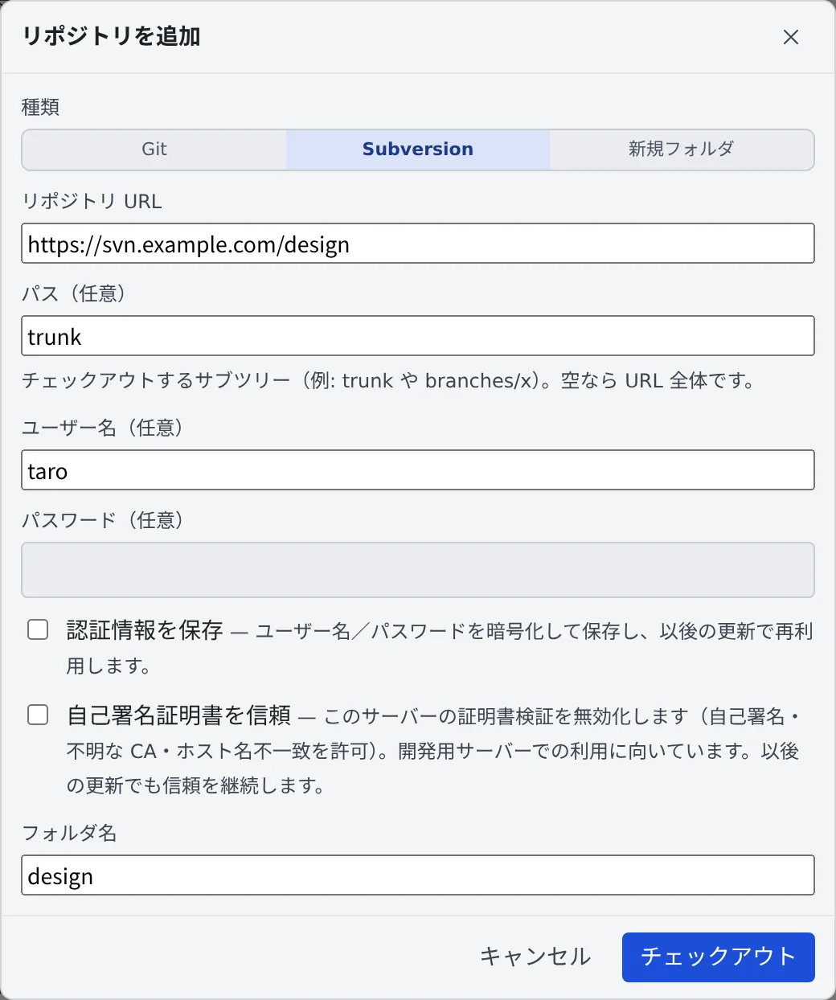

# Subversion のリポジトリを使う

[English](svn.md) | 日本語

Git だけでなく Subversion（SVN）のリポジトリも、チェックアウトしてセッションで作業できます。
認証情報を保存しておけば、セッションの `svn update` や `svn commit` もパスワードを聞かれません。

## 全体像

| あなたがやること | エージェントがやること |
|---|---|
| 「追加」で Subversion を選び、チェックアウトする | — |
| 認証情報を保存する | `svn update`・`svn commit -m "…"` を、`--username` なしで実行する |
| 行のメニューで更新・ログ・手元の変更を見る | — |

- SVN には worktree がありません。svn の行から起動するセッションは、その作業コピーで直接動きます
- ブランチ切替と「変更」のペインは Git 専用です。コミットはセッションの中で `svn commit` を使います

## チェックアウトする

1. 左ペイン **リポジトリ** の「**追加**」を押します
2. 「**種類**」で「**Subversion**」を選びます
3. 欄を埋めて、「**チェックアウト**」を押します

| 欄 | 入れるもの |
|---|---|
| リポジトリ URL | リポジトリの URL |
| パス（任意） | チェックアウトするサブツリー（`trunk` や `branches/x`）。空なら URL 全体 |
| ユーザー名（任意）・パスワード（任意） | 基本認証のアカウント |
| 認証情報を保存 | ユーザー名を入れると出る。印を付けると暗号化して保存し、以後の更新で使う |
| 自己署名証明書を信頼 | そのサーバーの証明書の検証を止める |
| フォルダ名 | 作業コピーのフォルダ名 |

- 並行して作業したいときは、別のパスをもう一度チェックアウトします。別のフォルダになり、Git のクローンを分けたのと同じように隔離されます
- パスワードは、プロセスの一覧にも平文のキャッシュにも残りません

## 認証情報をあとから入れる

保存しなかったときも、チェックアウトし直す必要はありません。

- svn の行のメニューから「**再認証（svn）**」を選び、ユーザー名とパスワードを入れて「**認証して保存**」を押します
- 入れた内容は、保存の前にサーバーに当てて確かめます
- 認証で更新に失敗したときは、このダイアログが自動で出ます

保存した認証情報は、**⚙設定 →「Git ホスティング」** の Subversion のカードに並びます。

- そこから追加と「**切断**」ができます
- URL は、リポジトリかサーバー全体のどちらでも登録できます。いちばん長く一致する URL が使われるので、リポジトリの登録がサーバー全体の登録より優先されます

## 自己署名証明書のサーバーを使う

社内のサーバーなどで証明書を信頼できないときは、チェックアウトの画面で「**自己署名証明書を信頼**」に印を付けます。

- そのサーバーの証明書の検証を止めます。自己署名、不明な CA、ホスト名の不一致を許します
- サーバーごとの設定で、以後の更新でも続きます
- 開発用のサーバーに向いています

## 更新する・ログを見る

svn の行には、今のリビジョン（`r1234`）が出ます。行のメニューには次の項目があります。

| 項目 | すること |
|---|---|
| 更新（svn） | 最新のリビジョンに更新する |
| ロックを解除（svn） | 中断などで残った作業コピーのロックを外す |
| 再認証（svn） | 認証情報を入れ直す |
| ログを表示 | リビジョンの一覧を新しい順に出す |
| ローカルの変更 | `svn status` の一覧を出す。押すとそのファイルの差分 |

- ログはパスで絞り込め、「**さらに読み込む**」で古いものを足します。作業コピーより新しいリビジョンには「**未更新**」と出ます
- リビジョンを選ぶと、変わったパスと差分が出ます
- Files のツリーで作業コピーの中のフォルダやファイルを右クリックし、「**ログを表示**」を選ぶと、そのパスで絞り込んだログが開きます
- ログは、開いたときと「さらに読み込む」を押したときだけサーバーから読みます
- どちらのビューも読み取り専用です

## セッションで svn を使う

保存した認証情報は、セッションの中の `svn` にも使われます。`svn update` や `svn commit -m "…"` に `--username` は要りません。

パスワードを聞かれるのは、次の 2 つのときだけです。

- `-m` を付けない `svn commit`。svn がエディタを開くので、端末を使います
- `--username`・`--password` を自分で付けたコマンド。付けたものが優先されます

## 困ったとき

### 「svn cleanup」を促すエラーで更新できない

作業コピーがロックされています。チェックアウトと更新は、自動で 1 回直そうとします。
残ったときは、行のメニューの「**ロックを解除（svn）**」を使ってください。

### 「サーバーに拒否されました。…」と出る

ユーザー名かパスワードが違います。確かめて入れ直してください。

### ログを開くと再認証の画面が出る

サーバーがパスワードを求めています。入れると、ログが読めます。

## 関連

- [リポジトリをクローンする](clone.ja.md)
- [Git のサービスを接続する](connect-git.ja.md)：同じタブの GitHub と Bitbucket
