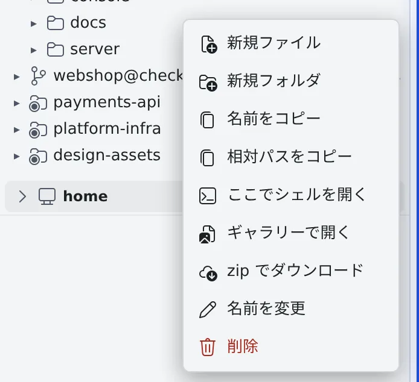

# ファイルを見る・ダウンロードする

[English](browse.md) | 日本語

左ペインの**ファイル**で、ワークスペースの中のファイルをたどって開けます。ファイルやフォルダは
右クリックのメニューからダウンロードでき、フォルダは zip にまとめて持ってこられます。

## 全体像

| あなたがやること | 起きること |
|---|---|
| **ファイル**でフォルダをたどり、ファイルをクリックする | メイン領域のビュアーにファイルが開く |
| ファイルやフォルダを右クリックする | 作成・コピー・ダウンロード・シェルを開くなどのメニューが出る |
| セッションに作業させる | ターンが終わったときや作業の途中で、ツリーが自動で新しくなる |

## ファイルをたどる

左ペインの**ファイル**に、ワークスペースの中がツリーで並びます。

- リポジトリの行は三角で折りたためます。1 つの作業コピーに集中したいときは、ほかを畳んでおくと見やすくなります
- 中身がサブフォルダ 1 つだけの階層は、`a/b/c` のように 1 行にまとめて表示されます
- リポジトリの行では、「**ツリー**」と「**変更**」（変更したファイルだけ）を切り替えられます。変更したファイルには「未追跡」「追加」「変更」「改名」「削除」のバッジが付きます
- ファイルを Ctrl を押しながらクリックするか中クリックすると、今の表示を残したまま新しいペインで開きます

ファイルを開いたあとの表示は、[ドキュメントや図を表示する](view.ja.md) にあります。

## 右クリックでできること

ファイルやフォルダを右クリックすると、メニューが開きます。タッチ画面では長押しで、キーボードでは Menu キーで開きます。

| 項目 | すること |
|---|---|
| 新規ファイル・新規フォルダ | その場所に作る |
| 名前をコピー・相対パスをコピー | 名前やパスをクリップボードに入れる |
| ここでシェルを開く | フォルダを作業場所にした shell セッションを起動する（[下](#フォルダからシェルを開く)） |
| ダウンロード | ファイルを 1 つダウンロードする |
| zip でダウンロード | フォルダを zip にまとめてダウンロードする（[下](#フォルダを-zip-でダウンロードする)） |
| アシスタントで翻訳・アシスタントで要約 | ファイルをアシスタントのチャットに渡す（[ファイルをセッションに渡す](send.ja.md)） |
| 名前を変更・削除 | 名前を変える、消す。フォルダを消すときは中身ごと消えるので確認が出ます |

朗読やギャラリーで開く項目もあります。すべての項目と、出る条件は
[アイコン・バッジ・メニュー](../../ref/console-ui.ja.md#ファイルとフォルダ) にあります。

## ファイルを追加する

- **ファイル**のツリーにファイルをドラッグ＆ドロップすると、アップロードされます
- 同じ名前のファイルがあると、上書きしてよいか確認が出ます
- 右クリックの「**新規ファイル**」で、空のファイルを作ることもできます

## フォルダからシェルを開く

フォルダを右クリックして「**ここでシェルを開く**」を選ぶと、そのフォルダを作業場所にした shell セッションが起動します。
名前は `shell · <フォルダ名>` です。

- リポジトリの作業コピーの中のフォルダなら、セッションもその作業コピーのものになります
- ホームの外のパスでも使えます

## フォルダを zip でダウンロードする

1. フォルダを右クリックして「**zip でダウンロード**」を選びます。画像ギャラリーのフォルダのメニューにも同じ項目があります
2. Console がフォルダを確かめ、ファイル名・ファイル数・大きさと、含めなかったものをトーストで知らせます
3. ブラウザが `<フォルダ名>.zip` を保存します

zip の中は、最上位の `<フォルダ名>/` の下にそのままのフォルダ構成で入ります。空のフォルダや日本語の名前もそのままです。

| zip に入らないもの | 理由 |
|---|---|
| 選んだフォルダの下にある `.git` と `node_modules` | 大きくなりやすいため。そのフォルダ自体を選べば丸ごと入ります。メニュー項目のツールチップにも出ます |
| ファイルの一覧にもともと出ないフォルダ | 認証情報やエージェントの状態が入っているため（[下](#見えないフォルダがある)） |
| シンボリックリンク、ハードリンクされたファイル、特殊ファイル | 件数がトーストに出ます |

- **大きすぎるフォルダは断られます。** ファイル数・フォルダ数・深さ・大きさ・読み込みにかかる時間の上限があり、超えると上限の名前を挙げたメッセージが出て、ダウンロードは始まりません。数値は [上限](../../ref/limits.ja.md#製品として固定のもの) にあります
- **作成は 1 つずつです。** ワークスペースごとに同時に 1 つしか作れません。作成中にもう一度押すと、混み合っていると出ます
- **ホームフォルダそのもの**（ツリーのいちばん上）はダウンロードできません

## ツリーが新しくなるとき

ツリーは自動で新しくなるので、ふつうは手で更新する必要はありません。

- セッションがターンを終えて入力待ちに戻ったとき
- セッションが作業している間。動いているセッションの作業コピーは、20 秒ごとに追いつきます
- タブやウィンドウに戻ってきたとき
- 畳んでいたフォルダを開き直したとき
- クローンの直後や、ワークスペースの起動・停止のあと

自動で増えたファイルの行には、数秒だけ淡い色が付きます。どれにも当てはまらないときは、見出しの ⟳ で更新できます。

## 困ったとき

### 見えないフォルダがある

ツリーには、わざと出していないフォルダがあります。エージェントのログイン情報や、暗号化された保管場所
（claude・codex・opencode の資格ファイル、SSH 鍵、Agent Fleet の内部の状態など）が入ったフォルダです。
一覧に出ず、直接開くこともできません。見当たらなくても異常ではありません。

### zip のダウンロードがブラウザの一覧でだけ失敗している

ディスクの空きが足りない、読み込みに失敗した、ファイルが作成中に大きくなった、遅いボリュームで時間切れになった、といった
ことは、Console の確認の段階ではわかりません。このときはダウンロード自体が失敗し、ブラウザのダウンロード一覧にだけ出ます。
途中までの zip を受け取ることはありません。

- 作成中にファイルが消えたりリンクに置き換わったりしても失敗します。もう一度試してください
- 書き込み中のファイルは、途中の状態で入ることがあります。作業が止まっているときにダウンロードしてください

### 「zip に入れられない名前」で止まった

バックスラッシュや制御文字を含む名前、UTF-8 として正しくない名前のファイルがあると、そのファイル名を挙げて
ダウンロード全体を止めます。名前を変えるか、そのファイルを含まないフォルダを選んでください。

## 関連

- [ドキュメントや図を表示する](view.ja.md)：開いたファイルを読む
- [ファイルを編集する](edit.ja.md)：開いたファイルをその場で直す
- [画像ギャラリーを使う](../images/gallery.ja.md)：フォルダの画像を並べて見る
- [上限](../../ref/limits.ja.md#製品として固定のもの)：zip のダウンロードの上限
