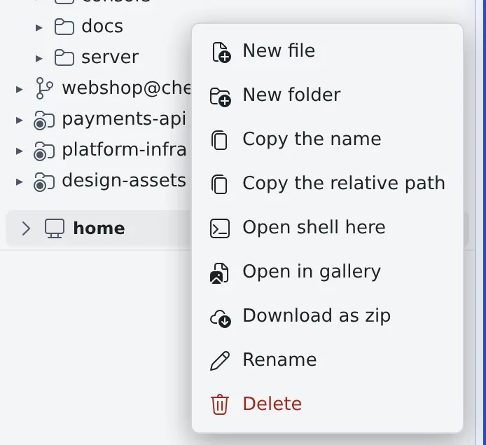

# See and download files

English | [日本語](browse.ja.md)

**Files** in the left pane lets you walk through the workspace and open files. Files and folders download from the
right-click menu, and a folder can come down as one zip.

## How it works

| What you do | What happens |
|---|---|
| Walk the folders in **Files** and click a file | The file opens in the viewer in the main area |
| Right-click a file or folder | A menu offers create, copy, download, open a shell and more |
| Let a session work | The tree refreshes by itself when a turn ends and while the work goes on |

## Walk the files

**Files** in the left pane shows the workspace as a tree.

- Repository rows fold with their triangle. When you want to concentrate on one working copy, fold the others
- A level whose only content is one subfolder is shown on one line, like `a/b/c`
- A repository row switches between "**Tree**" and "**Changes**" (changed files only). Changed files carry an "Untracked", "Added", "Modified", "Renamed" or "Deleted" badge
- Ctrl-click or middle-click a file to open it in a new pane and keep what you have on screen

What an open file looks like is in [View documents and diagrams](view.md).

## What the right-click menu does

Right-click a file or folder to open its menu. On a touch screen, long-press; from the keyboard, press the Menu key.

| Item | What it does |
|---|---|
| New file, New folder | Create one there |
| Copy the name, Copy the relative path | Put the name or the path on the clipboard |
| Open shell here | Start a shell session working in that folder ([below](#open-a-shell-from-a-folder)) |
| Download | Download one file |
| Download as zip | Download a folder as one zip ([below](#download-a-folder-as-zip)) |
| Translate with assistant, Summarize with assistant | Hand the file to an assistant chat ([Hand a file to a session](send.md)) |
| Rename, Delete | Rename or delete it. Deleting a folder deletes its contents too, so it asks first |

There are also items to open a file in the reader or the gallery. Every item and when it shows is in
[Icons, badges, and menus](../../member/badges-and-menus.md#files-folders).

## Add files

- Drag and drop files onto the **Files** tree to upload them
- When a file of the same name exists, it asks before overwriting
- "**New file**" in the right-click menu creates an empty file

## Open a shell from a folder

Right-click a folder and choose "**Open shell here**" to start a shell session working in that folder. It is named
`shell · <folder name>`.

- For a folder inside a repository's working copy, the session belongs to that working copy
- It also works for a path outside your home

## Download a folder as zip

1. Right-click a folder and choose "**Download as zip**". The image gallery's folder menu has the same item
2. The Console checks the folder and a toast tells you the file name, the number of files, the size and what was left out
3. The browser saves `<folder name>.zip`

Inside the zip, everything sits under a top-level `<folder name>/` with the folder layout as it is. Empty folders and
non-ASCII names come through unchanged.

| What stays out of the zip | Why |
|---|---|
| `.git` and `node_modules` below the folder you picked | They tend to be large. Pick that folder itself and it is included whole. The menu item's tooltip says so too |
| Folders the file list never shows | They hold credentials and agent state ([below](#some-folders-are-not-shown)) |
| Symbolic links, hard-linked files and special files | The toast gives their number |

- **A folder that is too large is refused.** There are limits on files, folders, depth, size and the time spent reading; past one, a message names the limit and the download does not start. The numbers are in [Limits and defaults](../../ref/limits.md#fixed-in-the-product)
- **One at a time.** A workspace builds one zip at a time. Pressing again while one is being built says it is busy
- **The home folder itself** (the top of the tree) cannot be downloaded

## When the tree refreshes

The tree refreshes by itself, so you normally never refresh it by hand.

- When a session ends its turn and waits for input again
- While a session works. A running session's working copy catches up every 20 seconds
- When you come back to the tab or window
- When you reopen a folder you had folded
- Right after a clone, and after the workspace starts or stops

Rows that appear on their own are tinted for a few seconds. When none of these applies, refresh with the ⟳ in the header.

## When it goes wrong

### Some folders are not shown

The tree deliberately leaves some folders out: those holding agents' login data and encrypted storage (the credential
files of claude, codex and opencode, SSH keys, Agent Fleet's internal state and the like). They are not listed and
cannot be opened directly. Not finding them is normal.

### A zip download fails only in the browser's list

A full disk, a read error, a file growing while the archive is built, or a time-out on a slow volume cannot be seen
when the Console checks the folder. Then the download itself fails and shows only in the browser's download list.
You never receive a partial zip.

- A file that disappears or turns into a link while the archive is built also fails it. Try again
- A file being written can go in half-written. Download while nothing is working on the folder

### It stopped on "a name that cannot go in a zip"

A file whose name contains a backslash or a control character, or is not valid UTF-8, stops the whole download, and
the message names it. Rename the file or pick a folder without it.

## Related

- [View documents and diagrams](view.md): read a file you opened
- [Edit a file](edit.md): fix an open file in place
- [Use the image gallery](../images/gallery.md): see a folder's images side by side
- [Limits and defaults](../../ref/limits.md#fixed-in-the-product): the limits on zip downloads
