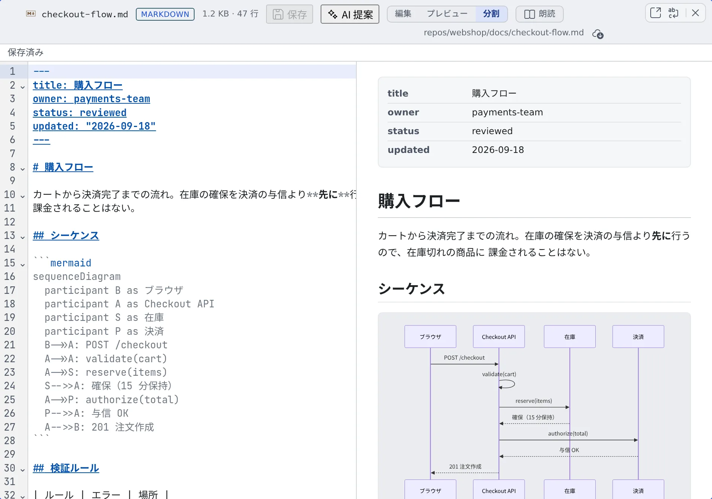

# ファイルを編集する

[English](edit.md) | 日本語

ビューアで開いたファイルを、その場で書き換えて保存できます。ちょっとした修正のためにセッションを起動する必要はありません。
エージェントが同じファイルを書き換えても、あなたの編集が黙って消えることはありません。

## 全体像

| あなたがやること | 起きること |
|---|---|
| ビューアを編集に切り替えて、書き換える | 上部に「未保存の変更」と出る |
| Ctrl+S（Mac は ⌘+S）か「保存」を押す | ワークスペースのファイルに保存される |
| 「AI 提案」で指示を書く | AI が差分を作る。適用するかどうかはあなたが決める |
| エージェントが同じファイルを書き換える | 「ファイルが外部で変更されました」と出て、差分を見てから取り込める |

## 編集に切り替える

ファイルを開き、上部の切り替えで編集にします。

| ファイル | 切り替え |
|---|---|
| Markdown | 「**編集**」「**プレビュー**」「**分割**」。分割ではテキストとプレビューが並び、どちらをスクロールしても、もう片方が同じ位置に付いてきます |
| `.drawio` の図 | 「**図**」「**編集**」。編集では XML をテキストのまま直します |
| そのほかのテキスト | 「**表示**」「**編集**」 |

編集の切り替えが出ないファイルは、Console からは書き換えられません。

同じセルの別のタブへ移って戻っても、選んでいた切り替えとスクロール位置、保存していない編集はそのまま残ります。ブラウザを再読み込みすると最初の状態に戻ります。

## 保存する

Ctrl+S（Mac は ⌘+S）を押すか、「**保存**」を押します。上部の状態が「**未保存の変更**」→「**保存中…**」→「**保存しました**」と変わります。

- 保存していないまま、ペインを移る・再読み込みする・ログアウトするなどをしようとすると、確認が出ます。「**保存して続行**」か「**破棄して続行**」を選びます
- 保存していないファイルは、別のタブへ切り離せません。先に保存するか破棄してください

## AI に書き換えを提案させる

1. 直したい範囲を選びます。選ばなければ全文が対象です
2. 「**AI 提案**」を押します
3. 変えてほしい内容を書き、Ctrl+Enter か「**生成**」を押します
4. 出てきた差分を見て、「**適用**」か「**却下**」を押します

- 提案が勝手に適用されることはありません
- 生成のあとで本文が変わると、その提案は適用できなくなります。もう一度生成してください
- このボタンは、⚙設定の「**AI 補助**」で「**変更提案（エディタ）**」がオンのときだけ出ます
- 使ったトークンは、⚙設定の「**エージェント使用量**」に「変更提案（エディタ）」として記録されます（[料金と使用量を確かめる](../agents/usage.ja.md#何にトークンを使ったかを見る)）

## 困ったとき

### 「ファイルが外部で変更されました」と出た

エージェントや別のセッションが、同じファイルを書き換えました。「**差分を確認**」で見比べてから取り込めます。

### 「リモートの変更と競合しました」と出た

保存しようとしたときに、ファイルがすでに別の内容に変わっていました。あなたの内容（mine）は保持されています。

| 選ぶもの | すること |
|---|---|
| remote を採用 | ディスクの内容に合わせる。あなたの変更は捨てる |
| mine を破棄 | あなたの変更を捨てる |
| remote を base に手動マージ | ディスクの内容を土台に、あなたの変更を手で入れ直す。保存前の mine は参照用に残ります |

保存できたかどうかわからないときも、mine と送った内容は保持されます。「**再取得**」か「**明示的に再保存**」のどちらかを選んでください。

### 保存できない

次の内容は保存できません。

- 2 MiB を超える変更
- NUL を含むもの
- CR や CRLF の改行（LF だけに対応しています）
- 正しくない Unicode を含むもの

## 関連

- [ドキュメントや図を表示する](view.ja.md)：編集に入る前の表示
- [ファイルをセッションに渡す](send.ja.md)：大きな直しはエージェントに頼む
- [コミットグラフでコミットする](../code/commit.ja.md)：直したファイルをコミットする
