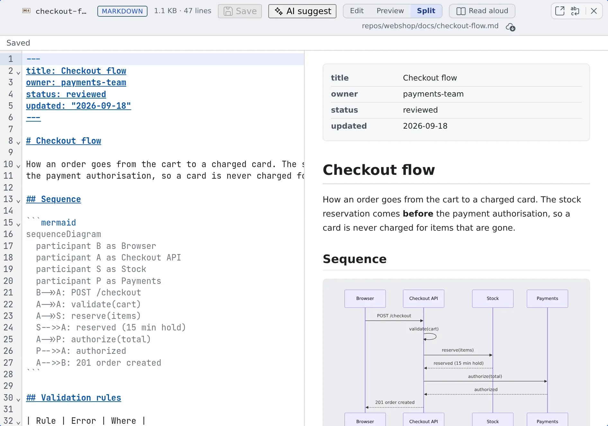

# Edit a file

English | [日本語](edit.ja.md)

A file open in the viewer can be changed and saved in place. There is no need to wake a session for a small fix.
Even if an agent rewrites the same file, your edits are never silently lost.

## How it works

| What you do | What happens |
|---|---|
| Switch the viewer to editing and change the text | "Unsaved changes" shows at the top |
| Press Ctrl+S (⌘+S on a Mac) or "Save" | The file is saved in the workspace |
| Write an instruction under "AI suggest" | An AI drafts a diff. You decide whether to apply it |
| An agent rewrites the same file | "The file was changed outside this editor" shows, and you can take it in after looking at the diff |

## Switch to editing

Open the file and switch the control at the top to editing.

| File | Switch |
|---|---|
| Markdown | "**Edit**", "**Preview**", "**Split**". Split puts the text beside the preview, and scrolling either one keeps the other at the same place |
| A `.drawio` diagram | "**Diagram**", "**Edit**". Edit changes the XML as text |
| Any other text | "**View**", "**Edit**" |

A file that shows no editing switch cannot be changed from the Console.

Switching to another tab in the same cell and back keeps the switch you chose, the scroll position and any unsaved edits. A browser reload starts over.

## Save

Press Ctrl+S (⌘+S on a Mac) or "**Save**". The state at the top goes from "**Unsaved changes**" to "**Saving**" to "**Saved**".

- Moving the pane, reloading, logging out and the like with unsaved changes asks first. Choose "**Save and continue**" or "**Discard and continue**"
- A file with unsaved changes cannot be detached to another tab. Save or discard first

## Have an AI propose a change

1. Select the part you want changed. With no selection, the whole text is the target
2. Press "**AI suggest**"
3. Write what you want changed and press Ctrl+Enter or "**Generate**"
4. Look at the diff and press "**Apply**" or "**Reject**"

- A proposal is never applied on its own
- If the text changes after the proposal is generated, it can no longer be applied. Generate again
- The button only shows when "**Edit suggestions (editor)**" is on under ⚙ Settings, "**AI assistance**"
- The tokens it uses are recorded under ⚙ Settings, "**Agent usage**", as "Edit suggestions (editor)" ([Check prices and usage](../agents/usage.md#see-what-your-tokens-went-on))

## When it goes wrong

### "The file was changed outside this editor"

An agent or another session rewrote the same file. "**Check diff**" lets you compare before taking it in.

### "Remote changes conflict with yours"

When you saved, the file had already changed to something else. Your content (mine) is kept.

| Choice | What it does |
|---|---|
| Adopt remote | Take what is on disk and drop your changes |
| Discard mine | Drop your changes |
| Use remote as base for manual merge | Start from what is on disk and put your changes back in by hand. Your pre-save text stays alongside for reference |

When it cannot tell whether the save went through, mine and what was sent are kept as well. Settle it with "**Fetch again**" or "**Explicitly re-save**".

### It will not save

These cannot be saved:

- A change over 2 MiB
- Content containing NUL
- CR or CRLF line endings (only LF is supported)
- Invalid Unicode

## Related

- [View documents and diagrams](view.md): the view before you edit
- [Hand a file to a session](send.md): ask an agent for bigger changes
- [Commit in the commit graph](../code/commit.md): commit the file you fixed
