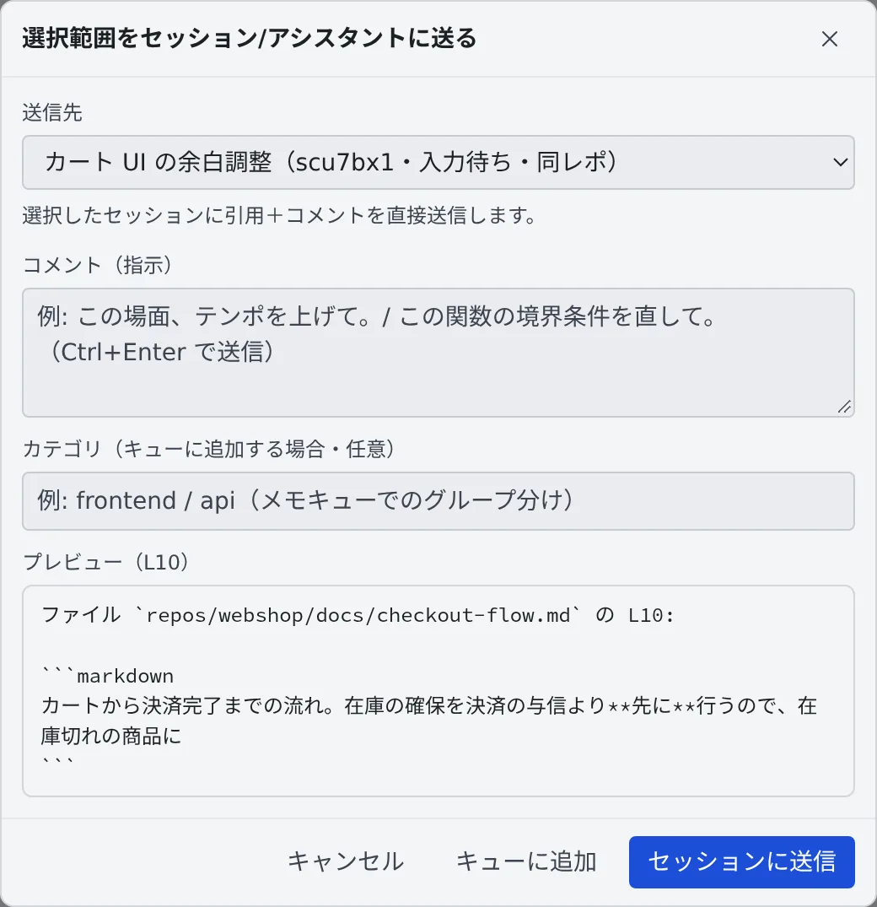

# ファイルをセッションに渡す

[English](send.md) | 日本語

ビューアで選んだ範囲を、指示を添えてセッションやアシスタントに送れます。「この関数を直して」「ここを訳して」と、
場所を説明し直さずに頼めます。ファイル全体の翻訳や要約は、右クリックのメニューからアシスタントに渡せます。

## 全体像

| あなたがやること | エージェントがやること |
|---|---|
| ビューアで範囲を選び、「送る」から指示を書いて送る | 引用された行と指示を受け取って作業する |
| ファイルを右クリックして「アシスタントで翻訳」「アシスタントで要約」を選ぶ | ファイルを添付した新しいチャットで、翻訳や要約をする |
| 「キューに追加」で送らずにためる | あとでまとめて送られたときに作業する |

## 選んだ範囲を送る

1. ファイルをビューアで開き、送りたい行を選びます
2. 選んだところに出る「**送る**」を押します
3. 「**送信先**」でセッションかアシスタントを選び、「**コメント（指示）**」に頼みたいことを書きます
4. 「**セッションに送信**」を押します。アシスタントを選んだときは「**アシスタントで開く**」です

- 「送る」は、Markdown のプレビューでは出ません。「**ソース**」か「**編集**」に切り替えてから選んでください
- ダイアログの下の「**プレビュー**」に、送られる内容（ファイルのパス、行番号、引用）が出ます
- 指示の欄で Ctrl+Enter を押しても送れます

| 送信先 | 送ったあと |
|---|---|
| セッション（直接送信） | 稼働中のセッションに、引用と指示がそのまま届きます。同じリポジトリのセッションには「同レポ」と付きます |
| アシスタント（チャットで開く） | そのアシスタントとのチャットが開き、引用と指示が下書きされます。送信はチャットの画面から行います |

停止中のセッションには送れません。先にセッションを再開するか、別の送信先を選んでください。

## あとでまとめて送る

「**カテゴリ（キューに追加する場合・任意）**」を書いて「**キューに追加**」を押すと、すぐには送らずにメモキューにたまります。
ためたものは、カテゴリごとにまとめて送れます（[メモをためて渡す](../chat/memos.ja.md)）。

## ファイル全体を翻訳・要約してもらう

ファイルを右クリックして「**アシスタントで翻訳**」か「**アシスタントで要約**」を選ぶと、そのファイルを添付したアシスタントの
チャットが新しく開きます。

ファイル全体をセッションに任せるとき（大きなファイルを訳して別のファイルに保存させる、など）は、右クリックの「**相対パスをコピー**」で
パスを取り、セッションへの指示に貼ってください。セッションはそのパスのファイルを自分で読み書きします。

## 関連

- [ドキュメントや図を表示する](view.ja.md)：送る範囲を選ぶビューア
- [セッションに返事をする](../sessions/reply.ja.md)：送ったあとの会話
- [送る内容を待たせる・ターンを止める](../sessions/queue.ja.md)：ターン中のセッションに送ったときの順番
