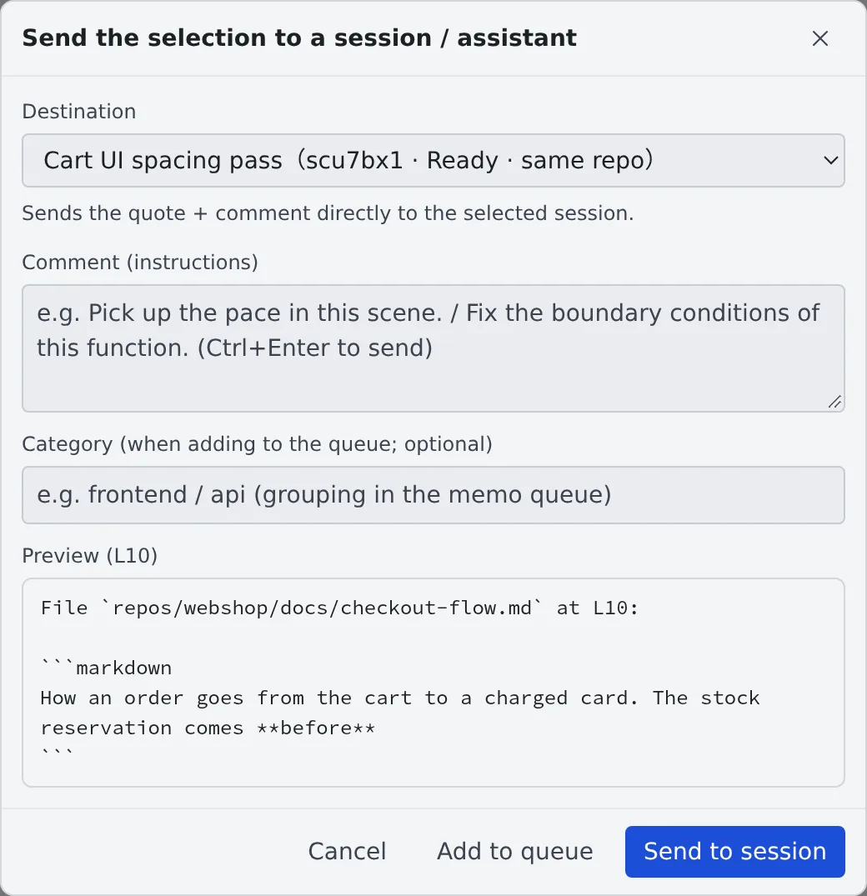

# Hand a file to a session

English | [日本語](send.ja.md)

Send a range you selected in the viewer, with an instruction, to a session or an assistant. "Fix this function",
"translate this part": you ask without describing where it is. A whole file can go to an assistant for a translation
or a summary from the right-click menu.

## How it works

| What you do | What the agent does |
|---|---|
| Select a range in the viewer, write an instruction under "Send" and send it | Works from the quoted lines and the instruction |
| Right-click a file and choose "Translate with assistant" or "Summarize with assistant" | Translates or summarises it in a new chat with the file attached |
| Hold it with "Add to queue" instead of sending | Works on it when the queue is sent later |

## Send a selection

1. Open the file in the viewer and select the lines you want to send
2. Press "**Send**", which appears at the selection
3. Pick a session or an assistant under "**Destination**" and write what you want under "**Comment (instructions)**"
4. Press "**Send to session**". With an assistant picked, it is "**Open in an assistant**"

- "Send" does not appear in a Markdown preview. Switch to "**Source**" or "**Edit**" first, then select
- "**Preview**" at the bottom of the dialog shows what will be sent (the file's path, the line numbers and the quote)
- Ctrl+Enter in the instruction field sends too

| Destination | After sending |
|---|---|
| Sessions (send directly) | The quote and instruction reach the running session as they are. A session on the same repository is marked "same repo" |
| Assistants (open in chat) | A chat with that assistant opens with the quote and instruction drafted. You send it from the chat |

A stopped session cannot be sent to. Resume it first, or pick another destination.

## Send it later, in a batch

Write a "**Category (when adding to the queue; optional)**" and press "**Add to queue**" to hold it in the memo queue
instead of sending it now. What you hold can be sent per category in one go ([Collect memos and hand them over](../chat/memos.md)).

## Have a whole file translated or summarised

Right-click a file and choose "**Translate with assistant**" or "**Summarize with assistant**" to open a new assistant
chat with that file attached.

To give a whole file to a session (translate a large file and save the result to another file, say), take its path with
"**Copy the relative path**" in the right-click menu and paste it into your instruction. The session reads and writes
the file at that path itself.

## Related

- [View documents and diagrams](view.md): the viewer you select in
- [Reply to a session](../sessions/reply.md): the conversation after you send
- [Hold what you send, stop a turn](../sessions/queue.md): the order when you send to a session mid-turn
