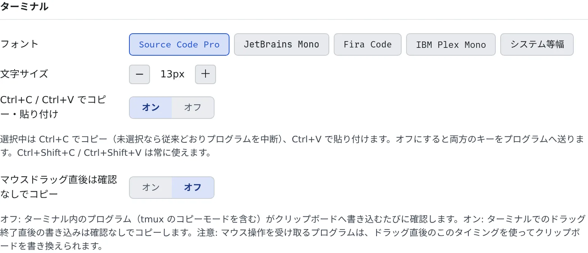

# ターミナルを使う

[English](terminal.md) | 日本語

ターミナル（CLI）で動かすセッションと shell・SSM のセッションは、ブラウザのターミナルで操作します。
コピーと貼り付けのしかた、キー入力の遅れの見かた、フォントと文字サイズの変えかたをまとめます。

## 全体像

| あなたがやること | 起きること |
|---|---|
| セッションを開く | メイン領域にターミナルが出る |
| 文字を選んで Ctrl+C、Ctrl+V で貼り付ける | クリップボードとやりとりする。何も選んでいない Ctrl+C はプログラムを止める |
| 改行を含む文字列を貼り付ける | 実行される前に確認が出る |
| ⚙設定の「表示」でフォントやサイズを変える | どのブラウザでサインインしても同じ見た目になる |

Codex や OpenCode をマネージドで始めたセッションにはターミナルがなく、会話の画面だけが開きます（[セッションを始める](../sessions/start.ja.md#実行方式を選ぶ)）。
停止中のセッションを開いたときは「**再開**」を押すと再開します。

## コピーと貼り付け

ターミナルにフォーカスがあるとき、文字を選んでいれば **Ctrl+C でコピー**、**Ctrl+V で貼り付け**になります。
何も選んでいないときの Ctrl+C は、これまでどおりプログラムを止める割り込みです。

| したいこと | 操作 |
|---|---|
| コピー | マウスでドラッグして選ぶと、離したときにコピーされます。キーボードなら Ctrl+Shift+C（macOS は ⌘+Shift+C、選んでいれば ⌘C）か Ctrl+Insert |
| 貼り付け | 右クリックか中クリック。キーボードなら Ctrl+Shift+V（macOS は ⌘+Shift+V か ⌘V）か Shift+Insert |
| プログラムを止める | 何も選んでいない状態で Ctrl+C |

- キーボードでコピーすると「**コピーしました**」と短く出ます。ブラウザがクリップボードを断ったときも知らせが出ます
- Ctrl+C でコピーすると選択は解除されるので、続けて押した Ctrl+C は割り込みになります
- ターミナルに出た URL（ログインのリンクなど）は、折り返していてもクリックで新しいタブに開けます

### 貼り付ける前の確認

シェルのように入力を待っているプログラムに改行を含む文字列を貼ると、1 行ずつ実行されてしまいます。そのため、改行を含むときや 1,000 文字を超えるときは
「**ターミナルに貼り付けますか？**」と確認が出ます。

- 貼る文字数と行数が出て、改行を含むときはそのまま実行される場合があると警告されます
- 「**貼り付け**」で貼り、キャンセルなら何も貼りません
- 短い 1 行は確認なしで貼られます。貼り付けを安全に受け取れるプログラム（エージェントの CLI、vim、多くのシェルの入力行）にも確認は出ません

### プログラムがクリップボードに書くとき

ターミナルの中のプログラム（tmux のコピーモードなど）がクリップボードに書こうとすると、「**ターミナルによるコピーを許可しますか？**」と確認が出ます。
自分でコピーの操作をした直後だけ、「**許可**」か「**1 分間許可**」を押してください。

## キー入力の遅れを見る

ターミナルのペインの上に、往復の時間がミリ秒で小さく出ます。キー入力がワークスペースまで行って戻るまでの時間で、
キー入力と同じ経路で測っているので、文字が画面に出るまでの遅れそのものです。

- 出ている数字は、直近の実測の中央値です。カーソルを重ねると、中央値・最大・何回分かが出ます
- 120 ms 未満ならほぼ手元のターミナルと同じ感覚で、300 ms を超えるとキー入力の遅れが目に見えます。数字の色で、どの範囲にあるかがわかります
- ワークスペースの中の遅れは 1 ms 未満なので、この数字は経路の遅さです。数字が小さいのにエージェントが遅く感じるなら、待っているのは通信ではなくエージェントの考える時間です

## フォントと文字サイズを変える

⚙設定の「**表示**」タブの「**ターミナル**」で変えます。

| 項目 | 決めること |
|---|---|
| フォント | ターミナルのフォント |
| 文字サイズ | 9〜28 px の範囲で指定します。既定は 13 px です |
| Ctrl+C / Ctrl+V でコピー・貼り付け | 既定ではオンです。オフにすると、両方のキーがそのままプログラムに届きます。Ctrl+Shift+C・Ctrl+Shift+V はいつでも使えます |
| マウスドラッグ直後は確認なしでコピー | 既定ではオフです。オンにすると、ターミナルでドラッグを終えた直後のプログラムからの書き込みは、確認なしでコピーされます |

- この設定はサーバーに保存されます。別の PC や別のブラウザでサインインしても、同じフォントとサイズになります
- ターミナルの背景は、ライトテーマでも暗いままです

## 関連

- [セッションを始める](../sessions/start.ja.md)：ターミナルを持つセッションと持たないセッション
- [ファイルを見る・ダウンロードする](browse.ja.md#フォルダからシェルを開く)：フォルダからシェルを開く
- [SSM で EC2 にログインする](../integrations/aws-ssm.ja.md)：EC2 のターミナルを開く
