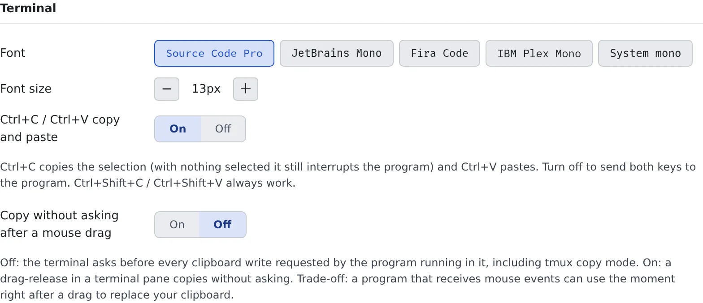

# Use the terminal

English | [日本語](terminal.ja.md)

Sessions run as Terminal (CLI) and shell and SSM sessions are driven from a terminal in the browser. This page covers
copy and paste, reading how far the terminal is from you, and changing the font and size.

## How it works

| What you do | What happens |
|---|---|
| Open a session | A terminal appears in the main area |
| Select text and press Ctrl+C; paste with Ctrl+V | The terminal talks to the clipboard. Ctrl+C with nothing selected stops the program |
| Paste text that contains a newline | It asks before anything runs |
| Change the font or size under ⚙ Settings, "Display" | The terminal looks the same in every browser you sign in from |

A Codex or OpenCode session started as Managed has no terminal; only the conversation view opens ([Start a session](../sessions/start.md#choose-the-execution-method)).
When you open a stopped session, press "**Resume**" to resume it.

## Copy and paste

With the terminal focused, **Ctrl+C copies** when text is selected and **Ctrl+V pastes**.
Ctrl+C with nothing selected is still the interrupt that stops the program.

| To | Do |
|---|---|
| Copy | Drag with the mouse to select; it is copied when you let go. From the keyboard, Ctrl+Shift+C (⌘+Shift+C on macOS, or ⌘C with a selection) or Ctrl+Insert |
| Paste | Right-click or middle-click. From the keyboard, Ctrl+Shift+V (⌘+Shift+V or ⌘V on macOS) or Shift+Insert |
| Stop the program | Ctrl+C with nothing selected |

- Copying from the keyboard flashes "**Copied**". If the browser refuses the clipboard, it tells you too
- Copying with Ctrl+C clears the selection, so a second Ctrl+C right after is an interrupt
- A URL printed in the terminal (a login link, say) opens in a new tab on click, even when it wraps

### The check before a paste

Pasting text with newlines into a waiting prompt such as a shell runs it line by line. So when the text has a newline,
or is longer than 1,000 characters, "**Paste into the terminal?**" asks first.

- It shows how many characters and lines will go in, and warns that text with newlines may run as it is
- "**Paste**" pastes it; cancel pastes nothing
- A short single line pastes without asking, and so does a paste into a program that takes pastes safely (the agents' CLIs, vim, most shells' input lines)

### When a program writes to the clipboard

When a program in the terminal (tmux's copy mode, say) tries to write to the clipboard, "**Allow the terminal to copy?**"
asks first. Press "**Allow**" or "**Allow for 1 minute**" only right after you yourself copied something.

## See how far away the terminal is

A small round-trip time in milliseconds shows above the terminal pane. It is the time a keystroke takes to reach the
workspace and come back, measured on the same path as your typing, so it is exactly the delay before a character shows.

- The figure is the median of the recent measurements. Hover it for the median, the maximum and how many samples
- Under 120 ms feels like a local terminal; over 300 ms the typing visibly lags. The colour tells you which side you are on
- Inside the workspace the delay is under 1 ms, so this figure is the path's slowness. If it is small and the agent still feels slow, what you are waiting for is not the network but the agent thinking

## Change the font and size

Change them under ⚙ Settings, "**Display**" tab, "**Terminal**".

| Item | What it sets |
|---|---|
| Font | The terminal's font |
| Font size | Anywhere from 9 to 28 px. The default is 13 px |
| Ctrl+C / Ctrl+V copy and paste | On by default. Turned off, both keys go straight to the program. Ctrl+Shift+C and Ctrl+Shift+V always work |
| Copy without asking after a mouse drag | Off by default. Turned on, a program's write to the clipboard right after you finish a drag in the terminal is copied without asking |

- These settings are stored on the server. On another PC or another browser you get the same font and size
- The terminal's background stays dark even with the light theme

## Related

- [Start a session](../sessions/start.md): sessions with a terminal and without
- [See and download files](browse.md#open-a-shell-from-a-folder): open a shell from a folder
- [Log in to EC2 with SSM](../integrations/aws-ssm.md): open a terminal on EC2
