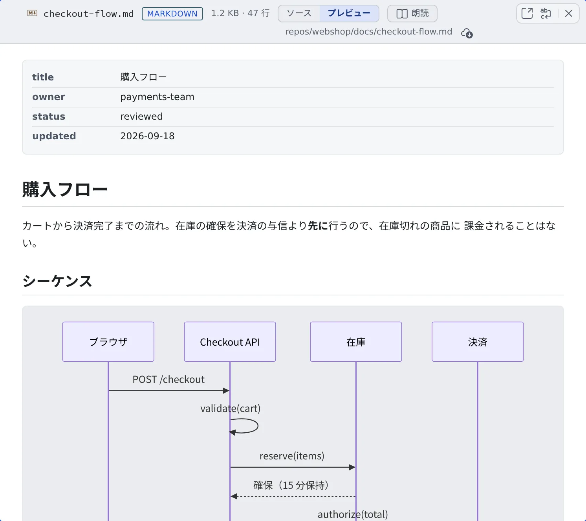
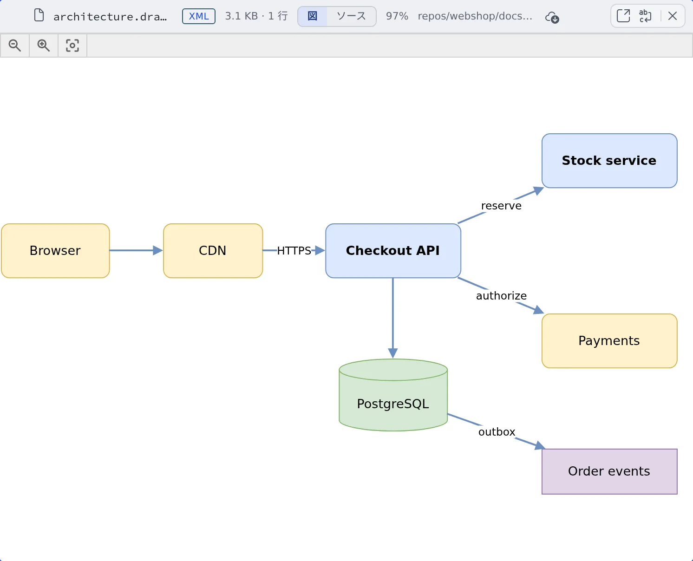

# ドキュメントや図を表示する

[English](view.md) | 日本語

ファイルを開くと、コードはハイライトして、Markdown は整えた形で、Marp はスライドで、`.drawio` は図で表示されます。
PDF や Office の文書も、ダウンロードせずに Console の中で読めます。

## 全体像

| あなたがやること | 起きること |
|---|---|
| **ファイル**でファイルをクリックする | ビュアーが形式に合わせて表示する |
| 上部の切り替えで表示を変える | プレビュー・ソース・スライド・図などを行き来する |
| 文書の中のリンクを押す | ファイル・フォルダ・課題・ワークスペースのポートを開く |

文書も図も、ブラウザの中だけで描きます。ファイルが外部のサービスに送られることはありません。

## ファイルを開く

左ペインの**ファイル**でファイルをクリックすると、メイン領域のビュアーに開きます（[ファイルを見る・ダウンロードする](browse.ja.md)）。
上部には、ファイル名・形式・大きさ・行数が出ます。

- コードは言語を判定してハイライトされます
- 行番号やミニマップを出すかどうかは、⚙設定の「**表示**」タブの「**ファイルビューア**」で決めます
- とても大きいファイルや、とても長い行のファイルは、ハイライトと行番号のない「**プレーン表示**」に切り替わります
- Git LFS の実体がまだないファイルには「**LFS ポインタ**」のバッジが出ます。取り込み方は [リポジトリをクローンする](../code/clone.ja.md#ファイルにlfs-ポインタと出る) にあります

## Markdown を読む

`.md` は、整えた形の「**プレビュー**」で開きます。上部の切り替えで、元のテキストに切り替えられます。

| 切り替え | 表示 |
|---|---|
| プレビュー | 整えた形。Mermaid のコードブロックは図として描かれます |
| ソース（編集できるファイルでは「編集」） | 元のテキスト |
| 分割 | 編集できるファイルだけ。テキストとプレビューを並べます（[ファイルを編集する](edit.ja.md)） |

- コードブロックには「**このコードをコピー**」のボタンが付きます
- プレビューでは、相対リンクはそのファイルがあるフォルダから読み、`#見出し` のリンクはページの中をスクロールします

## 文書の中のリンク

Console が Markdown を表示するところ（ファイルのプレビュー、セッションの返信、アシスタントのチャット、ドキュメントビュアー）では、
次のものがリンクになります。

| 書かれているもの | 押すと |
|---|---|
| 外部の URL | 新しいタブで開く |
| ワークスペースのファイルやフォルダのパス（`[text](src/app.ts)` でも `` `src/app.ts` `` でも） | ファイルはビュアーで、フォルダは**ファイル**で開く |
| セッションの返信の `$AF_WORK_DIR/…` | そのセッションの作業用の一時フォルダの中を開く。そこにあるものだけリンクになります |
| 課題の番号（`#956`、`owner/name#956`、Jira のキー） | 課題の詳細を開く（[Issue やチケットから始める](../sessions/from-issues.ja.md#会話の中の課題番号から開く)） |
| `http://127.0.0.1:<ポート>/…`・`http://localhost:…`・`http://0.0.0.0:…` | ワークスペースのそのポートを開く（[起動した Web アプリを見る](../preview/browser-pane.ja.md)） |

- ファイルやフォルダのリンクを右クリック（長押し、メニューキーでも）すると、「**ペインで開く**」「**新しいペインで開く**」「**ファイル一覧で表示**」と、ファイルのメニューのうち何も変えない項目が並びます
- ファイルのプレビューの `#956` は、そのファイルがある作業コピーの番号として読みます。`~/repos/<名前>/` の下にあり、origin が github.com か bitbucket.org のファイルだけが対象です
- ループバックの URL は、そのポートで待ち受けているセッションがないと薄く表示されますが、それでも開けます。Ctrl（⌘）を押しながらか中クリックで、新しいタブで開きます
- 共有されたセッションを読んでいる人には、これらのリンクは働きません。パスと課題番号はただの文字になります

## Marp のスライドを見る

先頭に `marp: true` と書いた `.md` は、スライドとして開きます。プレビューの中に「**文書**」と「**スライド**」の切り替えが出ます。

- ◀ ▶ のボタン、または ← →・PageUp・PageDown・Space・Home・End で 1 枚ずつ送ります
- ⤢ を押すと全画面で表示します。そのまま発表にも使えます

## 図を見る

`.drawio`・`.dio` のファイルと、`mxfile` を収めた `.xml` は、図として開きます。上部の「**図**」と「**編集**」（編集できないファイルでは「**ソース**」）で、図と XML のテキストを行き来します。

- **ページを送る**：複数ページの図は、ヘッダに `1 / 2 ページ` のように出ます。左上の矢印で送ります
- **拡大・移動**：Ctrl（⌘）を押しながらホイール、または 2 本指のピンチで、指した点を中心に拡大縮小します。ふつうのホイールやドラッグで移動し、ダブルクリック（ダブルタップ）で全体表示と等倍を行き来します
- **テーマ**：Console の明暗を切り替えると、見ていたページ・倍率・位置のまま描き直します
- **アイコン**：AWS・GCP・Azure・Kubernetes などのアイコンは、Control Plane が 1 回だけ取得してキャッシュします。外への通信が制限された環境では取れないことがあり、そのときは図形の枠・色・ラベルだけが出ます

図を画面の上で編集すること（図形を動かす、線を引く）はできません。「編集」で変えられるのは XML のテキストだけです。作図には外部のエディタを使ってください。

## PDF と Office の文書を読む

**PDF** はページのまま表示します。ヘッダに `1 / 12 ページ` のように出て、矢印で送り、「**拡大**」「**縮小**」「**幅に合わせる**」が使えます。フォントを埋め込んでいない日本語の PDF でも文字が出ます。

PDF の中の文字を探すには：

1. PDF をクリックしてから Ctrl+F（Mac は Cmd+F）を押すか、ツールバーの「**PDF 内を検索**」を押します
2. 探す語を入れます。全ページが対象で、行をまたいで折り返した語も見つかります
3. Enter で次の一致、Shift+Enter で前の一致に移ります。Esc で検索バーを閉じます

**Word・Excel・PowerPoint**（`.docx`・`.xlsx`・`.pptx` と、`.odt`・`.rtf`・`.epub` など）は、中身を読める形に変えて表示する簡易プレビューです。
書式・図形・画像は再現されません。見た目どおりに見たいときは、上部の「**ダウンロード**」で原本を開いてください。

- その形式を初めて開くときだけ、読み込みに少し時間がかかります
- 開けないときは理由が出ます：パスワードで保護されている、壊れている、画像だけのページ（文字を読むには OCR が要り、ここではできません）、大きすぎる（40 MB 超）

## 関連

- [ファイルを見る・ダウンロードする](browse.ja.md)：ファイルを探す、ダウンロードする
- [ファイルを編集する](edit.ja.md)：開いたファイルをその場で直す
- [ファイルをセッションに渡す](send.ja.md)：開いたファイルの一部を、指示を添えてエージェントに送る
