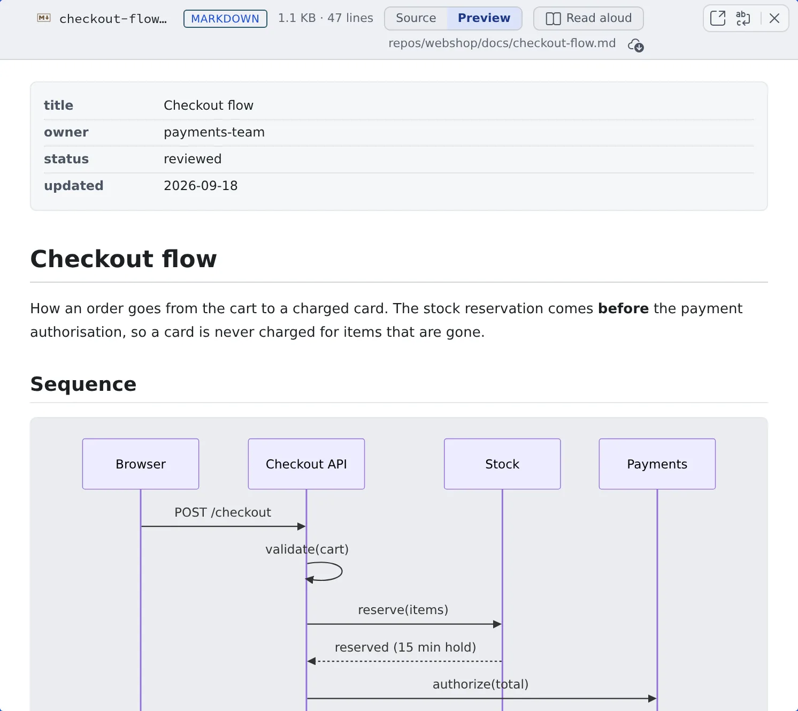
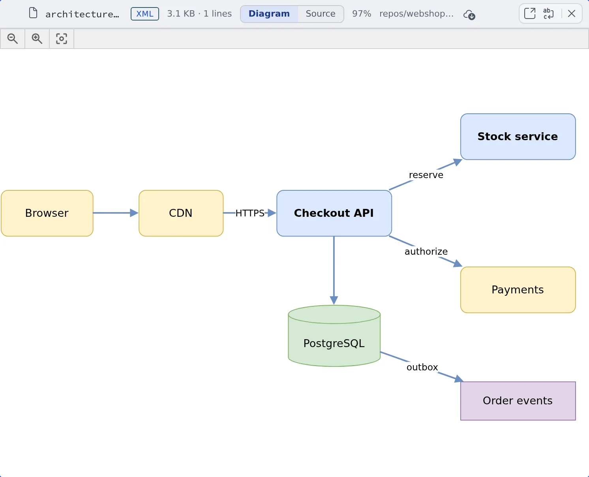

# View documents and diagrams

English | [日本語](view.ja.md)

Open a file and code is highlighted, Markdown is rendered, a Marp deck shows as slides and a `.drawio` file as a
diagram. PDFs and Office documents are readable inside the Console too, without downloading them.

## How it works

| What you do | What happens |
|---|---|
| Click a file in **Files** | The viewer shows it the way its format calls for |
| Use the switch at the top | Move between preview, source, slides, diagram and so on |
| Follow a link in a document | It opens a file, a folder, an issue or a port of the workspace |

Documents and diagrams are drawn inside your browser only. No file is sent to an outside service.

## Open a file

Click a file in **Files** in the left pane and it opens in the viewer in the main area ([See and download files](browse.md)).
The top shows the file name, the format, the size and the number of lines.

- Code is highlighted for its detected language
- Whether line numbers and the minimap show is set under ⚙ Settings, "**Display**" tab, "**File viewer**"
- A very large file, or one with very long lines, switches to "**Plain view**" with no highlighting and no line numbers
- A file whose Git LFS content has not been fetched yet carries an "**LFS pointer**" badge. How to fetch it is in [Clone a repository](../code/clone.md#a-file-shows-lfs-pointer)

## Read Markdown

A `.md` file opens as a rendered "**Preview**". The switch at the top takes you to the original text.

| Switch | What shows |
|---|---|
| Preview | The rendered page. Mermaid code blocks are drawn as diagrams |
| Source ("Edit" for a file you can edit) | The original text |
| Split | Only for a file you can edit. The text and the preview side by side ([Edit a file](edit.md)) |

- Code blocks carry a "**Copy this code**" button
- In the preview, relative links are read from the file's own folder, and a `#heading` link scrolls within the page

## Links in documents

Where the Console shows Markdown (a file's preview, a session's replies, an assistant chat, the document viewer), these
become links.

| What is written | Clicking it |
|---|---|
| An outside URL | Opens it in a new tab |
| A path to a workspace file or folder (`[text](src/app.ts)` or `` `src/app.ts` ``) | Opens a file in the viewer and a folder in **Files** |
| `$AF_WORK_DIR/…` in a session's reply | Opens that session's temporary work folder. Only what exists there becomes a link |
| An issue number (`#956`, `owner/name#956`, a Jira key) | Opens the issue's details ([Start from an issue or a ticket](../sessions/from-issues.md#open-from-an-issue-number-in-the-conversation)) |
| `http://127.0.0.1:<port>/…`, `http://localhost:…`, `http://0.0.0.0:…` | Opens that port of the workspace ([See a web app you started](../preview/browser-pane.md)) |

- Right-click a file or folder link (or long-press, or the Menu key) for "**Open in pane**", "**Open in new pane**", "**Show in Files**" and the file menu's items that change nothing
- In a file's preview, `#956` is read as a number of the working copy the file is in. Only files under `~/repos/<name>/` whose origin is on github.com or bitbucket.org count
- A loopback URL with no session listening on its port is shown faded but still opens. Ctrl-click (⌘-click) or middle-click opens it in a new tab
- For someone reading a shared session, none of these links work. Paths and issue numbers stay plain text

## View Marp slides

A `.md` that starts with `marp: true` opens as slides. Inside the preview, a "**Document**" / "**Slides**" switch appears.

- Step through one slide at a time with the ◀ ▶ buttons, or ←, →, PageUp, PageDown, Space, Home and End
- ⤢ shows them full screen, ready to present

## View diagrams

`.drawio` and `.dio` files, and `.xml` files holding an `mxfile`, open as diagrams. "**Diagram**" and "**Edit**" ("**Source**" for a file you cannot edit) at the top move between the picture and the XML text.

- **Pages**: a diagram with several pages shows `1 / 2` style page numbers in the header. Turn them with the arrows at the top left
- **Zoom and move**: Ctrl (⌘) and the wheel, or a two-finger pinch, zooms around the point under it. The plain wheel or a drag moves; a double-click (double-tap) toggles between fit and 100%
- **Theme**: switching the Console between light and dark redraws it on the same page, zoom and position
- **Icons**: AWS, GCP, Azure, Kubernetes and similar icons are fetched once by the Control Plane and cached. Where outbound traffic is restricted they may not arrive, and then only the shapes' outlines, colours and labels show

Editing the diagram on screen (moving shapes, drawing lines) is not possible. "Edit" changes the XML text only. Use an
external editor to draw.

## Read PDFs and Office documents

A **PDF** is shown as its pages. The header says `1 / 12` style page numbers; turn pages with the arrows and use "**Zoom in**", "**Zoom out**" and "**Fit width**". Japanese PDFs without embedded fonts show their text too.

To find text in a PDF:

1. Click the PDF and press Ctrl+F (Cmd+F on a Mac), or press "**Find in PDF**" in the toolbar
2. Type the words. Every page is searched, including words wrapped across lines
3. Enter moves to the next match and Shift+Enter to the previous one. Esc closes the search bar

**Word, Excel and PowerPoint** (`.docx`, `.xlsx`, `.pptx`, plus `.odt`, `.rtf`, `.epub` and others) get a simple preview that converts the content into readable form.
Formatting, shapes and images are not reproduced. To see it as laid out, open the original with "**Download**" at the top.

- Only the first time you open a format does it take a moment to load
- When a document cannot be opened, it says why: password-protected, damaged, image-only pages (reading their text needs OCR, which is not done here), or too large (over 40 MB)

## Related

- [See and download files](browse.md): find and download files
- [Edit a file](edit.md): fix an open file in place
- [Hand a file to a session](send.md): send part of an open file to an agent with instructions
