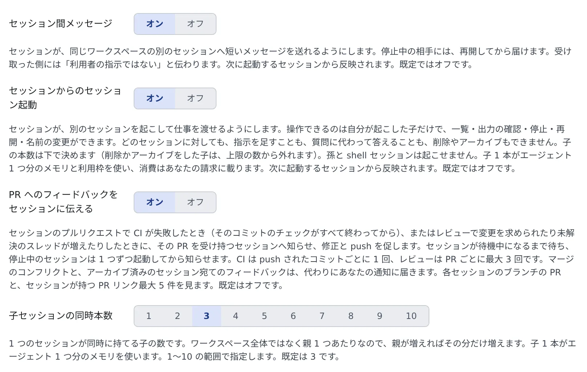

# セッションから子セッションを起動する

[English](child-sessions.md) | 日本語

設定をオンにすると、動いているセッションが別のセッションを起動して仕事を渡し、その面倒を見られます。
起動されたほうが**子セッション**です。時間のかかる別作業や、別のリポジトリでの作業、別の種類のエージェントにやらせたい作業を分けられます。

## 全体像

| あなたがやること | エージェントがやること |
|---|---|
| 設定で「セッションからのセッション起動」をオンにする | 次に起動するセッションから、子を起動できるようになる |
| 「テストは codex のセッションに並行して書かせて」と頼む（頼まなくてもよい） | 子を起動し、そのことと目的をあなたに伝える。子は新しい worktree で動く |
| 子の質問や許可に答える | 子は終わったら親に 1 通だけ結果を送る |
| 要らなくなった子を削除かアーカイブする | 親は最後のターンの前に、残していく子とその状態を伝える |

セッション同士で一言だけ伝えるなら [セッション同士でやりとりさせる](messages.ja.md)、ひと仕事まるごと渡すならこのページです。

## オンにする

1. **⚙設定 →「エージェント」** を開きます
2. 「セッション」の「**セッションからのセッション起動**」をオンにします
3. その下の「**子セッションの同時本数**」で、1 つのセッションが同時に持てる子の数を選びます

- 既定ではオフです。オンにすると、**次に起動するセッションから**使えます。動いているセッションは、再起動するまで変わりません
- 同時本数は 1〜10 の範囲で、既定は 3 です。数えるのは親 1 つあたりなので、親が 2 つあればそれぞれがその数まで持てます
- 子の終わりの 1 通を親に届けるには、「**セッション間メッセージ**」もオンにします

## 子を起動させる

セッションは、仕事が分かれると判断したときに自分で子を起動します。あなたから頼むこともできます。

> テストは codex のセッションに並行して書かせて

> このレビューは別のエージェントのセッションに、effort を high にしてやらせて

| 決められること | 決まり |
|---|---|
| エージェント | shell・ssm 以外のどれでもよい。claude のセッションが codex の子を起動できる |
| モデル | 「使わないモデル」に入れていないものなら、どれでもよい |
| effort | 親が選べる。モデルも指定したときは、そのモデルが対応する effort から選ぶ |
| 権限モード | 親は選べない。設定 >「エージェント」の種類ごとの既定に従う |
| 作業コピー | 新しい worktree。ほかのセッションが使っている作業コピーは指定できない |

どのエージェントが子を起動できるかは、[エージェントリファレンス](../../ref/agents.ja.md) の「子セッションを起こす・ほかのセッションへメッセージを送る」の行にあります。

### 親の作業コピーを子と共有する

親がはっきり求めたときだけ、子を親自身の作業コピーで起動できます。

- 親子で 1 つのチェックアウト・index・ブランチを共有します
- 子には「ブランチを切り替えない・stash しない・パスを指定して commit する」と伝わります
- 親が動いていて、作業コピーのパスに symlink を含まないときに限ります。それ以外は断られます

## 子の様子を見る

- 子は、左ペイン・セッション一覧・フリート俯瞰図に、ほかのセッションと同じように出ます
  - 左ペインでは、子の worktree は親の作業コピーの下に入ります
  - セッション一覧では、子のカードは親のカードのすぐ下に並び、親から畳めます
  - フリート俯瞰図では、子のレーンは親のレーンの下に描かれ、起動と報告が矢印になります
- 子の会話の最初の指示には「**‹親の名前› が起動**」のバッジが付きます。あなたが打った指示とは混ざりません
- 子は誰に起動されたかを覚えています。分岐しても作り直しても引き継がれます

## 親と子でできること

| | できる | できない |
|---|---|---|
| 親 | 自分が起動した子を一覧する、最近の出力を読む、すぐ止める、今のターンが終わったら止める予約をする、停止中の子を再開する、名前を変える | 子に指示を足す、子の質問・プラン・許可にあなたの代わりに答える、削除・アーカイブ |
| 子 | 親から渡された仕事をする | 自分の子（孫）を起動する |
| あなた | すべて。子の削除とアーカイブも | — |

- 子への指示は**あなたの承認の代わりにはなりません**。許可の確認や、人にしか決められない判断が出ると、子はそこで止まってあなたを待ちます
- 指示に書かれたコマンドはただの文字列です。子がそれを理由に設定や指示ファイルを書き換えることもありません
- 質問や承認を待っている子は、「ターンが終わったら止める」予約では止まりません
- あなたが子の名前を変えると、その名前が残ります。親はもう変えられません
- 子に続きの仕事を渡すときは、親がメッセージを送ります（[セッション同士でやりとりさせる](messages.ja.md)）
- 自分が起動していないセッションに対して親ができるのは、メッセージを送ることと出力を読むことだけです

## 親に届くもの

- **結果の 1 通**：子は、終わったときに親へ 1 通だけ送るよう頼まれています。途中経過は送りません。「セッション間メッセージ」がオフなら届かないので、親は子の状態と出力を自分で確かめます
- **停滞通知**：動いている親と、生きている子のすべてが 15 分間待機のままで、バックグラウンドの作業も、届いていないメッセージもないとき、親に 1 通届きます。待機中の子の名前が入っていて、誰かが誰かを待って止まっていないかを親が確かめられます。会話には「**停滞通知**」のバッジが付きます

停滞通知について知っておくこと：

- 数える子は、セッションが起動した子だけです。引き継ぎの提案からあなたが起動したセッションは数えません
- 質問・プラン・許可の確認と、利用上限の解除待ちは、待機に数えません
- 待機が続いている間に届くのは 1 通だけです。次に届くのは、子のどれかの状態が変わったあとです
- 15 分という時間を変えたり、通知を止めたりするのは配備の設定です

## 片付ける

- **親が終わっても、子は止まりません。** 親は最後のターンの前に、残していく子とその状態を伝えるよう指示されているので、その一覧を読んでください
- 子を削除・アーカイブできるのはあなただけです。削除かアーカイブをすると、その子は同時本数の数から外れます
- 停止したまま置いておいた子が期限で自動的にアーカイブされたときも外れます（[セッションを止める・再開する](../sessions/stop-resume.ja.md#停止したまま置いておくと)）。停止しただけでは外れません
- 子 1 本がエージェント 1 つ分です。ワークスペースのメモリを使い、そのエージェントの利用枠をあなたの分から使います
- 設定の「**エージェント使用量**」では、子の消費は「**セッションが起動**」として別に出ます。親の数字には足されません

## 関連

- [セッション同士でやりとりさせる](messages.ja.md)
- [セッションのつながりを時系列で見る](graph.ja.md)
- [フリート・オペレーターに任せる](operator.ja.md)：チャットから、あなたの代わりにセッションを起動して指揮させる
- [エージェントリファレンス](../../ref/agents.ja.md)
