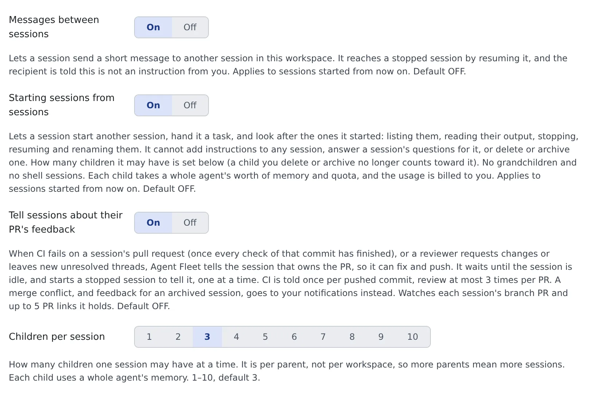

# Start child sessions from a session

English | [日本語](child-sessions.ja.md)

With the setting on, a running session can start another session, hand it a task, and look after it.
The one it starts is a **child session**. Use it for long side jobs, work in another repository, or work you want a different kind of agent to do.

## How it works

| What you do | What the agent does |
|---|---|
| Turn on "Starting sessions from sessions" in Settings | From the next session started, it can start children |
| Ask "have a codex session write the tests in parallel" (or let it decide) | It starts a child and tells you so and why. The child runs in a new worktree |
| Answer the child's questions and permissions | The child sends its parent one message with the result when it is done |
| Delete or archive children you no longer need | Before its last turn, the parent tells you which children it leaves behind and their state |

For a one-line note between sessions, see [Let sessions message each other](messages.md). This page is for handing over a whole task.

## Turn it on

1. Open **⚙ Settings → Agents**
2. Under "Session", turn on **Starting sessions from sessions**
3. Under it, pick **Children per session**: how many children one session can have at a time

- It is off by default. Once on, it applies **from the next session started**. Running sessions keep the old behaviour until they restart
- Children per session ranges from 1 to 10 and defaults to 3. It counts per parent, so two parents can each have that many
- For the child's closing message to reach the parent, turn on **Messages between sessions** as well

## Have it start a child

A session starts a child on its own when it judges the work splits. You can also ask.

> Have a codex session write the tests in parallel

> Have a session of another agent do this review, with effort set to high

| What can be chosen | Rule |
|---|---|
| Agent | Any kind except shell and ssm. A claude session can start a codex child |
| Model | Any model you have not hidden |
| Effort | The parent can choose. When it also names the model, it picks from that model's effort levels |
| Permission mode | The parent cannot choose. It follows the per-kind default in Settings > Agents |
| Working copy | A new worktree. A working copy another session is using cannot be given |

Which agents can start children is in the "Starts child sessions and messages other sessions" row of the [agents reference](../../ref/agents.md).

### Share the parent's working copy with the child

Only when the parent asks for it explicitly can a child start in the parent's own working copy.

- Parent and child share one checkout, index and branch
- The child is told not to switch branches, not to stash, and to commit by path
- This works only while the parent is running and the working copy's path has no symlink in it. Otherwise it is refused

## Watch the children

- Children appear in the left pane, the sessions overview and the fleet graph like any other session
  - In the left pane, the child's worktree sits under the parent's working copy
  - In the sessions overview, the child's card sits right under the parent's and can be collapsed from it
  - In the fleet graph, the child's lane is drawn under the parent's, with the start and the report as arrows
- The child's first instruction carries a **Started by ‹parent›** badge, so it is not mixed up with what you typed
- A child remembers which session started it, through a fork or a recreate too

## What parent and child can do

| | Can | Cannot |
|---|---|---|
| Parent | List the children it started, read their recent output, stop them now, book a stop at the end of the current turn, resume a stopped child, rename it | Add instructions to a child, answer a child's questions, plans or permissions for you, delete or archive |
| Child | Do the task the parent handed over | Start its own children (grandchildren) |
| You | Everything, including deleting and archiving children | — |

- An instruction to a child **never stands in for your approval**. When a permission prompt or a decision only a person can make comes up, the child stops and waits for you
- Commands written in the instruction are just text. The child does not change settings or instruction files because of it
- A child waiting on a question or an approval is not stopped by the end-of-turn booking
- When you rename a child, your name stays. The parent can no longer change it
- To give a child more work, the parent sends it a message ([Let sessions message each other](messages.md))
- To a session it did not start, a parent can only send messages and read output

## What reaches the parent

- **One result message**: the child is asked to send its parent one message when it is done, and no progress reports. With "Messages between sessions" off it does not arrive, so the parent checks the child's state and output itself
- **Stalled-tree notice**: when a running parent and all its live children have been idle for 15 minutes, with no background work and no message still on its way, the parent gets one notice. It names the idle children, so the parent can check whether someone is stuck waiting on someone else. In the conversation it carries the **Stalled-tree notice** badge

About the stalled-tree notice:

- Only children started by a session count. A session you started from a handoff proposal does not
- Waiting on a question, a plan, a permission or a usage-limit reset does not count as idle
- One notice per quiet spell. The next comes only after one of the children changes state
- Changing the 15 minutes, or turning the notice off, is a deployment setting

## Clear up

- **Children outlive their parent.** When the parent ends, its children keep running. The parent is told to list the children it leaves behind and their state before its last turn, so read that list
- Only you can delete or archive a child. Once deleted or archived, it no longer counts towards Children per session
- The same goes for a child left stopped and archived automatically when its time is up ([Stop and resume a session](../sessions/stop-resume.md#leave-a-session-stopped)). Merely stopping it does not free the slot
- Each child is one agent: it uses the workspace's memory and spends that agent's usage from your share
- In Settings' **Agent usage**, a child's spend shows separately as **Started by a session**. It is not added to the parent's figures

## Related

- [Let sessions message each other](messages.md)
- [See how sessions relate over time](graph.md)
- [Hand work to the Fleet Operator](operator.md): have it start and direct sessions for you from chat
- [Agents reference](../../ref/agents.md)
