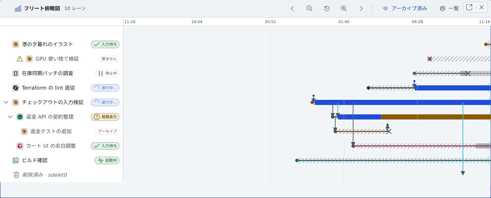

# セッションのつながりを時系列で見る

[English](graph.md) | 日本語

フリート俯瞰図を開くと、どのセッションがどれを起動し、その間に何が行き来し、それぞれがいつ動いて・待って・止まっていたかを 1 枚で読めます。
セッション一覧が「いま」の断面なら、こちらはその経過です。

## 全体像

| あなたがやること | 画面に出ること |
|---|---|
| フリート俯瞰図を開く | 1 セッション 1 レーンで、横軸が時間の図が出る。右端が「いま」 |
| 時間を動かす・広げる | 過去のレーンや、セッションの間の矢印をたどれる |
| レーンの名前を押す | そのセッションが図の隣に開く |

## 開く

次のどれかで開きます。

- セッション一覧のヘッダーの「**俯瞰図**」（同じペインが切り替わります。俯瞰図のヘッダーの「**一覧**」で戻ります）
- リーダーキー `g f`
- コマンドパレットの「**フリート俯瞰図を開く**」

「俯瞰図」「一覧」を Ctrl（⌘）＋クリックか中クリックすると、別のペインに開きます。

## 時間を動かす

最初は直近 24 時間を表示します。

| やりたいこと | 操作 |
|---|---|
| 過去・未来へ動かす | ヘッダーの「過去へ」「未来へ」の矢印。図の上での横スクロールやドラッグ |
| 範囲を狭める・広げる | ヘッダーの拡大・縮小のボタン。スマホでは 2 本指のピンチ |
| 直近 24 時間に戻す | ヘッダーの「直近 24 時間に戻す」のボタン |
| レーンを上下に動かす | 縦スクロール |

目盛りは、どこまでスクロールしても上端に残ります。

## レーンを読む

左の列には、エージェントの種類のアイコン・セッション名・状態チップが並びます。

| レーンの見た目 | 意味 |
|---|---|
| 実線に色の帯（進行中…・あなた待ち・入力待ち） | 動いている。右端で脈打つ |
| × から右端までの点線 | 停止中。再開できる |
| × で終わる | アーカイブ済みか、削除済み |
| 1 本のレーンに区間がいくつもある | 止めて再開したセッション |

- 一覧にもういないレーンには、「**停止中 — 再開できます**」「**アーカイブ済み — 復元できます**」「**もういません**」が出ます
- × は、止まったことに**気づいた時刻**です。実際に止まった時刻より遅れることがあり、マウスを重ねるとツールチップにそう出ます
- セッションを開くのは**名前**を押したときだけです。レーンを押しても何も開かないので、図をドラッグしていてセッションが開いてしまうことはありません

## 親子関係と矢印を読む

- **別のセッションから起動したセッション**（子セッション・フォーク・引き継ぎ）は、親のレーンの真下に描かれ、親から、子が生まれた位置へ線が引かれます
- 親の行の「**子セッションを畳む**」で子孫を隠せます。隠した本数は「＋N」で出ます
- 親が表示範囲の外にあるか、もういないときは、「親レーン … はこの図に描かれていません」と出ます

矢印は、セッションの間で行き来したものです。

| 矢印 | 何が行き来したか |
|---|---|
| 起動・フォーク・引き継ぎ | 新しいセッションが生まれた |
| 指示・報告 | 指示と、その報告 |
| セッション間メッセージ | [セッション同士のメッセージ](messages.ja.md)。種別（依頼・質問など）が付く |
| 先端に点の付いた短い矢印 | セッションでないところから来たもの。会話・利用者・定時実行・Discord 連携・Slack 連携・自動再開を、色とラベルで区別する |

矢印をクリックすると、その会話やレーンが開きます。

## 過去を見る

- ヘッダーの「**アーカイブ済み**」で、アーカイブ済みのレーンを出し入れします。この図では、最初から表示しています
- 停止中のセッションは、いつも描かれます
- 十分に遡ると、記録が残っている範囲の端に線が出ます。線は 3 種類あります。稼働帯と矢印が残っている範囲の端、親子関係が残っている範囲の端、起動と終了のおおまかな位置しか残っていない範囲の端です
- 何も描かれていない範囲でも、軸と操作は残るので、そのまま戻ってこられます

## 関連

- [動いているセッションを一覧する](overview.ja.md)
- [セッションから子セッションを起動する](child-sessions.ja.md)
- [別のセッションやエージェントに引き継ぐ](../sessions/handoff.ja.md)
