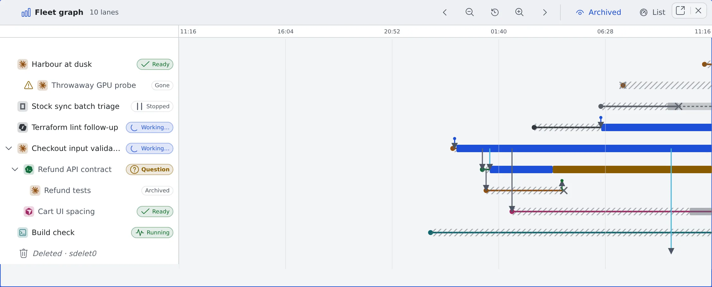

# See how sessions relate over time

English | [日本語](graph.ja.md)

The fleet graph shows on one figure which session started which, what passed between them, and when each was working, waiting or stopped.
The sessions overview is a snapshot of now; this is how it got there.

## How it works

| What you do | What appears on screen |
|---|---|
| Open the fleet graph | One lane per session on a time axis, with now at the right edge |
| Move along or widen the time axis | Past lanes and the arrows between sessions can be followed |
| Click a lane's name | That session opens beside the graph |

## Open it

Use any of these:

- **Graph** in the sessions overview's header (the same pane switches; **List** in the graph's header switches back)
- The leader keys `g f`
- **Open the fleet graph** in the command palette

Ctrl (⌘)-click or middle-click on Graph or List opens it in another pane instead.

## Move in time

It starts on the last 24 hours.

| To do this | Use |
|---|---|
| Move into the past or towards now | The arrows in the header. Scroll sideways or drag on the figure |
| Narrow or widen the window | The zoom buttons in the header. On a phone, pinch with two fingers |
| Return to the last 24 hours | The reset button in the header |
| Move up and down the lanes | Scroll vertically |

The time scale stays at the top however far you scroll.

## Read a lane

The left column holds the agent kind's icon, the session's name and its state chip.

| How the lane looks | What it means |
|---|---|
| A solid line with a coloured band (working, waiting on you, idle) | Running. It pulses at the right edge |
| A dotted line from an × to the right edge | Stopped. It can be resumed |
| It ends in an × | Archived or deleted |
| Several stretches on one lane | A session that was stopped and resumed |

- A lane no longer in the list shows **Stopped — resumable**, **Archived — restorable** or **Gone**
- The × is when the stop was **noticed**. It can be later than the session actually stopped, and its tooltip says so
- Only the **name** opens the session. Clicking the lane opens nothing, so dragging the figure never opens a session by accident

## Read families and arrows

- **A session started from another session** (a child session, a fork, a handoff) is drawn right under its parent's lane, with a line from the parent to where it was born
- **Collapse child sessions** on the parent's row hides its descendants. The number hidden shows as "+N"
- When the parent is outside the window or gone, the lane says "Parent lane … isn't drawn in this figure"

Arrows are what passed between sessions.

| Arrow | What passed |
|---|---|
| Spawned, forked, handoff | A new session was born |
| Instruction, report | An instruction, and its report |
| Session-to-session message | A [message between sessions](messages.md), with its kind (request, question and so on) |
| A short arrow with a dot at its tip | Something that came from outside the sessions: a conversation, a person, a scheduled execution, the Discord bridge, the Slack bridge or auto-resume, told apart by colour and label |

Clicking an arrow opens its conversation or lane.

## Look into the past

- **Archived** in the header shows or hides archived lanes. In this figure they are shown from the start
- Stopped sessions are always drawn
- Far enough back, a line marks the edge of what is kept. There are three: where activity bands and arrows end, where lineage ends, and where only the outline of births and ends is left
- A stretch with nothing drawn still keeps its axis and controls, so you can come back from it

## Related

- [See every running session](overview.md)
- [Start child sessions from a session](child-sessions.md)
- [Hand off to another session or agent](../sessions/handoff.md)
