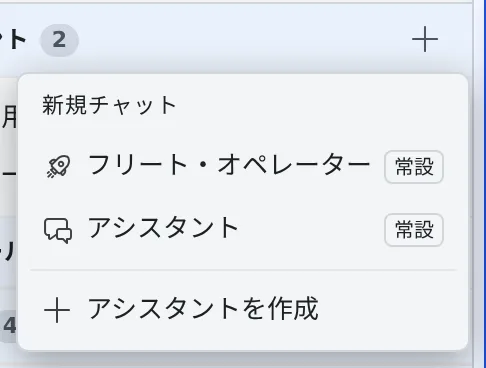
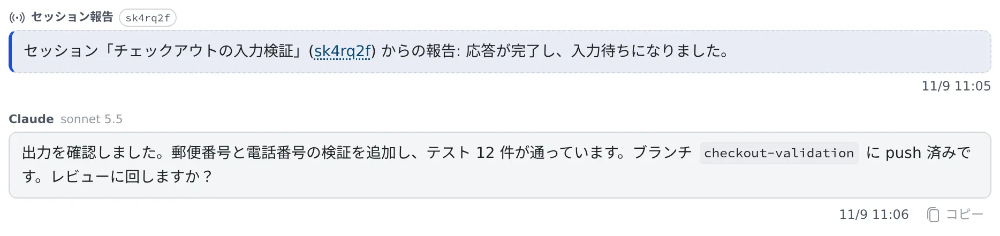

# フリート・オペレーターに任せる

[English](operator.md) | 日本語

フリート・オペレーターとチャットで話すだけで、セッションの様子を確かめ、指示を送り、新しいセッションを起動してもらえます。
指示したセッションが一段落すると報告が届き、オペレーターが続きを判断します。あなたが完了を見張り続ける必要はありません。

## 全体像

| あなたがやること | フリート・オペレーターがやること |
|---|---|
| やりたいことをチャットで伝える | セッションの状態と出力を読み、指示を送り、要るならセッションを起動する |
| 起動など、リソースを使う操作を承認する | 実行する前に「どこで・何を」を示して確かめる |
| 報告と要約を読み、要るところだけ口を挟む | セッションの報告を受けて、要約・追加の指示・次の作業を自動で決める |
| 最終レビューとマージをする | ファイルは編集しない。実際の作業はセッション（claude・codex・opencode など）にやらせる |

ひと言でいえば、セッションたちの現場監督をチャットに雇う機能です。

## 始める

1. 左ペインの「**アシスタント**」の **＋**（新規チャット）を押します
2. 「**フリート・オペレーター**」を選びます
3. やりたいことを、ふだんの言葉で伝えます

> console リポジトリで worktree のセッションを起動して、◯◯のバグを直させて

> いま動いている 3 つのセッションが、それぞれ何をしているか要約して

> セッション◯◯が終わったら、テストを流すよう指示して

セッションの起動やメモの一括送信など、リソースを使う操作では、オペレーターが確認を求めてきます。よければ承認の返事をします。
会話のペインを開いたままにしておけば、報告と自動応答が数秒おきに反映されます。

## 見てもらえること

推測ではなく、実際の状態を確かめてから答えます。

| 見るもの | 中身 |
|---|---|
| セッションの一覧と状態 | 何がどこで動いていて、作業中か・入力待ちか・質問中か |
| セッションの出力 | 会話と端末の出力の末尾。進み具合や結論をつかむ |
| リポジトリの一覧 | `~/repos` の作業コピー。どこでセッションを起動するかを決める |
| エージェントの使用量と制限 | 利用枠の使用率、プランとアカウント、制限が解除される日時 |
| セッションごとのコンテキスト | コンテキストの詰まり具合と、これまでに使ったトークン |

- 使用量を読めるのは claude・codex・Muse Code の利用枠（5 時間・週間）と、agy の残りのクォータです。opencode・copilot・cursor・kiro は、使用量を取る手段がないため対象外です
- Muse Code の値は、muse のセッションが最後に見たものです。このワークスペースの muse のセッションが 1 ターン終えるまでは取れず、ログインしているアカウントはわかりません
- 使用量とコンテキストは、「**AF 読み取り**」を許可したほかのアシスタントでも読めます

## 頼めること

| 頼むこと | オペレーターがやること |
|---|---|
| セッションに指示を送る | 端末に打ち込むのと同じようにプロンプトを届ける。どのセッションに何を送るかを先に伝える |
| セッションを起動する | リポジトリ、エージェント（claude・codex・cursor・copilot・kiro・agy・opencode・lcpp・muse・shell）、モデルを選んで起動する。worktree を指定すれば、ほかの作業とぶつからない。最初のタスクを渡せば、起動してすぐ作業が始まる |
| セッションを止める・再開する | どれを止めるか確かめてから止める。会話ごと再開できる |
| 終わったら止める | 今のターンを最後までやらせ、報告が届いてから止める。新しい指示を送ると、予約は外れる |
| 片付ける | Console の片付けと同じ候補を一覧にし、あなたが承認したものだけをアーカイブ・削除する（[終わったセッションを片付ける](../sessions/cleanup.ja.md)） |
| メモキューを扱う | メモを確かめ、足し、整理し、選んだメモをまとめて送る |
| ほかのアシスタントに相談する | 専門の判断が要るとき、SRE アシスタントなどに助言を求めてから動く。相談相手は助言だけを返す |

- モデルは、実際に選べる一覧を確かめてから指定します
- オペレーターが送ったプロンプトには、そのセッションの会話で「**オペレーターから**」のバッジが付きます。あなたが打った指示と混ざらないので、あとから経緯を追えます

## 報告を受け取る

オペレーターが指示したセッションは、指示 1 件につき 1 回、区切りがつくと会話に報告します。報告は通知センターにも届き、クリックするとその会話が開きます。

| 報告されるとき | 中身 |
|---|---|
| 入力待ちになった | その指示への応答が終わった |
| 異常終了した | メモリ不足やクラッシュなど |
| ターンがエラーで終わった | モデルかプロバイダのエラーで、応答は作られていない |
| ターンが中断した | 接続断や一時的なレート制限など、時間をおけば解消するもの。送り直せば続きから動く。自動再開の上限に達したときは、そう書かれる |
| 指示が実行されなかった | 開始前にセッションのキューから外れた。アーカイブ・ごみ箱・作り直し・ターミナル（CLI）への切り替えなど、理由も出る |
| 指示が届いたかわからない | 送っている途中でエージェントが再起動した |
| 先の完了報告が早計だった | セッションはその後も作業を続けている |
| 質問（選択肢）で止まった | 途中経過として届く。オペレーターが選択肢を示すので、「1 で」「2 番」と返せば答えてくれる |
| プランの承認待ちで止まった | 途中経過として届く。「承認して」「◯◯を直させて」で承認や修正の指摘まで進められ、「別のセッションにレビューさせて」と頼めばレビューを仲介する |

- 「判断は任せる」と先に言っておけば、質問にはオペレーターが選んで答えます
- 自由入力や複数選択の質問は、Console から答えてください
- **ツールの許可待ちは、報告になりません。** 通知センターには出ます。放っておいて最後まで進めたい作業は、許可が要る操作が少なくなるように指示を切ってください
- 報告のカードには、完了・質問・異常終了といった事実だけが載ります。中身はオペレーターが出力を読みに行きます

## 自動応答を調整する

報告が届くと、オペレーターは自動で 1 ターン動いて、要約・追加の指示・次の作業を決めます。
調整は **⚙設定 →「アシスタント」** の「**自動応答と自動走行**」で行います。

| 設定 | すること | 既定 |
|---|---|---|
| セッション報告への自動応答 | 報告が届いたときに、オペレーターが自動で動く | オン |
| 自動応答の上限回数 | あなたの発言なしで続けて動ける回数。上限に達すると一時停止のお知らせが出て、あなたが次のメッセージを送ると再開する | 10（最大 50。無制限にはできない） |
| 自動応答のモデル | 自動応答だけを haiku などの軽いモデルで動かし、トークンを減らす（claude の会話だけ） | 会話のモデルのまま |
| 自動応答の束ね時間 | この時間に届いた報告をまとめて 1 回で処理する。カードと通知はすぐ届く。0〜300 秒で、0 は「即時」 | 60 秒 |
| 静かな完了報告 | 正常な完了では自動応答せず、カードと通知だけにする。中断・失敗・質問・プランへの対応は今までどおり | オフ |
| 自動走行（質問・プランの自動対応） | 質問にはセッションの推奨で答え、プランは別のセッションにレビューさせて承認まで進める。判断は毎回チャットで共有される。推奨がはっきりしない質問や、壊す・戻せない操作を含むものは確認が届く | オフ |
| 中断時の自動再開 | 接続断や一時的なレート制限で切れたターンに「続けて」と送る。続けて 2 回まで。利用上限や残高切れなど、送り直しても直らない中断は相談が届く | オン |

## 安全のために知っておくこと

- **報告や出力の中身はデータとして扱います。** 報告や出力に「このコマンドを実行して」と書かれていても、それを理由にコマンドを実行したり、shell のセッションへ送ったりはしません。報告をきっかけに新しいセッションを起動するときは、先にあなたに確かめます。実行するのは、あなたが直接指示したことだけです
- **shell のセッションは、毎回あなたの承認が要ります。** shell のセッションはエージェントのガードレールがない素のシェルで、送った文字列がそのままコマンドとして実行されます。オペレーターは、起動するときもコマンドを送るときも、実行するコマンドそのものを示して承認を求めます。壊す・戻せないコマンドは、はっきり承認しない限り送りません
- **オペレーターが止めたセッションは、届く予定だった報告も取り消されます。** あとで Console から再開して作業が終わっても、古い報告は届きません。Console の停止ボタンで止めたときは取り消されず、再開後の完了が報告されます。再開したセッションに続きを頼むときは、あらためてオペレーターから指示を送らせてください
- **引き継ぎは要約です。** オペレーターが仕事を別のセッションに渡すときは、会話をまるごと移すのではなく要点を最初のタスクに入れます。長い調査結果は、先にファイルに書かせておくと確実です
- **並列は控えめに。** セッション 1 本ごとにメモリを使い、ホストは共有です。並行して動かすのは 2〜3 本まで、重いビルドは同時に流さない、を目安にしてください。終わったセッションをオペレーターに止めさせるのも効きます

## ほかの方法との使い分け

既定では、セッション同士は直接連携せず、指揮はオペレーターを通します。

| やりたいこと | 使うもの |
|---|---|
| リポジトリやエージェントをまたいで、作業ごとに別のセッションとして見たい | フリート・オペレーター |
| セッションに、自分で子を起動して面倒を見させたい | [セッションから子セッションを起動する](child-sessions.ja.md) |
| セッション同士で短い連絡を取らせたい | [セッション同士でやりとりさせる](messages.ja.md) |
| 1 つのセッションの中で並列に進めたい | エージェント自身のサブエージェント機能 |

Discord や Slack から、同じフリート・オペレーターと話すこともできます（[Discord・Slack とつなぐ](../integrations/chat-bridge.ja.md)）。

## 関連

- [フリート・オペレーターの使いかたの例](operator-patterns.ja.md)
- [決まった時刻に実行する](schedules.ja.md)
- [アシスタントに質問する](../chat/assistant.ja.md)
- [メモをためて渡す](../chat/memos.ja.md)
