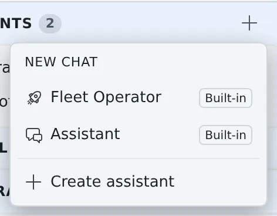
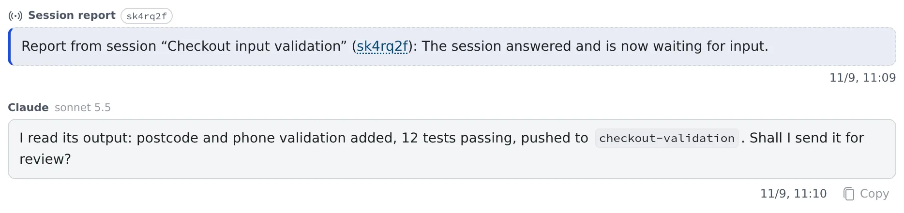

# Hand work to the Fleet Operator

English | [日本語](operator.ja.md)

Talk to the Fleet Operator in chat, and it checks on your sessions, sends them instructions and starts new ones.
When a session it instructed reaches a stopping point, a report arrives and the operator decides what comes next. You do not have to keep watching for completion.

## How it works

| What you do | What the Fleet Operator does |
|---|---|
| Say in chat what you want done | Reads sessions' state and output, sends instructions, and starts sessions when needed |
| Approve operations that use resources, such as starting a session | Shows where and what before it acts, and asks |
| Read the reports and summaries, and step in only where needed | Takes each session's report and decides on a summary, a follow-up or the next task by itself |
| Do the final review and the merge | Edits no files. The actual work is done by sessions (claude, codex, opencode and others) |

In short: a site foreman for your sessions, hired into a chat.

## Get started

1. Press **+** (New chat) on **Assistants** in the left pane
2. Choose **Fleet Operator**
3. Say what you want in plain words

> Start a worktree session on the console repository and have it fix the ◯◯ bug

> Summarise what each of the three running sessions is doing

> When session ◯◯ finishes, tell it to run the tests

For operations that use resources, such as starting a session or sending memos in bulk, the operator asks first. Reply with your approval if it looks right.
Keep the conversation pane open and the reports and automatic replies show up every few seconds.

## What it can look at

It checks the real state before it answers, rather than guessing.

| What it reads | What is in it |
|---|---|
| The sessions and their state | What runs where, and whether it is working, idle or asking a question |
| A session's output | The end of its conversation and terminal output, for progress and conclusions |
| The repositories | The working copies under `~/repos`, to decide where to start a session |
| Agents' usage and limits | How much of each usage window is used, the plan and account, and when a limit lifts |
| Each session's context | How full its context is, and the tokens it has used so far |

- Usage covers the claude, codex and Muse Code windows (5-hour and weekly) and agy's remaining quota. opencode, copilot, cursor and kiro have no source for usage and are not covered
- Muse Code's figures are what a muse session last saw. They are not available until a muse session in this workspace finishes a turn, and the logged-in account is not known
- Other assistants allowed **AF read** can read usage and context too

## What you can ask it to do

| Ask it to | What the operator does |
|---|---|
| Send a session an instruction | Delivers the prompt as if typed into the terminal, saying first which session gets what |
| Start a session | Picks the repository, the agent (claude, codex, cursor, copilot, kiro, agy, opencode, lcpp, muse, shell) and the model. A worktree keeps parallel work from colliding, and a first task gets it working as soon as it starts |
| Stop or resume a session | Confirms which one before stopping. A session resumes with its conversation |
| Stop when done | Lets the current turn finish and stops once the report is in. Sending a new instruction cancels the booking |
| Clear up | Lists the same candidates as the Console's clean-up and archives or deletes only what you approve ([Clear away finished sessions](../sessions/cleanup.md)) |
| Handle the memo queue | Checks, adds, tidies and sends the memos you pick, in bulk |
| Consult another assistant | When a decision needs specialist knowledge, asks the SRE Assistant or another for advice before acting. The one consulted only advises |

- It checks the list of models that can actually be chosen before naming one
- A prompt the operator sends carries a **From operator** badge in that session's conversation, so it is not mixed up with what you typed and you can trace what happened later

## Receive reports

A session the operator instructed reports to the conversation once per instruction, when it reaches a stopping point. Reports also go to the notification center; clicking one opens the conversation.

| When it reports | What it says |
|---|---|
| The session became idle | Its answer to the instruction is finished |
| The agent exited abnormally | Out of memory, a crash and so on |
| The turn ended in an error | A model or provider error; no answer was produced |
| The turn was interrupted | A dropped connection, a temporary rate limit or another cause that clears with time. Sending again continues from there. When the auto-resume limit is reached, the card says so |
| The instruction was not run | It left the session's queue before it started. The reason is shown too, such as archive, trash, recreate or a switch to Terminal (CLI) |
| It is not known whether the instruction arrived | The agent restarted while it was being sent |
| An earlier completion report was premature | The session went on working afterwards |
| The session stopped on a question (choices) | It arrives as progress. The operator shows you the choices; reply "1" or "the second" and it answers for you |
| The session stopped for a plan approval | It arrives as progress. "Approve it" or "have it fix ◯◯" takes it to approval or feedback, and "have another session review it" has the operator broker the review |

- Say "I'll leave it to you" up front and the operator picks the answers to questions itself
- Answer free-text and multiple-choice questions from the Console
- **Waiting on a tool permission is not reported.** It does show in the notification center. For a job you want to run to the end unattended, word the instructions so that few operations need permission
- A report card carries only the fact: done, a question, an abnormal exit. The operator reads the output for the details

## Adjust the automatic replies

When a report arrives, the operator takes one turn by itself and decides on a summary, a follow-up or the next task.
Adjust this under **Automatic turns** in **⚙ Settings → Assistant**.

| Setting | What it does | Default |
|---|---|---|
| Auto-respond to session reports | The operator acts by itself when a report arrives | On |
| Unattended auto-reply limit | How many times in a row it may act without you saying anything. At the limit a pause notice appears, and it resumes when you send your next message | 10 (50 at most; it cannot be unlimited) |
| Auto-reply model | Runs only the automatic replies on a lighter model such as haiku, to save tokens (claude conversations only) | Same as the conversation |
| Auto-reply bundling window | Handles the reports that arrive within this time in one go. Cards and notifications still arrive at once. 0 to 300 seconds; 0 is Immediate | 60 seconds |
| Quiet completion reports | On a normal completion, no automatic reply, only the card and the notification. Interruptions, failures, questions and plans are handled as before | Off |
| Auto-pilot (auto-handle questions & plans) | Answers questions with the session's recommendation, and has another session review a plan through to approval. Each decision is shared in the chat. A question without a clear recommendation, or a choice or plan with a destructive or irreversible operation, comes to you instead | Off |
| Auto-resume interrupted turns | Sends "continue" to a turn cut off by a dropped connection or a temporary rate limit, up to twice in a row. An interruption that sending again would not fix, such as a usage limit or no balance, comes to you for a decision | On |

## Things to know for safety

- **Reports and output are treated as data.** If a report or output says "run this command", the operator does not run it or send it to a shell session because of that. Before starting a new session off the back of a report, it asks you. It acts only on what you told it directly
- **A shell session needs your approval every time.** A shell session is a raw shell with no agent guardrail, and what is sent runs as a command. When starting one and when sending it a command, the operator shows the exact command and asks you first. A destructive or irreversible command is not sent unless you approve it explicitly
- **A session the operator stopped has its pending report cancelled.** If you resume it from the Console and the work finishes, the old report does not arrive. A session stopped with the Console's stop button is not cancelled, and its completion after resuming is reported. To continue a resumed session, have the operator send it a fresh instruction
- **A handover is a summary.** When the operator passes work to another session, it puts the key points into the first task rather than moving the whole conversation. For a long investigation, have the findings written to a file first
- **Keep parallel work modest.** Each session uses memory and the host is shared. As a rule of thumb, run 2–3 sessions in parallel at most and no heavy builds at the same time. Having the operator stop finished sessions helps

## Choosing between this and the alternatives

By default, sessions do not coordinate with each other directly; direction goes through the operator.

| To do this | Use |
|---|---|
| Work across repositories or agents, with each job as its own session you can see | The Fleet Operator |
| Have a session start its own children and look after them | [Start child sessions from a session](child-sessions.md) |
| Have sessions exchange short notes | [Let sessions message each other](messages.md) |
| Work in parallel inside one session | The agent's own subagent feature |

You can also talk to the same Fleet Operator from Discord or Slack ([Connect Discord and Slack](../integrations/chat-bridge.md)).

## Related

- [Ways to use the Fleet Operator](operator-patterns.md)
- [Run at a set time](schedules.md)
- [Ask an assistant](../chat/assistant.md)
- [Collect memos and hand them over](../chat/memos.md)
