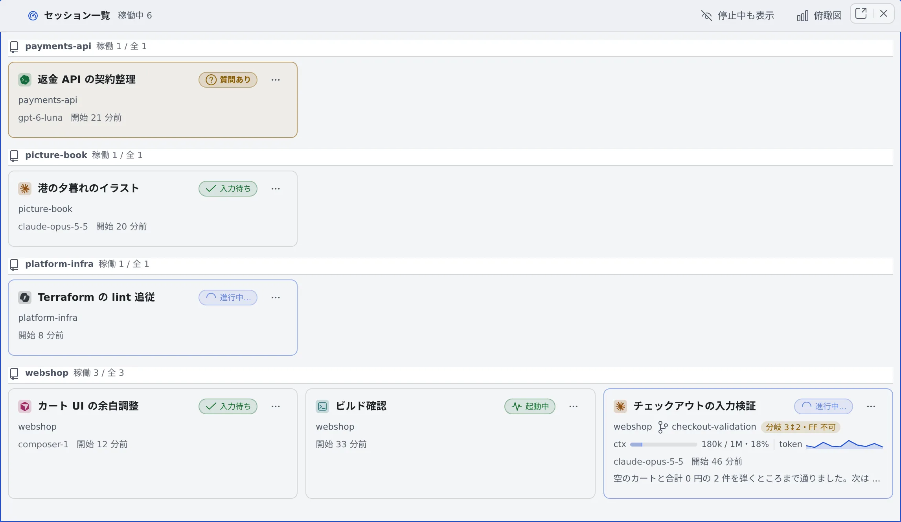

# 動いているセッションを一覧する

[English](overview.md) | 日本語

セッション一覧を開くと、動いているセッションを 1 枚ずつのカードで並べて見られます。
あなたの返事を待っているセッションは、離れたところからでも見つけられます。

## 全体像

| あなたがやること | 画面に出ること |
|---|---|
| セッション一覧を開く | 動いているセッションが、リポジトリごとの見出しの下にカードで並ぶ |
| カードを眺める | 状態・ブランチ・コンテキスト・モデル・最後に言ったことがカードに出る。質問・プラン・許可を待つカードは色が付く |
| カードをクリックする | そのセッションが一覧の隣に開く。一覧はそのまま残る |

## 開く

次のどれかで開きます。

- 操作バーの「**セッション一覧**」（「右に分割」「下に分割」「全て閉じる」の並び）
- 左ペイン上部のレイアウト図にある同じボタン
- リーダーキー `g s` または `s l`

一覧は普通のペインです。分割やタブにでき、別のブラウザタブへ切り離せて、再読み込みしても残ります。
スマホでは、「セッション一覧」が操作バーの **⋯** の中に入ることがあります。

## カードを読む

| 場所 | 出るもの |
|---|---|
| 左上 | エージェントの種類を示す色付きアイコンと、セッション名 |
| 右上 | 状態（入力待ち・進行中…・質問あり・停止中など） |
| 2 行目 | プロジェクトとブランチ。親との差分（「親+2・FF 可」「未取込 3」など。左ペインのリポジトリの行と同じ見方） |
| 3 行目 | コンテキストの使用量と、返答ごとのトークン消費のグラフ（チャット画面と同じ帯） |
| 4 行目 | 最後に答えたモデル、「開始 …」、待ちになってからの経過（「待ち …」、答えたあとは「応答から …」） |
| いちばん下 | そのセッションが最後に言ったことの冒頭。マウスを重ねると全文が出る |

- 待ちの経過時間は、通知と、このブラウザで見た記録から計算します。どちらにも記録がないときは出ません
- まだ何も言っていないセッションには、いちばん下の行が出ません。停止したセッションには出ます

## 並び方

- **見出しはリポジトリごと**です。ベースの作業コピーも worktree も、別のフォルダ名でクローンしたものも、取得元の URL が同じなら同じ見出しに入ります
- 作業コピーで動いていないセッションは、末尾の「その他のセッション」に入ります。見出しはプロジェクト名の順で、動きません
- **見出しの中は親子関係ごと**に並びます。あるセッションから起動したセッション（引き継ぎ・子セッション）は、親のすぐ下に起動した順で並びます。停止した子も親の下に残ります
- 親子関係の順は、あなたの返事を待っているセッションを含む親子関係が先頭、次に動いている親子関係の新しい順、最後に停止中だけの親子関係です
- 順番が入れ替わるのは、親子関係が待ちに入ったときと待ちから出たときだけです。親子関係が割れることはありません
- 見出しの「稼働 N / 全 M」は、その見出しで動いている数と全体の数です

## 見るものを絞る

| やりたいこと | 操作 |
|---|---|
| 停止したセッションも並べる | ヘッダーの「**停止中も表示**」。停止したカードは薄く出ます。この切り替えはペインごとに覚えます |
| 子セッションを隠す | 親のカードの「**子セッションを畳む**」。隠した本数が「＋N」で出ます（何段下でも数えます）。戻すときは「**子セッションを開く**」 |
| 案件ごとに絞る | 左ペインの作業グループを切り替えると、一覧も同じように絞られます（[作業グループで絞り込む](working-sets.ja.md)） |
| 時間の流れで見る | ヘッダーの「**俯瞰図**」を押すと、同じペインがフリート俯瞰図に切り替わります（[セッションのつながりを時系列で見る](graph.ja.md)） |

## カードから操作する

- **クリック**すると、そのセッションが一覧の隣のペインに開きます。すでに開いているセッションなら、そのペインに移ります
- **Ctrl（⌘）＋クリック**か**中クリック**は、画面の広さによらず別のペインに開きます
- **右クリック・⋯ ボタン・Menu キー**で、左ペインの行と同じメニューが出ます。停止・名前の変更・引き継ぎ・共有・アーカイブなどです

### スマホで使う

- 隣のペインがないので、タップしたセッションはそのペインに開きます。一覧へはデバイスの戻るボタンで戻ります
- 「停止中も表示」の切り替えは、戻ってもそのままです
- タブ表示にしているときは、タップすると新しいタブで開き、一覧はタブとして残ります

## 関連

- [セッションの状態を読む](../sessions/status.ja.md)：状態の印の意味
- [セッションのつながりを時系列で見る](graph.ja.md)
- [アイコン・バッジ・メニュー](../../ref/console-ui.ja.md)：メニューの項目の一覧
