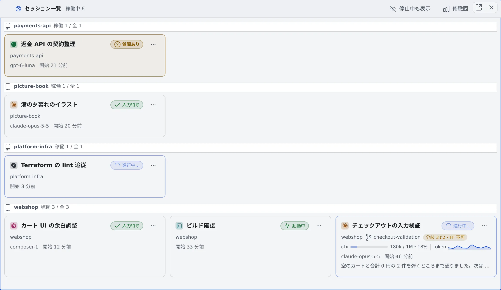
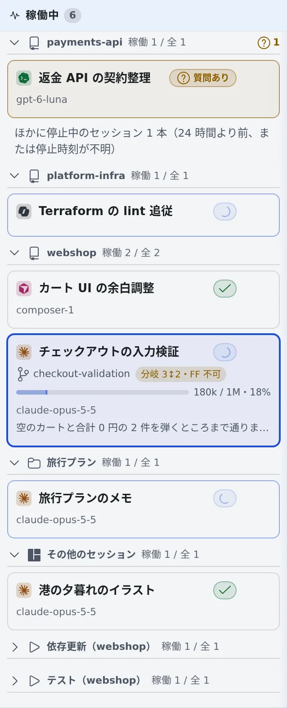

# セッションをカードで見る

[English](overview.md) | 日本語

「**セッション一覧**」を開くと、セッションの状態をカードで確認できます。返事を待っているセッションには色が付きます。
停止したセッションも見たいときは、ヘッダーの「**停止中も表示**」をオンにします。

## 全体像

| あなたがやること | 画面に出ること |
|---|---|
| セッション一覧を開く | 動いているセッションが、リポジトリごとの見出しの下にカードで並ぶ |
| カードを眺める | 状態・ブランチ・コンテキスト・モデル・最後に言ったことがカードに出る。質問・プラン・許可を待つカードは色が付く |
| カードをクリックする | そのセッションが一覧の隣に開く。一覧はそのまま残る |

## 開く

次のどれかで開きます。

- アクティビティバー（左端のアイコンの列）の足元にある「**セッション一覧**」
- リーダーキー `g s` または `s l`

一覧は普通のペインです。分割やタブにでき、別のブラウザタブへ切り離せて、再読み込みしても残ります。
スマホでは、**≡** で左ペインを出すとアクティビティバーに届きます。

## カードを読む

| 場所 | 出るもの |
|---|---|
| 左上 | エージェントの種類を示す色付きアイコンと、セッション名 |
| 右上 | 状態（入力待ち・進行中…・質問あり・停止中など） |
| 2 行目 | プロジェクトとブランチ。親との差分（「親+2・FF 可」「未取込 3」など。左ペインのリポジトリの行と同じ見方） |
| 3 行目 | コンテキストの使用量と、返答ごとのトークン消費のグラフ（チャット画面と同じ帯） |
| 4 行目 | 最後に答えたモデル、「開始 …」、待ちになってからの経過（「待ち …」、答えたあとは「応答から …」） |
| いちばん下 | そのセッションが最後に言ったことの冒頭。マウスを重ねると全文が出る |

- 待ちの経過時間は、通知と、このブラウザで見た記録から計算します。どちらにも記録がないときは出ません
- まだ何も言っていないセッションには、いちばん下の行が出ません。停止したセッションには出ます

## 並び方

- **見出しはリポジトリごと**です。ベースの作業コピーも worktree も、別のフォルダ名でクローンしたものも、取得元の URL が同じなら同じ見出しに入ります
- 作業コピーで動いていないセッションは、末尾の「その他のセッション」に入ります。見出しはプロジェクト名の順で、動きません
- **見出しの中は親子関係ごと**に並びます。あるセッションから起動したセッション（引き継ぎ・子セッション）は、親のすぐ下に起動した順で並びます。停止した子も親の下に残ります
- 親子関係の順は、あなたの返事を待っているセッションを含む親子関係が先頭、次に動いている親子関係の新しい順、最後に停止中だけの親子関係です
- 順番が入れ替わるのは、親子関係が待ちに入ったときと待ちから出たときだけです。親子関係が割れることはありません
- 見出しの「稼働 N / 全 M」は、その見出しで動いている数と全体の数です

## 見るものを絞る

| やりたいこと | 操作 |
|---|---|
| 停止したセッションも並べる | ヘッダーの「**停止中も表示**」。停止したカードは薄く出ます。この切り替えはペインごとに覚えます |
| 子セッションを隠す | 親のカードの「**子セッションを畳む**」。隠した本数が「＋N」で出ます（何段下でも数えます）。戻すときは「**子セッションを開く**」 |
| 案件ごとに絞る | 左ペインの作業グループを切り替えると、一覧も同じように絞られます（[作業グループで絞り込む](working-sets.ja.md)） |
| 時間の流れで見る | ヘッダーの「**俯瞰図**」を押すと、同じペインがフリート俯瞰図に切り替わります（[セッションのつながりを時系列で見る](graph.ja.md)） |

## カードから操作する

- **クリック**すると、そのセッションが一覧の隣のペインに開きます。すでに開いているセッションなら、そのペインに移ります
- **Ctrl（⌘）＋クリック**か**中クリック**は、画面の広さによらず別のペインに開きます
- **右クリック・⋯ ボタン・Menu キー**で、左ペインの行と同じメニューが出ます。停止・名前の変更・引き継ぎ・共有・アーカイブなどです

### スマホで使う

- 隣のペインがないので、タップしたセッションはそのペインに開きます。一覧へはデバイスの戻るボタンで戻ります
- 「停止中も表示」の切り替えは、戻ってもそのままです
- タブ表示にしているときは、タップすると新しいタブで開き、一覧はタブとして残ります

## 左ペインで見る：「稼働中」ビュー

アクティビティバーの「**稼働中**」は、同じカードを左ペインに並べます。メイン領域のペインは使いません。
稼働中のセッション、最近止まったセッション、あなたの対応がまだ要るセッションを並べます。

| 見えるもの | 意味 |
|---|---|
| 見出し | リポジトリ、スペース、「その他のセッション」の順で、最後に自動実行キューと「**スケジュール**」（下）。並べるセッションがあるあいだだけ出ます。どの見出しも押して畳めて、畳んだ状態はこのブラウザが覚えます。畳んだ見出しには、全体のうち稼働中の本数と、そのうち回答を待っている本数が出ます |
| **起動** と隣の ▼ | 「リポジトリ」の行と同じ分割ボタンが、リポジトリの見出しにあります。見出しを畳んだままでも使えます。**起動** はベースの作業コピーからリポジトリの起動画面を開き、▼ はエージェントの一覧から選んで、プロンプトなしですぐに起動します（行の ▼ と同じです）。経路など起動画面でしか選べないものが要るエージェントは、起動画面をそのエージェントで開きます。同じリモートのクローンが複数ある場合は、どちらの操作でも先に使うフォルダを選びます。ワークスペースが停止中か、ベースの作業コピーが見つからないときは、どちらも押せません |
| 自動実行キューと「**スケジュール**」 | 稼働中の無人の実行と、その子セッションが並びます。メモの自動実行はキューごとに見出しが付き、「自動実行」ビューと同じ「リポジトリ名 / カテゴリ名」で表示されます。同じリポジトリ内ではカテゴリの順に並びます。レビューや補助のセッションも親の実行と同じ見出しに出ます。キューが分からない実行（カテゴリが記録されていない以前の実行や、設定が削除されたキューの実行）は「**その他の実行**」（リポジトリ名の付かない見出し）にまとまり、スケジュールの実行は「**スケジュール**」にまとまります。どの見出しも最初は畳まれています |
| カード | 稼働中のセッション、過去 24 時間以内に止まったセッション、質問・プラン・権限確認への返答や引き継ぎの受け取りを待つ停止中のセッションです。対応待ちのものは止まった時刻にかかわらず並びます。並んだセッションの子も、停止中のものを含めて並びます。親と見出しが同じなら親の下に、別のリポジトリやスペースにあるならそちらの見出しに出ます |
| 親のカード | 同じ見出しにある子セッションを畳んだ状態で始まります。「＋N」は隠している本数、疑問符の付いた数はそのうち稼働中であなたの回答を待っている本数です。左端の矢印で開閉でき、開いた親はこのブラウザが覚えます |
| ペイン番号 | 画面を分割しているあいだ、そのセッションを出しているペインの番号。押すとそのペインに移ります |

- クリックすると、いまいるペインにセッションが開きます。**Ctrl（⌘）＋クリック**か**中クリック**は別のペインに開きます
- 見出しを開くと、24 時間より前に止まったか、停止時刻が不明でカードに出ていないセッションの数が、カードの下に出ます。それらは「**セッション**」で確認できます
- カードにはプロジェクト名（見出しにあります）、トークンのグラフ、開始時刻は出ません。メニューは同じです
- 「**稼働中**」のアイコンの数字は、稼働中であなたの回答を待っているセッションの本数です。質問に答えないまま停止したセッションは数えません。自動実行キューと「**スケジュール**」のグループの中で待っているセッションも数えません（「**自動実行**」のアイコンの数字は別で、回答を待っている実行の数です。実行ごとに 1 で、その実行のセッションが何本待っていても 1 と数えます）。このアイコンを出しているあいだ、「**セッション**」のアイコンは同じ数字を出しません。「**稼働中**」のアイコンを非表示にすると、数字は「**セッション**」に戻ります
- シェルと SSM セッションは「**ターミナル**」に出ます。メモの自動実行とスケジュールの実行は、それぞれ「**自動実行**」「**スケジュール**」のビューに出るほか、動いているあいだはこのビューの末尾にも出ます。例外は「**セッション一覧にも表示**」にしたスケジュールで、その実行が始めた worktree のセッションは通常の見出しの下に 1 回だけ並び、「**スケジュール**」のグループには出ません（「**スケジュール**」ビューには従来どおり出ます）
- 作業グループは、ほかのビューと同じくこのビューも絞ります
- ワークスペースが停止しているあいだ、このビューに並ぶものはありません

## 関連

- [セッションの状態を確認する](../sessions/status.ja.md)：状態の印の意味
- [セッションのつながりを時系列で見る](graph.ja.md)
- [アイコン・バッジ・メニュー](../../ref/console-ui.ja.md)：メニューの項目の一覧
