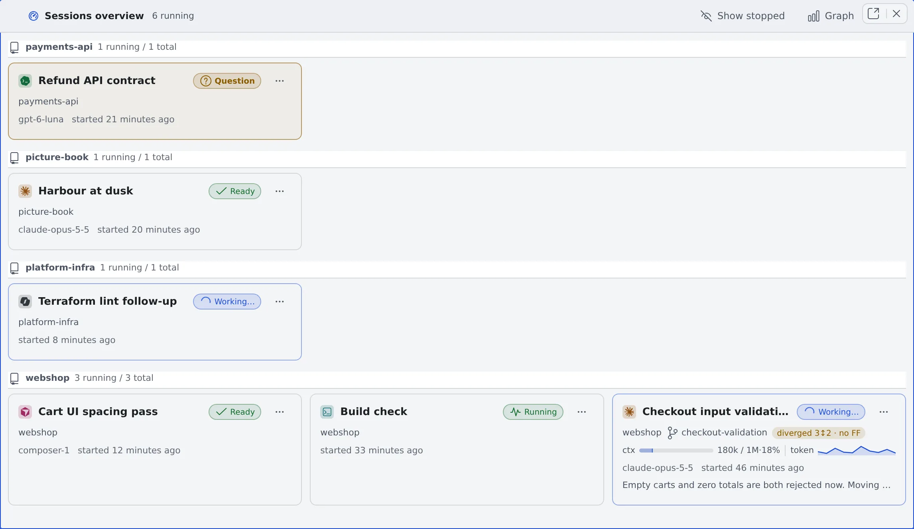

# See every running session

English | [日本語](overview.ja.md)

The sessions overview lays out your running sessions as cards, one per session.
A session waiting for your answer stands out even from across the room.

## How it works

| What you do | What appears on screen |
|---|---|
| Open the sessions overview | Running sessions appear as cards under one heading per repository |
| Look over the cards | Each card shows the state, branch, context, model and the last thing the session said. Cards waiting on a question, a plan or a permission are tinted |
| Click a card | The session opens beside the overview, which stays where it is |

## Open it

Use any of these:

- **Sessions** on the action bar (next to Split right, Split down and Close all)
- The same button in the layout diagram at the top of the left pane
- The leader keys `g s` or `s l`

The overview is an ordinary pane: split it, put it in a tab, detach it to another browser tab, and it survives a reload.
On a phone, **Sessions** may sit inside the **⋯** on the action bar.

## Read a card

| Where | What it shows |
|---|---|
| Top left | The coloured icon of the agent kind, and the session's name |
| Top right | The state (Idle, Working, Has a question, Stopped and so on) |
| Second line | Project and branch. The difference from the parent ("parent +2 · FF ok", "unmerged 3" and so on, read the same way as the repository row in the left pane) |
| Third line | Context in use, and a graph of the tokens each reply used (the same strip as in the chat view) |
| Fourth line | The model that answered last, "started …", and how long it has been waiting ("waiting …", or "… since your reply" once you answered) |
| Bottom | The opening of the last thing the session said. Hover for the whole text |

- The waiting time is worked out from notifications and from what this browser saw. When neither has a record, it does not show
- A session that has said nothing yet has no bottom line. A stopped session still has one

## How cards are ordered

- **One heading per repository.** The base working copy, its worktrees and a clone under another folder name share a heading when they were cloned from the same URL
- Sessions that do not run in a working copy go under "Other sessions" at the end. Headings are in project-name order and do not move
- **Inside a heading, cards are grouped by family.** A session started from another session (a handoff, a child session) sits right under its parent, in the order they were started. A stopped child stays under its parent
- Families are ordered with those containing a session waiting for you first, then the other running families newest first, then the families with only stopped sessions
- The order changes only when a family starts or stops waiting. A family is never split
- A heading's "N running / M total" counts the running sessions and all of them

## Narrow what you see

| To do this | Use |
|---|---|
| Show stopped sessions too | **Show stopped** in the header. Stopped cards are dimmed. Each pane remembers this |
| Hide child sessions | **Collapse child sessions** on the parent's card. The number hidden shows as "+N" (however many levels down). **Expand child sessions** brings them back |
| Narrow to one piece of work | Switch the working set in the left pane, and the overview narrows the same way ([Narrow the view with working sets](working-sets.md)) |
| See the timeline | **Graph** in the header turns the same pane into the fleet graph ([See how sessions relate over time](graph.md)) |

## Act from a card

- **Click** to open the session in a pane beside the overview. If it is already open, focus moves to that pane
- **Ctrl (⌘)-click** or **middle-click** opens it in another pane, whatever the screen size
- **Right-click, the ⋯ button or the Menu key** opens the same menu as the session's row in the left pane: stop, rename, hand off, share, archive and so on

### On a phone

- There is no pane beside it, so a tapped session opens in the same pane. Your device's back button returns to the overview
- The Show stopped switch is kept when you come back
- In tab layout, a tap opens a new tab and the overview stays as a tab

## Related

- [Read a session's state](../sessions/status.md): what the state marks mean
- [See how sessions relate over time](graph.md)
- [Icons, badges and menus](../../member/badges-and-menus.md): every menu item
