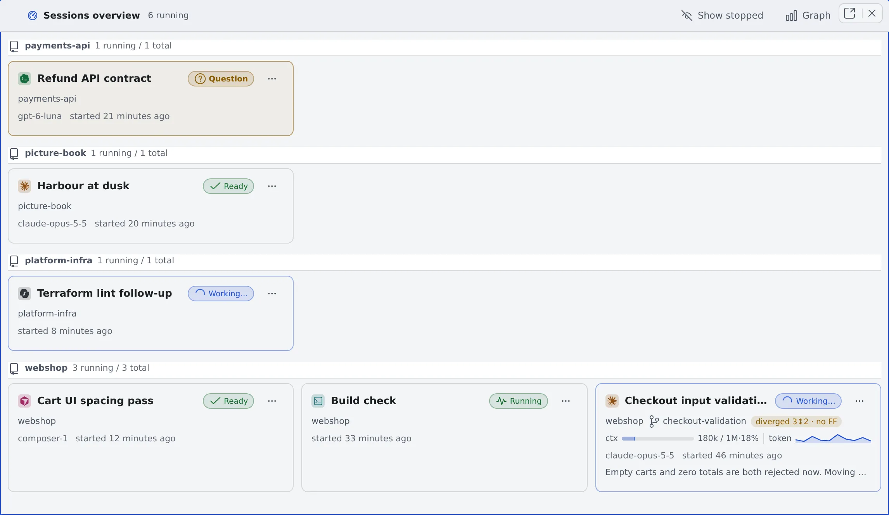

# View sessions as cards

English | [日本語](overview.ja.md)

Open **"Sessions overview"** to check session states on cards. Cards for sessions waiting for your answer are tinted.
To include stopped sessions, turn on **"Show stopped"** in the header.

## How it works

| What you do | What appears on screen |
|---|---|
| Open the sessions overview | Running sessions appear as cards under one heading per repository |
| Look over the cards | Each card shows the state, branch, context, model and the last thing the session said. Cards waiting on a question, a plan or a permission are tinted |
| Click a card | The session opens beside the overview, which stays where it is |

## Open it

Use any of these:

- **Sessions overview** at the foot of the activity bar (the column of icons at the left edge)
- The leader keys `g s` or `s l`

The overview is an ordinary pane: split it, put it in a tab, detach it to another browser tab, and it survives a reload.
On a phone, open the left pane with **≡** to reach the activity bar.

## Read a card

| Where | What it shows |
|---|---|
| Top left | The coloured icon of the agent kind, and the session's name |
| Top right | The state (Idle, Working, Has a question, Stopped and so on) |
| Second line | Project and branch. The difference from the parent ("parent +2 · FF ok", "unmerged 3" and so on, read the same way as the repository row in the left pane) |
| Third line | Context in use, and a graph of the tokens each reply used (the same strip as in the chat view) |
| Fourth line | The model that answered last, "started …", and how long it has been waiting ("waiting …", or "… since your reply" once you answered) |
| Bottom | The opening of the last thing the session said. Hover for the whole text |

- The waiting time is worked out from notifications and from what this browser saw. When neither has a record, it does not show
- A session that has said nothing yet has no bottom line. A stopped session still has one

## How cards are ordered

- **One heading per repository.** The base working copy, its worktrees and a clone under another folder name share a heading when they were cloned from the same URL
- Sessions that do not run in a working copy go under "Other sessions" at the end. Headings are in project-name order and do not move
- **Inside a heading, cards are grouped by family.** A session started from another session (a handoff, a child session) sits right under its parent, in the order they were started. A stopped child stays under its parent
- Families are ordered with those containing a session waiting for you first, then the other running families newest first, then the families with only stopped sessions
- The order changes only when a family starts or stops waiting. A family is never split
- A heading's "N running / M total" counts the running sessions and all of them

## Narrow what you see

| To do this | Use |
|---|---|
| Show stopped sessions too | **Show stopped** in the header. Stopped cards are dimmed. Each pane remembers this |
| Hide child sessions | **Collapse child sessions** on the parent's card. The number hidden shows as "+N" (however many levels down). **Expand child sessions** brings them back |
| Narrow to one piece of work | Switch the working set in the left pane, and the overview narrows the same way ([Narrow the view with working sets](working-sets.md)) |
| See the timeline | **Graph** in the header turns the same pane into the fleet graph ([See how sessions relate over time](graph.md)) |

## Act from a card

- **Click** to open the session in a pane beside the overview. If it is already open, focus moves to that pane
- **Ctrl (⌘)-click** or **middle-click** opens it in another pane, whatever the screen size
- **Right-click, the ⋯ button or the Menu key** opens the same menu as the session's row in the left pane: stop, rename, hand off, share, archive and so on

### On a phone

- There is no pane beside it, so a tapped session opens in the same pane. Your device's back button returns to the overview
- The Show stopped switch is kept when you come back
- In tab layout, a tap opens a new tab and the overview stays as a tab

## In the left pane: the Active view

**Active** in the activity bar shows the same cards in the left pane, without using a pane of the main area.
It lists running sessions, recent stops and sessions that still need your attention.

| What you see | What it means |
|---|---|
| Headings | Repositories first, then spaces, then "Other sessions", and last the auto-run queues and **Schedules** (below). A heading appears only while it has a session to list. Every heading folds; press it to fold or open, and this browser remembers which you folded. A folded heading shows how many sessions are running out of the total, and how many of them wait for your answer |
| Auto-run queues and **Schedules** | Running unattended runs and their child sessions. Each memo queue has a heading showing its repository (if set) and category, in category order within each repository. Reviewers and other child sessions stay with their run. Older runs without a category appear under **Auto-run**. Scheduled runs appear under **Schedules**. Each heading starts folded |
| Cards | Running sessions, sessions that stopped within the last 24 hours, and stopped sessions with an unanswered question, plan or permission request, or an untaken handoff. The last group stays listed regardless of stop time. Listed sessions also bring along their child sessions, including stopped ones. A child appears under its parent within the same heading, or under its own repository or space heading |
| A parent's card | Starts with the child sessions under the same heading folded. "+N" is how many it hides; the number with the question mark is how many of those are running and wait for your answer. The arrow at the left opens and folds them, and this browser remembers which you opened |
| Pane numbers | The panes that show the session, while the screen is split. Click a number to go to that pane |

- A click opens the session in the pane you are in. **Ctrl (⌘)-click** or **middle-click** opens it in another pane
- An expanded group shows a count below its cards for other sessions that stopped more than 24 hours ago or have no recorded stop time. Find those sessions in **Sessions**
- The card leaves out the project name (the heading has it), the token graph and the start time. The menu is the same
- The number on the **Active** icon is how many running sessions wait for your answer; a stopped session with an unanswered question is not counted, and neither are the waiting sessions inside the auto-run queue and **Schedules** groups. (The **Auto-run** icon has its own number: how many runs wait for your answer, one per run however many of its sessions wait.) While that icon is shown, the **Sessions** icon does not repeat the number. Turn the **Active** icon off and the number is on **Sessions** again
- Shells and SSM sessions are in **Terminals**. Runs of memo auto-run and scheduled runs are in their own views, **Auto-run** and **Schedules**, and also under their headings at the end of this view while they are running. A schedule set to **Also show in the Sessions view** is the exception: the worktree sessions its runs start are listed under the ordinary headings, once, and not in the **Schedules** group (they are in the **Schedules** view as before)
- A working set narrows this view like the others
- While the workspace is stopped, the view has nothing to list

## Related

- [Read a session's state](../sessions/status.md): what the state marks mean
- [See how sessions relate over time](graph.md)
- [Icons, badges and menus](../../ref/console-ui.md): every menu item
