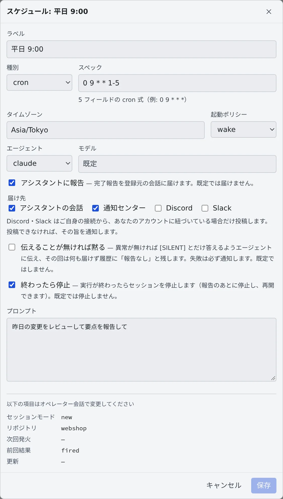

# 決まった時刻に実行する

[English](schedules.md) | 日本語

フリート・オペレーターに「毎平日 9 時に昨日の変更をレビューして」のように頼むと、決まった時刻にエージェントが作業する**スケジュール**ができます。
ワークスペースが止まっていても起こして実行し、結果を報告します。

## 全体像

| あなたがやること | エージェントがやること |
|---|---|
| オペレーターに、いつ・何をするかを頼む | スケジュールとして登録し、解釈した日時と次の実行日時を確かめてくる |
| 左ペインの「スケジュール」で、一覧と実行履歴を見る | 時刻になると、止まっているワークスペースも起こしてプロンプトを実行する |
| 報告の届け先や、終わったあとの扱いを選ぶ | 結果を選んだ届け先に送る。失敗したときは通知センターに出す |

## 登録する

[フリート・オペレーター](operator.ja.md) の会話で頼みます。

> 毎平日 9 時に、昨日の変更をレビューして要点を報告して

> 6 時間ごとに依存パッケージの脆弱性を確かめて

- 決まった時刻（cron）・一定の間隔・1 回だけ、のどれでも登録できます。タイムゾーンと夏時間にも対応します
- 登録のときに、オペレーターが解釈したスケジュールと次の実行日時を確かめてきます。意図とずれていないか見てください
- 既定では、毎回新しいセッションで実行します。「同じセッションを使い回して文脈を積み上げて」と頼めば、同じセッションを使い続けます。何回ごと・どのくらいの期間ごとに作り直すかも決められます

## 一覧と実行履歴を見る

左ペインの「**スケジュール**」に、登録したスケジュールが並びます。行を開くと実行履歴が出ます。

| 実行履歴に出るもの | 中身 |
|---|---|
| 結果 | 「成功」「失敗」「スキップ」「成功（報告なし）」 |
| きっかけ | 「定時」か「手動」 |
| セッション | 実行したセッション。押すとそのセッションが開く |

行の ⋯ メニュー（右クリックでも開きます）で、次の操作ができます。

| メニュー | すること |
|---|---|
| 詳細・編集 | 中身を見て、書き換える |
| 一時停止・再開 | 止めている間は、行に「**停止中**」と出る |
| 今すぐ発火 | 時刻を待たずに 1 回実行する |
| 削除 | スケジュールを消す |

実行したセッションの会話には、「**定時実行**」か「**手動発火**」のバッジが付きます。あなたが打った指示とは混ざりません。

## 中身を書き換える

行の ⋯ メニューから「**詳細・編集**」を開きます。

| 項目 | 中身 |
|---|---|
| ラベル | 一覧に出る名前 |
| 種別・スペック | cron なら 5 フィールドの式（`0 9 * * 1-5`）、間隔なら秒数（`3600` で 1 時間）、1 回だけなら ISO 8601 の日時 |
| タイムゾーン | スペックを読むタイムゾーン |
| 起動ポリシー | `wake`（既定）と `catch_up` は、止まっているワークスペースを起こして実行する。`skip` は起こさずに、その回を「スキップ」にする |
| エージェント・モデル | 実行するエージェントと、そのモデル |
| アシスタントに報告 | 完了の報告を届ける。既定では届けない |
| 届け先 | 報告をどこへ届けるか（次の節） |
| 伝えることが無ければ黙る | 異常がなければ何も届けない（次の節） |
| 終わったら停止 | 実行が終わったらセッションを止める |
| プロンプト | 毎回送る本文 |

セッションモード・再利用ターゲット・ローテーション・重複ポリシーなどは、この画面では変えられません。オペレーターの会話で頼みます。

## 報告の届け先を選ぶ

「**アシスタントに報告**」をオンにすると、「**届け先**」を組み合わせて選べます。

| 届け先 | 届くもの |
|---|---|
| アシスタントの会話（既定） | 登録した会話に、完了の報告が届く |
| 通知センター | 通知として届く |
| Discord・Slack | スケジュール名の見出しの下に、実行の回答を投稿する。接続が全文モードでなくても載る |

- Discord・Slack に投稿するのは、あなた自身の接続が、そのサービスのあなたのアカウントに紐づいていて（返信やボタン操作と同じ紐づけ）、通知をオフにしていないときだけです
- 投稿できなかったときは、どの接続に届かなかったかを添えて通知センターに出します
- 届け先を選んだスケジュールの実行は、選んだ先にだけ届きます。ふだんの「返答が届きました」の写しを、すべてのチャット接続へ送ることはしません

## 伝えることがなければ黙らせる

「夜間ジョブを確かめて、失敗があったときだけ教えて」のような見張りのスケジュールでは、「**伝えることが無ければ黙る**」をオンにします。

- エージェントには、異常がなければ `[SILENT]` とだけ答えるよう伝えます。そう答えた回は、報告も通知もチャットへの投稿も届きません
- 実行履歴には「**成功（報告なし）**」と残ります
- 判定は回答全体で行います（前後の空白を除き、大文字と小文字を区別します）。長い回答の中に `[SILENT]` が入っていても、ふだんどおり届けます
- **失敗は黙りません。** エラー・中断・異常終了した回は、届け先の設定にかかわらず通知センターに出ます

届け先と `[SILENT]` は、セッションを動かすスケジュールが対象です。アシスタントの会話そのもので動くスケジュールは、実行が会話の 1 ターンなので対象外です。

## 終わったら止める

「**終わったら停止**」をオンにすると、実行が終わったところでセッションが止まります。オペレーターに頼むときは `stop_after_run` です。

- 報告が先で、止めるのはそのあとです。止めたセッションは再開できます
- 誰も見ていない時刻に起きたセッションが、そのあともメモリを使い続けるのを防げます
- ワークスペース自体が止まる時刻は変わりません。作業を終えたセッションは、もともとアイドルの自動停止を妨げないためです

## 作業項目のクエリに新しい結果があるときだけ動かす

「`agent` ラベルの付いた課題があれば拾う」のように、たいていは何も見つからずに終わるスケジュールは、保存済みの作業項目クエリで **ゲート** を掛けられます。「**詳細・編集**」の「**ゲート**」で「**保存済みクエリの結果が変わった時だけ実行する**」をオンにします。

- 時刻が来るたびに、まずクエリを確認します。クエリに一致があり、その結果が前回ゲートが発火したときと違うときだけ、セッションを起動します
- 「**再び発火する条件**」で、何を「違う」とみなすかを選びます。「**項目の集合が変わった時**」か「**集合が変わるか、項目が更新された時**」です。クエリやこの選択を変えると、前回発火した内容の記録は破棄されます
- 「**1 日あたりの発火上限**」と「**発火間隔の下限（秒）**」で、変わり続ける結果での発火を抑えます。空欄なら既定値（1 日 2 回、6 時間）です
- 確認のために停止中のワークスペースを起こすことはなく、確認に失敗した回はセッションを起動しません。「**今すぐ実行**」はゲートを通さずに動きます
- ゲートの下の行に、最後に確認した時刻と判定が出ます。確認に失敗すると、実行履歴に「**ゲートの確認に失敗**」と出て、一度だけ通知します
- ゲートを掛けられるのは、毎回新しいセッションを起動する繰り返しのスケジュール（cron か間隔）です。クエリは、左ペインの「**課題管理**」にある自分の「**保存したクエリ**」に限ります（[課題管理サービスを接続する](../integrations/issue-tracker.ja.md)）

## 困ったとき

### 時刻になっても実行されない

- 行に「**停止中**」と出ていたら、一時停止しています。⋯ メニューの「**再開**」で戻します
- 実行履歴が「**スキップ**」なら、起動ポリシーが `skip` で、ワークスペースが止まっていました
- ワークスペースの起動や実行に失敗したときは、通知センターに出ます

## 関連

- [フリート・オペレーターに任せる](operator.ja.md)
- [Discord・Slack とつなぐ](../integrations/chat-bridge.ja.md)
- [終わったら止める・起こしたままにする](../sessions/auto-stop.ja.md)
