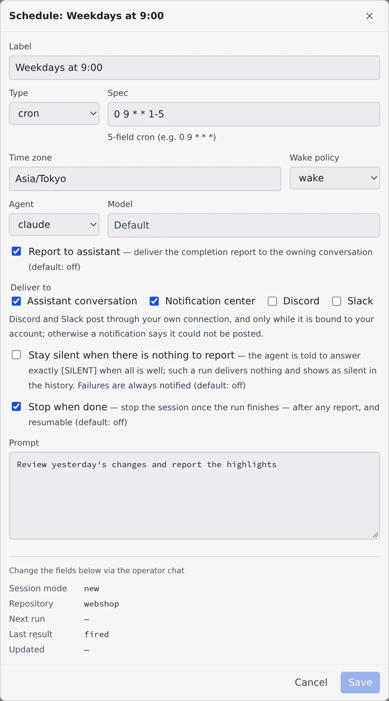

# Run at a set time

English | [日本語](schedules.ja.md)

Ask the Fleet Operator something like "every weekday at 9, review yesterday's changes", and you get a **schedule**: an agent works at the set time.
It wakes the workspace if it is stopped, runs, and reports the result.

## How it works

| What you do | What the agent does |
|---|---|
| Tell the operator when and what | Registers it as a schedule and confirms how it read the time and when it runs next |
| See the list and run history under Schedules in the left pane | At the set time, wakes a stopped workspace too and runs the prompt |
| Choose where reports go and what happens afterwards | Sends the result where you chose. A failure goes to the notification center |

## Register a schedule

Ask in a [Fleet Operator](operator.md) conversation.

> Every weekday at 9, review yesterday's changes and report the highlights

> Check dependency advisories every 6 hours

- A set time (cron), a fixed interval or a single run can all be registered. Time zones and daylight saving time are handled
- When registering, the operator confirms how it read the schedule and when it runs next. Check that it matches what you meant
- By default each run uses a new session. Ask it to "reuse the same session and build on the context" and it keeps one session going. You can also say how many runs or how long before it is recreated

## See the list and run history

**Schedules** in the left pane lists your schedules. Open a row for its run history.

| In the run history | What it shows |
|---|---|
| Result | "Success", "Failed", "Skipped" or "Success (silent)" |
| Trigger | "Scheduled" or "Manual" |
| Session | The session that ran it. Click to open it |

The row's ⋯ menu (also opened with a right-click) offers:

| Menu | What it does |
|---|---|
| Details / edit | Shows and changes what the schedule does |
| Pause, Resume | While paused, the row shows **Paused** |
| Run now | Runs it once without waiting for the time |
| Delete | Removes the schedule |

The conversation of a session it ran carries a **Scheduled** or **Manual fire** badge, so it is not mixed up with what you typed.

## Change what it does

Open **Details / edit** from the row's ⋯ menu.

| Field | What it holds |
|---|---|
| Label | The name shown in the list |
| Type, Spec | For cron, a 5-field expression (`0 9 * * 1-5`); for an interval, seconds (`3600` is one hour); for a single run, an ISO 8601 date and time |
| Time zone | The time zone the spec is read in |
| Wake policy | `wake` (the default) and `catch_up` wake a stopped workspace and run. `skip` leaves it stopped and records the run as "Skipped" |
| Agent, Model | The agent that runs it, and its model |
| Report to assistant | Sends a completion report. Off by default |
| Deliver to | Where the report goes (next section) |
| Stay silent when there is nothing to report | Sends nothing when all is well (see below) |
| Stop when done | Stops the session when the run is done |
| Prompt | The text sent each time |

Session mode, reuse target, rotation, overlap policy and the like cannot be changed here. Ask the operator in its conversation.

## Choose where reports go

With **Report to assistant** on, combine the targets under **Deliver to**.

| Target | What arrives |
|---|---|
| Assistant conversation (the default) | The completion report, in the conversation that registered it |
| Notification center | A notification |
| Discord, Slack | The run's answer, posted under a heading with the schedule's name, even when the connection is not in full-text mode |

- It posts to Discord or Slack only through your own connection, linked to your account on that service (the same link replies and buttons use), and only when you have not turned its notifications off
- When it cannot post, the notification center says which connection it did not reach
- A run with chosen targets goes only there. It does not also send the usual "answer arrived" copy to every chat connection

## Stay silent when there is nothing to report

For a watching schedule such as "check the nightly jobs and tell me only if something failed", turn on **Stay silent when there is nothing to report**.

- The agent is told to answer just `[SILENT]` when all is well. A run that answers that sends no report, no notification and no chat post
- The run history records "**Success (silent)**"
- The whole answer is compared (leading and trailing space removed, case-sensitive). A long answer that contains `[SILENT]` is delivered as usual
- **Failures are never silent.** A run that errored, was interrupted or exited abnormally goes to the notification center whatever the targets

Targets and `[SILENT]` apply to schedules that drive a session. A schedule that runs in an assistant conversation is itself a turn of that conversation, so they do not apply.

## Stop when done

With **Stop when done** on, the session stops when the run is done. Asking the operator, it is `stop_after_run`.

- The report comes first and the stop after it. The stopped session can be resumed
- A session woken at an hour nobody is watching does not keep holding memory afterwards
- When the workspace itself stops does not change: a session that has finished its work already does not hold off the idle auto-stop

## Run only when a work item query has something new

A schedule that would otherwise wake an agent just to find nothing (for example "pick up any issue labelled `agent`") can be **gated** on one of your saved work item queries. In **Details / edit**, turn on **Run only when a saved query has a new result** under **Gate**.

- On each due tick the query is checked first. A session starts only when the query matches something and the result differs from the one the gate last fired on
- **Fires again when** chooses what counts as different: **the set of items changes**, or **the set changes or an item is updated**. Changing the query or this choice forgets what the gate last fired on
- **Fires per day (max)** and **Gap between fires (min, seconds)** hold back a result that keeps changing. Blank means the defaults (2 per day, 6 hours)
- A stopped workspace is not woken to check, and a check that fails does not start a session. **Run now** ignores the gate
- The line under the gate shows when it was last checked and what it decided. A failed check shows **Gate check failed** in the run history and is notified once
- A gate needs a recurring schedule (cron or interval) that starts a new session each time. The query has to be one of your own **Saved queries** under the left rail's **Issue tracker** ([Connect an issue tracker](../integrations/issue-tracker.md))

## When it goes wrong

### It did not run at the set time

- If the row shows **Paused**, it is paused. **Resume** in the ⋯ menu brings it back
- If the run history says "**Skipped**", the wake policy is `skip` and the workspace was stopped
- When starting the workspace or the run fails, the notification center says so

## Related

- [Hand work to the Fleet Operator](operator.md)
- [Connect Discord and Slack](../integrations/chat-bridge.md)
- [Stop when done, or keep a session awake](../sessions/auto-stop.md)
