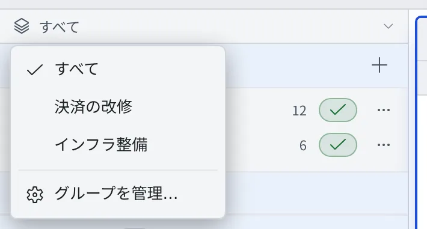

# 作業グループで絞り込む

[English](working-sets.md) | 日本語

リポジトリ・会話・セッション・スケジュールを案件ごとにまとめておくと、左ペインに今の案件のものだけを出せます。
中身が移動したり複製されたりはしません。変わるのは見え方だけです。

## 全体像

| あなたがやること | 画面に出ること |
|---|---|
| グループを作る | 新しいグループに切り替わる。まだ何も入っていない |
| 行のメニューでグループに割り当てる | worktree・セッション・スケジュールは、もとのリポジトリや会話について自動で入る |
| 左ペイン最上部のバーで切り替える | 左ペインとセッション一覧が、そのグループのものだけになる |

## グループを作る

1. 左ペイン最上部のバー（最初は「**すべて**」）を押します
2. 「**グループを管理…**」を選びます
3. 「新しいグループ名」に名前を入れて「**作成**」を押します

作ったグループにそのまま切り替わるので、続けて割り当てに進めます。
名前の変更と「**グループを削除**」も同じ画面で行います。グループを削除しても、中身（リポジトリ・会話・セッション）は消えません。

## グループに割り当てる

行を右クリックするか ⋯ メニューを開き、「作業グループ」の下のグループ名を選びます。もう一度選ぶと外れます。

| 割り当てられる行 | 一緒に入るもの |
|---|---|
| ベースのリポジトリ | その worktree、そこで動くセッション、そのリポジトリで動くスケジュール |
| 会話 | その会話から登録したスケジュール |
| リポジトリに属さないセッション（shell など） | なし |
| スケジュール | なし |

- 一緒に入ったものはチェック済みで表示され、その行では外せません。もとのリポジトリや会話を外すと外れます
- グループを選んでいる間にクローンしたリポジトリや、始めた会話は、そのグループに入ります

## 切り替える

- 左ペイン最上部のバーで選びます。「すべて」に戻すと、絞り込みが外れます
- キーボードでは、リーダーキー `w w` か Alt+G で順に切り替わります
- バーはスクロールしても残ります。セッションが見当たらないときは、まずどのグループを見ているかを確かめてください

## 知っておくこと

- グループの定義はあなた個人のもので、ほかの端末にも同じものが出ます。ほかのメンバーには共有されません
- どのグループを見ているかは、端末ごとに覚えます。PC とタブレットで別の案件を見ていられます
- セッション一覧も、左ペインと同じグループで絞られます（[動いているセッションを一覧する](overview.ja.md)）

## 関連

- [動いているセッションを一覧する](overview.ja.md)
- [リポジトリからセッションを起動する](../code/launch-from-repo.ja.md)
