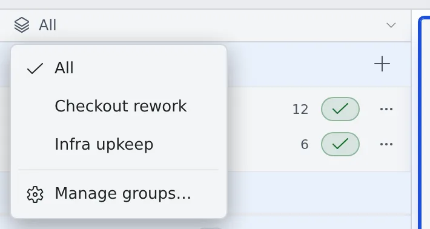

# Narrow the view with working sets

English | [日本語](working-sets.ja.md)

Group repositories, conversations, sessions and schedules by piece of work, and the left pane shows only the one you are on.
Nothing is moved or copied. Only what you see changes.

## How it works

| What you do | What appears on screen |
|---|---|
| Create a working set | You switch to the new set. It is still empty |
| Assign rows to it from their menus | Worktrees, sessions and schedules join with the repository or conversation they belong to |
| Switch with the bar at the top of the left pane | The left pane and the sessions overview show only that set |

## Create a working set

1. Press the bar at the top of the left pane (it reads **All** at first)
2. Choose **Manage groups…**
3. Type a name in "New group name" and press **Create**

You switch to the new set at once, so you can go straight on to assigning rows.
Renaming and **Delete group** are on the same screen. Deleting a group does not touch what is in it (repositories, conversations, sessions).

## Assign rows

Right-click a row or open its ⋯ menu, and choose a set under "Working sets". Choose it again to take the row out.

| Rows you can assign | What joins with it |
|---|---|
| A base repository | Its worktrees, the sessions running in them and the schedules that run in that repository |
| A conversation | The schedules registered from that conversation |
| A session outside any repository (shell and so on) | Nothing |
| A schedule | Nothing |

- What joined with another row shows as checked, and cannot be taken out from its own row. It leaves when you take out the repository or conversation it came with
- A repository you clone, or a conversation you start, while a set is selected joins that set

## Switch

- Choose a set on the bar at the top of the left pane. **All** removes the narrowing
- From the keyboard, the leader keys `w w` or Alt+G cycle through the sets
- The bar stays visible as you scroll. When a session seems to be missing, check which set you are looking at first

## Good to know

- The sets are yours alone and appear on your other devices too. Other members do not see them
- Which set you are looking at is remembered per browser, so a PC and a tablet can each show a different piece of work
- The sessions overview narrows to the same set as the left pane ([See every running session](overview.md))

## Related

- [See every running session](overview.md)
- [Launch a session from a repository](../code/launch-from-repo.md)
