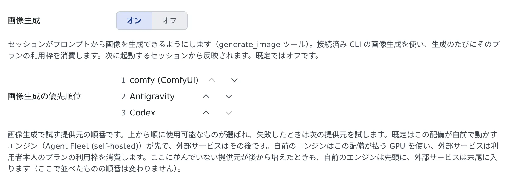

# セッションに画像を作らせる

[English](from-session.md) | 日本語

設定で画像生成をオンにすると、セッションにプロンプトで画像を作ってもらえます。
図の下絵、モックの差し替え画像、README の挿絵など、文章では渡せないものをその場で作らせるときに使います。

## 全体像

| あなたがやること | エージェントがやること |
|---|---|
| 設定で「画像生成」をオンにする | 次に起動したセッションから、`generate_image` ツールを使える |
| 描いてほしいものを頼む | プロンプトを書き、優先順位の上から順に、使える提供元で画像を作る |
| 提供元を指定する（任意） | 指定された提供元だけで作る |
| できた絵を見る | 会話にカードで出す。希望どおりにならなかった点は注記する |

## 始める前に

- この配備に画像エンジンがあるか、Codex か Antigravity の CLI を接続していること
- 使える提供元が 1 つもないときは、この機能は出ません

## オンにする

**⚙設定 →「エージェント」→「セッション」** の「**画像生成**」をオンにします。既定ではオフです。

- **次に起動するセッションから**使えます。動いているセッションは、再起動するまで変わりません
- 管理者がモデルや LoRA を有効・無効にしたときは、動いているセッションにも 1 分ほどで伝わります。再起動は要りません

### 優先順位を決める

オンにすると、「**画像生成の優先順位**」が出ます。このワークスペースから使える提供元が並び、矢印で順番を入れ替えられます。

| 行 | 提供元 | 消費するもの |
|---|---|---|
| エンジンの名前（ComfyUI か OpenAI 互換） | この配備が自前で動かすエンジン | 配備が払う GPU。あなたのプランは減りません |
| Antigravity | Antigravity の CLI | あなたの Gemini / Antigravity のプランの利用枠 |
| Codex | Codex の CLI | あなたの ChatGPT のプランの利用枠 |

- 上から順に、使えるものが使われます。**呼び出しに失敗したら次の提供元を試します**
- 既定では、配備のエンジンが先で、外部サービスはその後です
- あとから提供元が増えても、配備のエンジンは先頭に、外部サービスは末尾に入ります。あなたが並べた順番は変わりません
- ワークスペースが停止している間は、既定の並びだけが出ます

> [!IMPORTANT]
> CLI の提供元で作った画像は、1 枚ごとにそのプランの利用枠を消費します。テキストのやり取りより 3〜5 倍速く減ります。
> どのプランが減るかは順番で決まるので、片方の枠を使いたくないときは順番を入れ替えてください。

## 頼む

ふだんどおりにお願いするだけです。

> このアーキテクチャ図の下絵を 1 枚作って

> README の冒頭に置く横長の挿絵を作って。Codex で

> 同じプロンプトで、配備のエンジンと Antigravity の両方で作って見比べたい

- **提供元は指定できます。** 「Codex で」や、優先順位に出ている名前で頼むと、エージェントはその提供元を指定します
- 指定された提供元は、失敗しても次へは回りません。あなたが選んでいないサービスに課金しないためです。準備ができていないときは、その提供元のエラー（「ログインしていない」など）が返ります
- 見比べると、それぞれの提供元で 1 枚分ずつ消費します
- 何も言わなければ、優先順位に従います

### 使えるセッション

| セッション | 使える提供元 |
|---|---|
| claude・opencode などのセッション | 優先順位のすべて |
| codex のセッション | Codex 以外。Codex の絵は、codex の組み込みの画像生成で作れます |
| agy のセッション | Antigravity 以外。Antigravity の絵は、agy 自身の画像生成で作れます |
| スタジオに付けたセッション | 使えません（[スタジオで画像を仕上げる](studio.ja.md)） |

自分と同じ CLI の提供元を外すのは、同じ CLI をもう一度起動して利用枠を二重に払わないためです。使える提供元が 1 つも残らないセッションには、ツールそのものが出ません。

## 頼めること

| 指定 | 配備のエンジン | Codex | Antigravity |
|---|---|---|---|
| 寸法 | 頼めます | 希望として伝わります。違う寸法で返ることがあります | ぴったりの寸法は選べません |
| 縦横比 | 寸法で指定します | 指定できません | 1:1・2:3・3:2・3:4・4:3・9:16・16:9 |
| steps・cfg・sampler・scheduler・seed・ネガティブ・LoRA の強さ | 頼めます | — | — |
| clip skip・guidance・shift | その系統のモデルで頼めます | — | — |

- **寸法・背景・枚数は希望で、保証ではありません。** 実際に何が返ったかはエージェントに伝わります。仕上がりの寸法が大事なときは、できた絵を自分で確かめてください
- **配備のエンジン**で、省いた欄はそのモデルの公表値で描かれます。モデルの系統が読まない設定（FLUX.1 の cfg など）は、黙って捨てられず、結果に「適用されなかった」と名前つきで出ます
- **LoRA** を頼むと、ツールがアダプタごとのトリガー語をエージェントに伝え、プロンプトに入れるよう促します。トリガー語がないまま使った LoRA は、結果の注記に出ます

## できた絵を見る

- できた絵は、会話の中にカードで出ます。クリックで拡大でき、ペインでも開けます
- 希望どおりにならなかった点があれば、カードの上に、頼んだ寸法と実際の寸法が違ったことなどの注記が付きます
- カードが出るのは claude・opencode・GitHub Copilot のセッションです。ほかのセッションでは、エージェントにはファイルのパスが返り、会話に絵は出ません
- どの提供元で作ったかは、できた絵の記録に残ります

画像はセッションごとのフォルダに入り、30 日で自動的に消えます。セッションの右クリックメニューの「**生成した画像 (N)**」から、[画像ギャラリー](gallery.ja.md#セッションが作った画像を見る) で開けます。

## 安全に使う

- **プロンプトは提供元に送られます**（OpenAI・Google・または配備のエンジン）。機密を含む指示で画像を作らせないでください
- プランの利用枠を使いたくないときは、配備のエンジンを先頭に置くか、CLI の提供元を指定しないように頼みます

## 困ったとき

### セッションに画像生成のツールがない

- 「画像生成」をオンにする前に起動したセッションです。セッションを再起動してください
- スタジオに付けたセッションです。スタジオでは、ボタンを押して生成します
- そのセッションで使える提供元が 1 つもありません。配備にエンジンがなく、ほかの CLI も接続していないときに起きます

### 頼んだ寸法と違う絵ができた

Codex と Antigravity では、寸法は希望として伝わるだけです。カードの注記で、実際の寸法がわかります。寸法を決めたいときは、配備のエンジンで作ってもらってください。

### プランの利用枠が思ったより減った

CLI の提供元が使われています。優先順位で配備のエンジンを先頭に置くか、配備のエンジンを指定して頼んでください。

## 関連

- [画像を生成する](generate.ja.md)：エージェントを使わずに、まとめて絵を作る
- [スタジオで画像を仕上げる](studio.ja.md)：エージェントと話しながら下書きを直す
- [画像ギャラリーを使う](gallery.ja.md)：セッションが作った画像をまとめて見る
