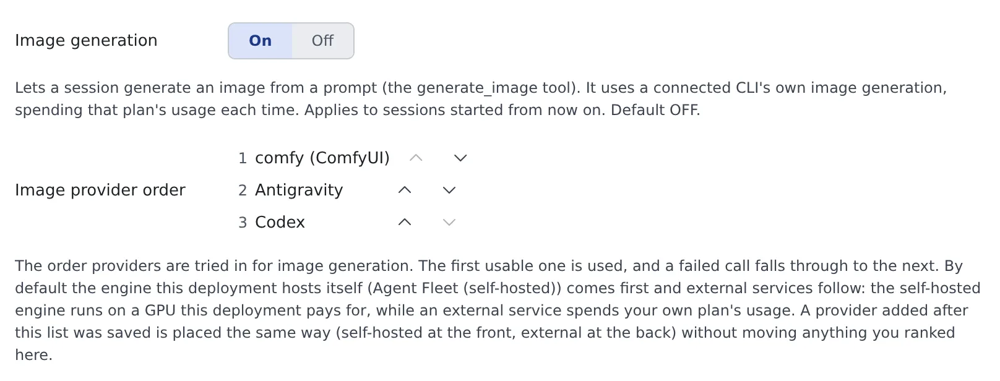

# Have a session make images

English | [日本語](from-session.ja.md)

Turn image generation on in Settings and a session makes pictures for you from a prompt.
Use it for what text cannot carry: a rough sketch for a diagram, a stand-in picture for a mock-up, an illustration for a README.

## How it works

| What you do | What the agent does |
|---|---|
| Turn "Image generation" on in Settings | Gets the `generate_image` tool in sessions started from then on |
| Ask for what you want drawn | Writes the prompt and makes the picture with the first usable provider in your order |
| Name a provider (optional) | Makes it with that provider only |
| Look at the picture | Shows it as a card in the conversation, noting anything that did not come out as asked |

## Before you start

- This deployment has an image engine, or you have connected the Codex or Antigravity CLI
- With no usable provider at all, the feature does not appear

## Turn it on

Turn on "**Image generation**" under **⚙ Settings → "Agents" → "Session"**. It is off by default.

- It applies to **sessions started from then on**. A running session stays as it is until restarted
- When an administrator enables or disables a model or a LoRA, running sessions learn of it within about a minute; no restart is needed

### Set the provider order

With it on, "**Image provider order**" appears. It lists the providers this workspace can use; reorder them with the arrows.

| Row | Provider | What it spends |
|---|---|---|
| The engine's name (ComfyUI or OpenAI-compatible) | An engine this deployment runs itself | A GPU the deployment pays for. None of your plans |
| Antigravity | The Antigravity CLI | Your Gemini / Antigravity plan's usage |
| Codex | The Codex CLI | Your ChatGPT plan's usage |

- The first usable one is used. **A failed call falls through to the next provider**
- By default the deployment's engines come first and external services after them
- A provider added later is placed the same way (deployment engines at the front, external services at the back) without moving anything you ranked
- While the workspace is stopped, only the default order is shown

> [!IMPORTANT]
> A picture made through a CLI provider spends that plan's usage, picture by picture, three to five times faster than text does.
> Which plan is spent follows the order, so if you do not want to spend one of them, move it down.

## Ask

Just ask as usual.

> Make a rough sketch for this architecture diagram

> Make a wide illustration for the top of the README. Use Codex

> I want to compare the same prompt on the deployment's engine and on Antigravity

- **You can name a provider.** Say "use Codex", or a name shown in the order, and the agent picks that provider
- A named provider does not fall through to the next one when it fails, so a service you did not choose is never charged. If it is not ready, you get its own error (not logged in, for example)
- A comparison spends one picture's worth on each provider
- Without a name, the order decides

### Sessions that can use it

| Session | Providers it can use |
|---|---|
| claude, opencode and other sessions | Everything in the order |
| A codex session | All but Codex. Codex's pictures come from codex's built-in image generation |
| An agy session | All but Antigravity. Antigravity's pictures come from agy's own image generation |
| A session attached to a studio | None ([Finish an image in the studio](studio.md)) |

A session's own CLI is left out so the same tool is not started again and its usage paid twice. A session left with no usable provider does not get the tool at all.

## What you can ask for

| Request | Deployment engine | Codex | Antigravity |
|---|---|---|---|
| Size | Yes | Passed on as a wish; a different size can come back | No exact size |
| Aspect ratio | Given through the size | No | 1:1, 2:3, 3:2, 3:4, 4:3, 9:16, 16:9 |
| steps, cfg, sampler, scheduler, seed, negative, LoRA strength | Yes | — | — |
| clip skip, guidance, shift | Yes, on a model of that family | — | — |

- **Size, background and count are wishes, not guarantees.** The agent is told what actually came back. When the finished size matters, check the picture yourself
- **On a deployment engine**, a field left out uses the model's published value. A setting the model's family does not read (cfg on FLUX.1, for example) is not silently dropped: the result names it as not applied
- **When you ask for a LoRA**, the tool gives the agent each adapter's trigger words and asks it to put one in the prompt. A LoRA used without its trigger word is noted in the result

## See the picture

- The picture appears as a card in the conversation. Click to enlarge it, or open it in a pane
- When something did not come out as asked, a note above the card says so, such as a size that differs from the one requested
- Cards appear in claude, opencode and GitHub Copilot sessions. In other sessions the agent gets the file's path and no picture shows in the conversation
- Which provider made it is kept in the picture's record

Pictures go into a folder per session and are deleted automatically after 30 days. Open them in the [image gallery](gallery.md#see-the-pictures-a-session-made) from "**Generated images (N)**" in the session's right-click menu.

## Use it more safely

- **The prompt is sent to the provider** (OpenAI, Google, or the deployment's engine). Do not have pictures made from instructions that contain anything confidential
- To keep your plans' usage untouched, put the deployment's engine first, or ask the agent not to name a CLI provider

## When it goes wrong

### The session has no image generation tool

- The session started before you turned "Image generation" on. Restart it
- The session is attached to a studio. In a studio, pictures are made with the buttons
- The session has no usable provider: the deployment has no engine and no other CLI is connected

### The picture came back at a different size

On Codex and Antigravity the size is only passed on as a wish. The card's note gives the actual size. To decide the size, have it made on the deployment's engine.

### A plan's usage dropped more than expected

A CLI provider is being used. Put the deployment's engine first in the order, or name it when you ask.

## Related

- [Generate images](generate.md): make pictures in bulk without an agent
- [Finish an image in the studio](studio.md): refine the draft by talking to an agent
- [Use the image gallery](gallery.md): look through the pictures sessions made
