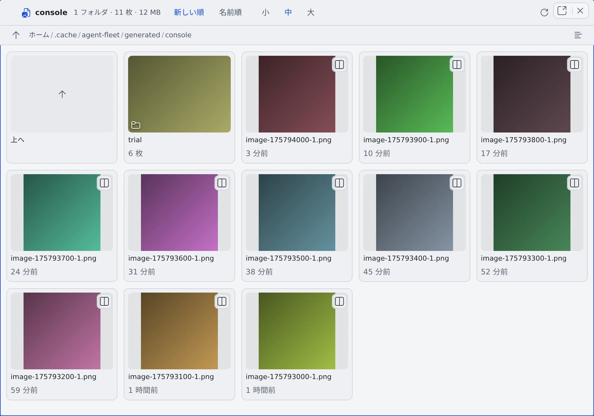

# 画像ギャラリーを使う

[English](gallery.md) | 日本語

フォルダの中の画像を、カードで並べて見比べられます。1 枚ずつ開かなくても、そのフォルダに何が入っているかがひと目でわかります。

## 全体像

| あなたがやること | 起きること |
|---|---|
| フォルダをギャラリーで開く | 画像とサブフォルダがカードで並ぶ |
| カードをクリックする | 画像が拡大され、← / → で前後へ送れる |
| カードを右クリックする | セッションへ送る・名前の変更・削除などができる |
| 開いたまま作業を続ける | 新しく増えた画像が、ハイライト付きで加わる |

## ギャラリーを開く

開き方は 7 つあります。どれもふだんのメニューの中の 1 項目です。

| どこから | 押すもの | 開くフォルダ |
|---|---|---|
| ファイルツリーのフォルダを右クリック | 「**ギャラリーで開く**」 | そのフォルダ |
| ファイルツリーの画像を右クリック | 「**ギャラリーで開く**」 | 親フォルダ。その画像が拡大された状態で開きます |
| ファイルツリーのそれ以外のファイルを右クリック | 「**フォルダをギャラリーで開く**」 | 親フォルダ |
| 画像ビュアーのヘッダ | 「**ギャラリー**」 | 表示中の画像のフォルダ |
| 会話の共有ファイルを拡大した画面 | 「**フォルダを開く**」 | そのファイルのフォルダ |
| セッションの右クリックメニュー | 「**生成した画像 (N)**」 | そのセッションが作った画像のフォルダ |
| **⚙設定 →「マシン」** の「Agent Fleet が使っているディスク」 | 「**ギャラリーで開く**」 | その内訳のフォルダ |

- 普通のクリックは今のペインに、Ctrl／⌘ ＋クリックと中クリックは別のペインに開きます
- スマホには隣のペインがないので、今のペインに開きます

## 見る

| 操作 | できること |
|---|---|
| 「**新しい順**」「**名前順**」 | 並びを切り替えます。ペインごとに覚えるので、タブを行き来しても戻りません |
| 「**小**」「**中**」「**大**」 | カードの大きさを変えます。既定は「中」です |
| 「**最新に更新**」 | フォルダをいつでも読み込み直します |
| 「**さらに表示**」 | 300 枚を超えるフォルダで、続きの 300 枚を出します |
| 「**サブフォルダの画像も並べる**」 | 3 階層下までの画像を、新しい順に 1 つのグリッドへまとめます |

- **ヘッダ**には、フォルダ全体の枚数と容量が出ます
- **サブフォルダ**もカードで並び、中のいちばん新しい 1 枚が表紙に、中の枚数がその下に出ます。押すとそのフォルダへ移ります
- **親へ戻る**には、パンくずの行の「**上へ**」かパンくずを押します。ブラウザの戻るボタンでも、たどってきた順に戻れます
- **サブフォルダの画像をまとめた**ときは、カードの名前にどのサブフォルダの画像かが出ます。とても大きなツリーでは「**新しい N 枚まで**」と出て、新しいものから並びます。別のフォルダへ移ると、まとめる表示はオフに戻ります
- **一度見たフォルダ**は、戻るとすぐに表示されます。スクロール位置も「さらに表示」で広げた分もそのままです。裏で読み込み直している間は、枚数の横に「**更新中…**」と出ます

### 拡大する

カードをクリックすると拡大します。

- ← / → で前後へ送れ、「3 / 12」のように位置が出ます。スマホでは左右のスワイプでも送れます（等倍のときだけです）
- 先に縮小版が出て、画面の大きさに合わせた画像が届くと鮮明になります。隣の 1 枚も先に読み込むので、送るときに待たされません
- 原寸の画像が要るとき（保存する・細部を見る）は、カード右上のボタンでファイルペインに開くか、ダウンロードしてください

## カードを操作する

カードを右クリック（または Menu キー）すると、メニューが開きます。

| カード | できること |
|---|---|
| 画像 | 「**セッション/アシスタントに送る…**」、パスやファイル名のコピー、ファイル名の変更、削除 |
| フォルダ | 「**別のペインで開く**」、フォルダ名のコピー、「**フォルダを zip でダウンロード**」、名前の変更、削除 |
| セッションが作った画像 | 上に加えて、「**生成したセッション「…」を開く**」 |

- 削除は元に戻せません。確認のあとで消えます
- メニューの項目は [アイコン・バッジ・メニュー](../../ref/console-ui.ja.md#画像ギャラリーのカード) にもまとめてあります

## 新しい画像を待つ

ギャラリーは、開いたとき・タブに戻ったときと、稼働中のセッションがある間は 20 秒ごとにフォルダを読み込み直します。
新しく増えた画像には、ファイルツリーと同じハイライトが付くので、セッションや画像生成の絵ができた瞬間がわかります。

## セッションが作った画像を見る

セッションが画像生成のツールで作った画像は、セッションごとのフォルダに入ります。フォルダ名はセッションの内部 ID なので、ファイルツリーからはたどれません。

- **1 つのセッションの分**：セッションの右クリックメニューの「**生成した画像 (N)**」から開きます。画像があるセッションにだけ出ます。ワークスペースが停止している間は出ません
- **全部まとめて**：「**生成した画像を開く**」で、生成した画像の置き場所をまとめて開きます

「生成した画像を開く」は次の 4 か所にあります。

- ミニマップのボタン
- 左ペインの「ファイル」の見出し
- 画像生成のペインのヘッダ
- リーダーキー `g g`（コマンドパレットからも）

開くと、セッションごとのフォルダと、画像生成のペインの出力先（`console`）がカードで並びます。

- セッションのフォルダは、内部 ID ではなくセッション名と枚数で出ます
- セッションのフォルダを開いている間は、パンくずの行にそのセッション名のボタンが出ます。押すと、絵を作った会話が開きます

## 画像が残る期間

| 置き場所 | 残る期間 |
|---|---|
| セッションごとのフォルダ | 30 日で自動的に消えます |
| 画像生成のペインの出力先（`console`） | 消えません |
| 画像生成の試走（`console/trial`） | 7 日で消えます |

残したい画像は、`~/repos` の中など別の場所へ移してください。

## 困ったとき

### 並びに「新しい順」を選べない・「3 分前」のような時刻が出ない

ワークスペースの Agent が古く、ファイルの更新時刻を返していません。この間は名前順で並び、相対時刻も出ません。

### サムネイルが出ないカードがある

カードをクリックすると、ファイルペインで画像を開きます。

### 「生成した画像 (N)」がメニューにない

そのセッションが画像を作っていないか、ワークスペースが停止しています。ワークスペースを起動すると出ます。

## 関連

- [画像を生成する](generate.ja.md)：エージェントを使わずに、まとめて絵を作る
- [セッションに画像を作らせる](from-session.ja.md)：会話の中で絵を 1 枚作ってもらう
