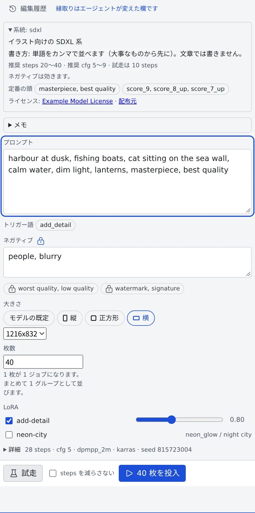

# 画像を生成する

[English](generate.md) | 日本語

画像生成のペインを使うと、この配備の画像エンジンに、エージェントを介さずに絵を描かせられます。
1 つのプロンプトで cfg を変えながら 40 枚、といった使い方に向いています。

## 全体像

| あなたがやること | 起きること |
|---|---|
| モデルを選び、プロンプトを書く | その系統に合った既定値がフォームに入る |
| テスト生成する | 1 枚だけが、キューの先頭で少ない steps で描かれる |
| N 枚を投入する | N 個のジョブが 1 グループとしてキューに並ぶ |
| できた絵を開く | 作り方の記録（モデル・seed・プロンプトなど）が絵と一緒に残る |

- 絵を描くのは、この配備が自前で動かすエンジン（ComfyUI か OpenAI 互換）です。費用は 1 枚いくらではなく、組織の GPU の稼働時間です
- エージェントと話しながら下書きを直したいときは、[スタジオで画像を仕上げる](studio.ja.md) を使います
- 会話の中で 1 枚だけ欲しいときは、[セッションに画像を作らせる](from-session.ja.md) ほうが手軽です

## 始める前に

- 管理者がこの配備に画像エンジンを用意し、モデルを有効にしている必要があります
- エンジンが使えないときは、ワークスペース操作バーに「**画像生成**」のボタンが出ません

## ペインを開く

次のどれかで開きます。

- ワークスペース操作バーの「**画像生成**」
- リーダーキー `g i`（コマンドパレットの「**画像生成を開く**」）
- ミニマップの「**画像生成を開く**」

- もう一度開くと、今あるペインに移ります
- ペインはいつも**スタジオ**を 1 つ開いています。このブラウザで前回開いたスタジオ、なければ最後に変更したスタジオです。スタジオが 1 つもないときだけ、新しい空のスタジオを作ります
- フォームの中身（下書き）はワークスペースに保存されます。PC で書いた続きを、スマホで開けます

## モデルを選ぶ

ヘッダーの「**モデル**」で選びます。管理者が有効にしたモデルが、配布元の付けた名前で並びます。

ヘッダーの右には、エンジンの状態が出ます。

| 表示 | 意味 |
|---|---|
| 「**すぐ描けます**」 | 選んだモデルがエンジンに読み込まれています |
| 「**エンジンは停止中**」 | 最初の 1 枚は、エンジンの起動を待ちます。目安の分数も出ます |
| 「**エンジンを起動しています**」 | 起動の途中です |
| 「**エンジンを使えません**」 | いまは描けません |

- モデル名の横の点は、エンジンに読み込み済みの印です
- エンジンが 2 つ以上あるときは、「**エンジン**」の欄も出ます

### 系統のカードを読む

モデルを選ぶと、フォームの先頭にその系統（モデルの種類）のカードが出ます。

| 行 | 内容 |
|---|---|
| 書き方 | 単語をカンマで並べるか、文章で書くか、両方を併記するか |
| 定番の頭 | その系統でよく使うプロンプトの書き出し。チップで出るだけで、勝手には入りません |
| 推奨値 | 推奨の steps・cfg（系統によって guidance・shift）と、テスト生成の steps |
| ネガティブ | 「**ネガティブは効きます。**」か、ネガティブを読まない系統か |

系統には SD 1.5・SDXL・SD3.5・FLUX.1・FLUX.2 klein・Z-Image・Anima・Krea 2・Qwen-Image-Edit（2509 と 2511）・Qwen-Image 2.1 があります。

- **サイズの既定は系統ごと**です。SD 1.5 だけは 512 から始まります。大きくすると、人物が 2 人に増えたような絵になりやすいためです
- **その系統が読まない欄**は、「**… はこの値を読みません**」と理由つきで無効になります（FLUX.1 と FLUX.2 klein の cfg など）
- **1 つの系統だけが読む欄**は、その系統を選んだときだけ「**詳細**」に出ます

| 欄 | 系統 | 目安 |
|---|---|---|
| clip skip | SD 1.5・SDXL | SDXL は最初から 2 相当なので、絵が変わるのは 3 以上です |
| guidance | FLUX.1 | モデルカードが CFG と呼ぶ値です。3.5〜5 |
| shift | Anima | 既定は 3 です。14〜24 にすると、大きな絵の構図が安定します |

## プロンプトを書く

- **プロンプト**と**ネガティブ**を書きます
- **管理者のネガティブ**は、外せないチップで出ます（「管理者がこのモデルに宣言」「管理者が配備全体に宣言」）。あなたの文章とは別に、上に重ねて使われます
- **LoRA** には、そのモデルの系統に使えるものだけが並びます。行には、選ぶと付いてくるトリガー語が出ます
- LoRA を選ぶと、トリガー語がプロンプト欄の上にチップで出ます。押すとプロンプトに足せます
- LoRA の重みは、配布元が公表した強さから始まります（ない場合は 1）

> [!TIP]
> LoRA が効かないときのいちばん多い原因は、トリガー語の書き忘れです。書かないまま生成すると、結果にそう表示されます。

## テスト生成してから投入する

| ボタン | キー | 動き |
|---|---|---|
| 「**試走**」 | `Ctrl+Enter` | 1 枚だけを、キューの先頭で、少ない steps で描きます |
| 「**N 枚を投入**」 | `Ctrl+Shift+Enter` | 「**枚数**」の分だけジョブ（1 枚 = 1 ジョブ）を、1 グループとして末尾に並べます |

1. 「**試走**」で 1 枚描きます。フォームの隣の「**直近の試走**」に、seed と所要時間つきで出ます
2. 気に入ったら「**この seed を使う**」で seed を固定します
3. 「**N 枚を投入**」で本番を並べます

- テスト生成そのものを本番にしたいときは、「**steps を減らさない**」に印を付けます
- seed の決め方は「**詳細**」で選びます。「**毎回ランダム**」「**固定**」（同じ絵で cfg だけ変えたいとき）「**連番**」です
- 枚数は 200 まで、キューに並べられるのも 200 件までです。テスト生成は 3 件まで待てます

### 詳細

「**詳細**」は最初は閉じていて、見出しの横に今の値が 1 行で出ます。

| 欄 | 決めること |
|---|---|
| steps・cfg・sampler・scheduler | 空欄ならモデルの既定で描きます |
| seed の決め方・seed | 上の 3 つの方針と、固定するときの値 |
| batch_size | 1 ジョブの中で同時に描く枚数（上限 4） |
| 操作 | 「**生成**」「**編集**」「**部分描き直し**」 |
| 出力先 | 絵を入れるフォルダ。空なら `generated/console/` です |
| ラベル | 一覧に出る覚え書き |

> [!WARNING]
> `batch_size` を上げると、VRAM に余裕のある GPU では速くなりますが、余裕のない GPU では 5 分待った末に OOM になります。1 枚ずつ取り消すこともできません。
> GPU の性能がわからないうちは 1 のままにしてください。

## 今ある絵を編集する

「**詳細**」の「**操作**」を「**編集**」か「**部分描き直し**」にします。

| 操作 | 使うもの |
|---|---|
| 編集 | 「**参照画像**」と、0〜1 のスライダー「**元画像をどれだけ変えるか**」 |
| 部分描き直し | 上に加えて、「**マスク画像（白いところを塗り直す）**」 |

- 参照画像は、ワークスペース内のパスで指定するか、欄にファイルをドロップします。ドロップしたファイルは `generated/console/inputs/` に置かれます
- 編集では元画像のサイズが使われるので、大きさの欄は出ません
- 部分描き直しでは、ボタンの上に「**マスク**」の行が出ます。マスクがないうちはテスト生成も投入もできず、「**inpaint にはマスク画像が要ります**」と出ます
- ComfyUI のエンジンで、モデルが部分描き直しに対応していれば、「**マスクを塗る**」でその場でマスクを塗れます。保存したマスクは `generated/console/masks/` に新しい PNG で置かれます
- マスクは寸法が違っても絵に合わせて引き伸ばされるので、同じ場所を指します

### 置ける参照画像の数

欄の見出しに「2 / 2 枚」のように数が出て、上限まで入れると追加の欄が消えます。

| モデル | 参照画像 | 操作 |
|---|---|---|
| 指示編集のモデル（Qwen-Image-Edit。「看板の文字を CLOSED に変えて」のように言葉で頼む） | 3 枚。1 枚目が描き直される絵で、2 枚目からはそこへ持ち込む題材です | 編集・部分描き直し |
| Qwen-Image 2.1 | 10 枚まで | 生成・編集 |
| ほかのモデル | 1 枚 | 系統による |

- 指示編集のモデルには「元画像をどれだけ変えるか」がなく、どれだけ変えるかは指示で決まります
- いまの操作に対応していないモデルを選ぶと、操作が読み替えられ、「**… はいまの操作に対応していないため「編集」に読み替えました**」のように出ます

## 走っている間

1 回の投入は、キューの 1 行（グループ）になります。行には「12 / 40」、進み具合のバー、残りのおおよその時間が出ます。

| 操作 | 対象 |
|---|---|
| 「**一時停止**」「**再開**」「**今の 1 枚を飛ばす**」「**中断**」 | そのグループ |
| 行の ✕（「**このジョブを取り消す**」） | 1 枚 |
| 「**ワークスペース全体を一時停止**」 | キュー全体。ほかのスタジオやセッションのジョブも止まります |

- キュー全体を止めても、テスト生成は走ります
- 描いている 1 枚には、段階（「**エンジン起動中**」「**送信中**」「**描画中**」「**受け取り中**」）と秒数が出ます
- 止めたままにしておくと、エンジンは休止します。行にもそう表示されます
- キューはワークスペースで 1 本です。ほかのスタジオやセッションのジョブは、「**他のスタジオ・セッションのジョブ N 件**」にまとめて出ます

## できた絵を使う

| 絵 | 置き場所 | 残る期間 |
|---|---|---|
| 投入した絵 | `generated/console/`（または「出力先」のフォルダ） | 消えません |
| テスト生成の絵 | `generated/console/trial/` | 7 日 |

- 置き場所は、[画像ギャラリー](gallery.ja.md) で普通のフォルダとして見られます
- 絵を拡大して「**プロパティ**」を押すと、モデル・seed・大きさ・steps・cfg・sampler・scheduler・LoRA と重み・プロンプト・ネガティブが、行ごとのコピーボタンつきで出ます
- 「**すべて JSON でコピー**」でまとめてコピーでき、「**画像生成で開く**」でその設定の新しいスタジオを開けます
- エージェントがツールで作った絵も、ComfyUI が PNG に埋めた情報から読めます。外部サービス（Codex・Antigravity）で作った絵には記録がなく、「この絵には作り方の記録がありません（復元できません）。」と出ます

## 困ったとき

### 最初の 1 枚がなかなか始まらない

エンジンが停止していて、起動を待っています。ヘッダーの「**エンジンは停止中**」に、待ち時間の目安が出ます。行の段階は「**エンジン起動中**」になります。

### 「待ち行列がいっぱいです」と出る

待っているジョブが 200 件に達しています。終わるのを待つか、要らないグループを「**中断**」してください。

### 自分の番がなかなか来ない

ほかのスタジオやセッションのジョブが先に並んでいます。「**他のスタジオ・セッションのジョブ N 件**」を開くと、何が並んでいるかわかります。

### LoRA が効かない

トリガー語がプロンプトに入っていません。プロンプト欄の上のチップを押して足してください。

## 関連

- [スタジオで画像を仕上げる](studio.ja.md)：エージェントと話しながら下書きを直す
- [セッションに画像を作らせる](from-session.ja.md)：会話の中で絵を作ってもらう
- [画像ギャラリーを使う](gallery.ja.md)：できた絵をまとめて見る
