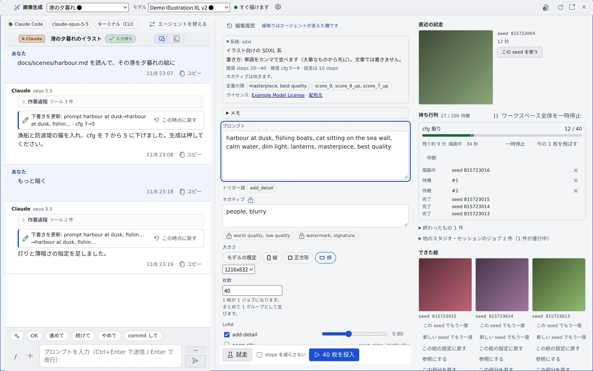

# スタジオで画像を仕上げる

[English](studio.md) | 日本語

スタジオにエージェントを付けると、画像生成のフォーム（下書き）を、会話しながら直してもらえます。
「`docs/chars/aoi.md` を読んで、その子を港の夕暮れに」「もっと暗く」と話すと、エージェントが資料を読んで下書きを書き換えます。

## 全体像

| あなたがやること | エージェントがやること |
|---|---|
| スタジオにエージェントを付ける | 役割の説明を受け取り、スタジオのツールで下書きを読む |
| 描きたいものを話す | 資料を読み、プロンプトや設定を書き換える |
| 会話でテスト生成を頼む | 頼まれたときだけ、今の下書きで 1 枚テスト生成する |
| 結果に感想を言う | 次の書き換えに生かす。頼まれれば知識のメモに記録する |

- **生成のボタンを押すのは、いつもあなたです。** エージェントが何枚も勝手に描くことはありません
- 押したときに走るのは、[画像を生成する](generate.ja.md) と同じキューです

## 始める前に

- 画像生成が使えること（[画像を生成する](generate.ja.md#始める前に)）
- エージェントに読ませたい資料は、リポジトリにコミットしておきます。worktree の中からは、コミットしていない資料は見えません

## エージェントを付ける

次のどちらかから始めます。

| どこから | 押すもの |
|---|---|
| 画像生成のペイン | 「**エージェントを付ける**」 |
| 左ペインの作業コピーの行（▼ のメニューか右クリック） | 「**画像スタジオを始める**」。その作業コピーで新しいスタジオを始めます |

ダイアログで、セッションを起動するときと同じように選びます。

| 項目 | 選ぶもの |
|---|---|
| 実行方式 | 「**ターミナル（CLI）**」か「**マネージド**」 |
| エージェント・「**エージェントのモデル**」・effort・権限の確認 | セッションの起動と同じです |
| 「**画像モデル**」 | 下書きのモデル。プロンプトの書き方はモデルごとに違うので、選ばないと始められません |
| 「**リポジトリ（作業フォルダ）**」・サブフォルダ | エージェントが資料を読む場所。「**ホーム（リポジトリなし）**」も選べます |
| 「**worktree で開く**」 | 作業コピーによって既定が変わります。下を見てください |

- **プロンプトの欄はありません。** 最初のターンはスタジオが送る役割の説明で、届くまでペインに「エージェントに役割を送っています…」と出ます。送れなかったときだけ「**再送**」が出ます
- **前回と同じ選び方**は「**前回と同じ**」の 1 行にまとまり、そのまま始められます
- ペインを開いただけでは、セッションは作られません。セッションの起動に失敗しても、スタジオと下書きは残ります

### 付けられるエージェントと実行方式

エージェントによっては、「自分はどのスタジオのセッションか」をまだスタジオのツールに伝えられないため、選べない組み合わせがあります。

| 表示 | 意味 |
|---|---|
| 「マネージドでは同じフォルダの別のセッションが下書きを書き換えられるため選べません（ターミナルなら選べます）」 | opencode のマネージド |
| 「マネージドではセッションを見分けられないため、いまはターミナルでだけ選べます」 | copilot・cursor・kiro のマネージド |
| 「スタジオのツールに届かないため、まだ選べません」 | いまは付けられないエージェント |

一覧は [エージェントリファレンス](../../ref/agents.ja.md) の「画像スタジオに付けられる」の行と脚注にあります。

### worktree

- **ふだんのクローン**では、新しい worktree で開くのが既定です。エージェントが自分のスタジオを確実に見分けられるようにするためです
- **worktree の行**から始めると、その worktree で直接開きます
- ホームディレクトリや、worktree を作れない作業コピーでは worktree を使いません
- worktree をオフにできるのは、ターミナル（CLI）のセッションと lcpp だけです。それ以外では「この組み合わせではセッションを見分けるために worktree が必要です。」と出ます

### エージェントを替える

「**エージェントを替える**」で、いつでも別のセッションに結び直せます（sonnet から opus へ、claude から codex へ）。

- 今のセッションは止まり、新しいセッションがスタジオに結ばれます
- 下書き・編集履歴・版はスタジオのものなので、そのまま残ります
- スタジオに結ばれたセッションを開くと、ミラーではなくこのスタジオが開きます

## 会話で下書きを直す

ペインは 3 列です。左が会話、真ん中が下書き、右が結果と履歴です。狭いペインでは「**会話**」「**設定**」「**結果**」のタブにまとまります。

| 欄 | 変えられる人 |
|---|---|
| プロンプト・ネガティブ・steps・cfg・sampler・scheduler・clip skip・guidance・shift・大きさ・LoRA・操作・参照画像・「元画像をどれだけ変えるか」 | エージェントとあなた |
| モデル・seed と seed の決め方・枚数・batch_size・「steps を減らさない」・出力先・ラベル・マスク画像・ロック | あなただけ |

- エージェントが変えた欄は、あなたがその欄を直すか、テスト生成か投入を押すまで縁取られます（「**縁取りはエージェントが変えた欄です**」）
- エージェントは、別のモデルを提案することはできますが、モデルを替えるのはあなたです。モデルが替わると、読む欄もサイズも最初の 1 枚の待ち時間も変わるためです
- モデルを替えると、エージェントは新しいモデルの書き方でプロンプトを書き直します
- エージェントが下書きを変えると、会話に「**下書きを更新**」のカードが出ます

### ロックを掛ける

欄ごとにロック（🔒、「**固定する（エージェントに変えさせない）**」）を掛けられます。

- ロックが掛かった欄にエージェントが書き込もうとしても、その欄だけは反映されず、エージェントには理由が返ります
- ロックが自動で掛かることはありません

### スマホで使う

- 入力している間は、見出し・タブ・提案が隠れ、下書きの帯（下書きの 1 行目と「**テスト生成**」）がキーボードの上に残ります
- 「N 枚できました」は、結果を見るか閉じるまでタブの下に残ります

## テスト生成と投入

| 操作 | できる人 |
|---|---|
| テスト生成 | あなたとエージェント |
| N 枚の投入 | あなただけ |

- エージェントのテスト生成は、**いま画面に出ている下書きをそのまま 1 枚**描くだけです。エージェントがテスト生成に何かを指定する余地はありません
- エージェントのテスト生成は、歯車の「**スタジオの設定**」の「**エージェントのテスト生成を許す**」（既定はオン）で止められます。切り替えは、エージェントの次のテスト生成から効きます。オフの間は、テスト生成が許可されていないことがエージェントに返ります
- スタジオのセッションでは、エージェントは画像生成のツール（`generate_image`）を使えません。絵を作る経路を、このペインのボタンにそろえるためです。CLI 自身が持つ画像ツール（codex の組み込みなど）は、この制限の外です

## 前の下書きに戻す

| 記録 | できること |
|---|---|
| 「**編集履歴**」 | 下書きが変わるたびに 1 件残ります（時刻、書き手、変わった欄の前と後）。「**この時点に戻す**」で戻せます |
| 版 | テスト生成・投入・エージェントのテスト生成を押した瞬間の下書きの写しです。編集しただけでは版はできません |
| 「**このスタジオの絵**」 | スタジオで作った絵が新しい順に並びます。絵はどの版から作られたかを覚えています |

- 「この時点に戻す」は、会話の「下書きを更新」のカードからも押せます
- 戻しても履歴は消えず、戻したこと自体が 1 件になります。あなたの操作なので、ロックを掛けた欄も含めて全部戻ります（ロックそのものは今のまま）

「このスタジオの絵」の絵には、次のボタンがあります。

| ボタン | 動き |
|---|---|
| 「**この絵の設定に戻す**」 | その絵を作ったときの下書きに戻します |
| 「**参照にする**」 | その絵を、次の編集の参照画像に置きます |
| 「**この部分を直す**」 | その絵を部分描き直しにし、マスクを塗る画面を開きます |

## スタジオを使い分ける

スタジオはいくつでも持てます。ペイン上部の「**スタジオ**」で切り替えます。

- 「＋ 新しいスタジオ」（コマンドパレットでは「**新しい画像スタジオ**」）は、空のスタジオを隣のペインで開きます。スマホでは今のペインに開きます
- 名前を付けていないスタジオは、作った日時（「スタジオ 9/27 14:05」）で並びます。名前は歯車のメニューで変えられます
- 「**スタジオを削除**」すると、下書き・編集履歴・版が消えます。**作った絵は残ります**
- 結果とテスト生成の枠に出るのは、そのスタジオで押したジョブだけです
- 画像のプロパティの「**画像生成で開く**」は、その絵の設定で新しいスタジオを作って開きます

## 知識のメモを育てる

モデルごと・系統ごとに 1 本ずつ、エージェントとあなたが一緒に育てるメモがあります。ペインの「**メモ**」で開きます。

| 節 | 中身 |
|---|---|
| 要約 | エージェントが毎回読む短い節 |
| 設定 | よく効く設定 |
| プロンプト | よく効く書き方 |
| 記録 | 気づいたこと。追記していきます |

- 置き場所は `~/imagegen-knowledge/` の `families/<family>.md` と `models/<model>.md`（系統とモデルの ID）です。`~/repos` の外なので、作り直し（Recreate）でも消えません
- エージェントがメモに書くのは、「覚えて」と言われたときと、結果の良し悪しを伝えられたときだけです。書き先は、スタジオで選んでいるモデルか、その系統のメモに限られます
- 消すのはあなたです。普通のファイルなので、ファイルツリーから開いて直せます
- ファイルツリーがホームディレクトリ全体を見せない配備では、ペインの「メモ」で 4 節とも編集します

## 困ったとき

### 会話の入力欄が使えない

画像モデルが選ばれていません。先にモデルを選んでください（狭い画面では「**設定**」タブの先頭にあります）。

### 「エージェントに役割を送れませんでした」と出る

最初の役割の説明が届いていません。「**再送**」を押してください。

### エージェントが資料を読めない

worktree で開いていて、資料がコミットされていません。資料をコミットしてから、エージェントに読み直してもらってください。

### エージェントが欄を変えてくれない

その欄にロックが掛かっているか、あなただけが変えられる欄です。エージェントには理由が返るので、会話でそう伝えてきます。ロックを外すか、自分で変えてください。

## 関連

- [画像を生成する](generate.ja.md)：フォームの欄・テスト生成・投入・編集の詳しい説明
- [画像ギャラリーを使う](gallery.ja.md)：できた絵をまとめて見る
- [エージェントリファレンス](../../ref/agents.ja.md)：スタジオに付けられるエージェント
