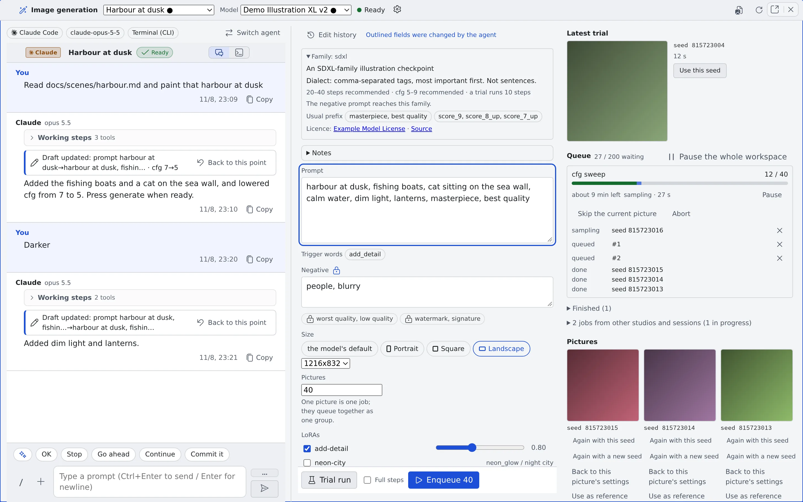

# Finish an image in the studio

English | [日本語](studio.ja.md)

Attach an agent to a studio and it refines the image generation form (the draft) with you in conversation.
Say "read `docs/chars/aoi.md` and put her in a harbour at dusk", then "darker", and the agent reads the material and rewrites the draft.

## How it works

| What you do | What the agent does |
|---|---|
| Attach an agent to the studio | Receives its role and reads the draft with the studio's tools |
| Say what you want drawn | Reads the material and rewrites the prompt and settings |
| Ask for a trial in the conversation | Runs one trial of the current draft, only when asked |
| Say what you think of the results | Uses it for the next rewrite; records it in the knowledge notes when asked |

- **You are always the one who presses generate.** The agent never draws picture after picture on its own
- What a press runs is the same queue as in [Generate images](generate.md)

## Before you start

- Image generation is available ([Generate images](generate.md#before-you-start))
- Commit the material you want the agent to read. Inside a worktree, uncommitted material cannot be seen

## Attach an agent

Start from either of these:

| Where | What to press |
|---|---|
| The image generation pane | "**Attach an agent**" |
| A working copy's row in the left rail (its ▼ menu or right-click) | "**Start an image studio**". Starts a new studio in that working copy |

The dialog asks what starting a session asks.

| Field | What to choose |
|---|---|
| Execution method | "**Terminal (CLI)**" or "**Managed**" |
| Agent, "**Agent model**", effort, permission prompts | As when starting a session |
| "**Image model**" | The draft's model. Prompts are written differently for each model, so you cannot start until one is chosen |
| "**Repository (working folder)**" and subfolder | Where the agent reads its material. "**Home (no repository)**" can be chosen too |
| "**Open in a worktree**" | The default depends on the working copy; see below |

- **There is no prompt field.** The first turn is the role the studio sends; until it arrives the pane shows "Sending the agent its role…". Only if it could not be sent does "**Resend**" appear
- **The choices you made last time** fold into one line, "**Same as last time**", so you can start straight away
- Opening the pane does not create a session. If the session fails to start, the studio and its draft remain

### Agents and execution methods

Some agents cannot yet tell the studio's tools which studio session they are, so some combinations cannot be chosen.

| Shown | Meaning |
|---|---|
| "Not under Managed: another session in the same folder could rewrite the draft (Terminal works)" | opencode under Managed |
| "Under Managed the session cannot be told apart yet; Terminal only for now" | copilot, cursor and kiro under Managed |
| "Not yet: it cannot reach the studio's tools" | An agent that cannot be attached for now |

The full list is the "Bound to an image studio" row of the [agent reference](../../ref/agents.md) and its footnote.

### Worktree

- **From an ordinary clone**, a new worktree is the default, so the agent can be sure which studio it belongs to
- **From a worktree's row**, the studio opens in that worktree directly
- Home, and working copies that cannot make a worktree, use none
- Only Terminal (CLI) sessions and lcpp can turn the worktree off. Elsewhere it says "This combination needs a worktree to tell the session apart."

### Switch agent

"**Switch agent**" binds the studio to another session at any time (sonnet to opus, claude to codex).

- The current session is stopped and a new one is bound to the studio
- The draft, the edit history and the versions belong to the studio, so they stay
- Opening a session bound to a studio opens this studio, not the mirror

## Refine the draft in conversation

The pane has three columns: the conversation on the left, the draft in the middle, results and history on the right. In a narrow pane they fold into the "**Chat**", "**Settings**" and "**Results**" tabs.

| Field | Who can change it |
|---|---|
| Prompt, negative, steps, cfg, sampler, scheduler, clip skip, guidance, shift, size, LoRAs, operation, reference images, "How much of the input to change" | The agent and you |
| Model, seed and seed policy, pictures, batch_size, "Full steps", output folder, label, mask, locks | You only |

- A field the agent changed stays outlined until you edit that field or press trial or enqueue ("**Outlined fields were changed by the agent**")
- The agent can suggest another model, but you are the one who switches. A new model changes the fields read, the sizes and the first picture's wait
- When you switch models, the agent rewrites the prompt in the new model's style
- When the agent changes the draft, a "**Draft updated**" card appears in the conversation

### Lock a field

You can lock (🔒, "**Lock (keep the agent from changing it)**") each field.

- A write to a locked field is dropped for that field alone, and the agent is told why
- Nothing is ever locked automatically

### On a phone

- While you type, the headings, tabs and suggestions step aside, and the draft strip (the draft's first line and "**Trial run**") stays above the keyboard
- "N pictures are ready" stays under the tabs until you look at the results or close it

## Trial runs and enqueueing

| Action | Who can do it |
|---|---|
| Trial run | You and the agent |
| Enqueue N pictures | You only |

- An agent's trial draws **exactly the draft on screen, once**. The agent has no say in what the trial uses
- Turn the agent's trials off with "**Let the agent run a trial**" (on by default) in the gear's "**Studio settings**". The change applies from the agent's next trial. While it is off, the agent is told it is not allowed to run trials
- In a studio session the agent cannot use the image generation tool (`generate_image`), so pictures are only made through this pane's buttons. An image tool of the CLI's own (codex's built-in one, for example) is outside this rule

## Go back to an earlier draft

| Record | What it gives you |
|---|---|
| "**Edit history**" | One entry per draft change (time, author, the field before and after). "**Back to this point**" returns to it |
| Versions | A copy of the draft at the moment trial, enqueue or the agent's trial was pressed. Editing alone makes none |
| "**This studio's pictures**" | The studio's pictures, newest first. Each remembers the version it was made from |

- "Back to this point" is also on the conversation's "Draft updated" cards
- Going back erases nothing; the return is itself an entry. It is your action, so locked fields go back too (the locks themselves stay as they are)

The pictures in "This studio's pictures" have these buttons:

| Button | What it does |
|---|---|
| "**Back to this picture's settings**" | Returns to the draft that made the picture |
| "**Use as reference**" | Puts the picture in as the reference image for the next edit |
| "**Fix this part**" | Switches to inpaint on the picture and opens the mask painting |

## Keep several studios

You can have as many studios as you like. Switch with "**Studio**" at the top of the pane.

- "+ New studio" ("**New image studio**" in the command palette) opens an empty studio in the pane beside. On a phone it opens in the current pane
- A studio without a name is listed by when it was made ("Studio 9/27 14:05"). Rename it from the gear menu
- "**Delete studio**" removes the draft, the edit history and the versions. **The pictures stay**
- The results and trial slots show only jobs pressed in that studio
- "**Open in image generation**" in a picture's properties creates and opens a new studio with that picture's settings

## Grow the knowledge notes

There is one note per model and one per family, which the agent and you grow together. Open it with the pane's "**Notes**".

| Section | Contents |
|---|---|
| Summary | A short section the agent reads every time |
| Settings | Settings that work well |
| Prompts | Ways of writing that work well |
| Records | What you noticed, appended over time |

- They live in `~/imagegen-knowledge/`, as `families/<family>.md` and `models/<model>.md` (the family and model IDs). That is outside `~/repos`, so Recreate does not remove them
- The agent writes only when told to remember something, or when you say what you think of a result. It writes only to the note of the model picked in the studio or of its family
- Deleting is yours to do. They are ordinary files, so you can open and edit them from the file tree
- Where the file tree does not show the whole home folder, edit all four sections in the pane's "Notes"

## When it goes wrong

### The conversation's input box cannot be used

No image model is chosen. Choose a model first (in a narrow pane it is at the top of the "**Settings**" tab).

### "Could not send the agent its role"

The first role message did not arrive. Press "**Resend**".

### The agent cannot read the material

The studio is in a worktree and the material is not committed. Commit it, then ask the agent to read it again.

### The agent does not change a field

That field is locked, or it is one only you can change. The agent is told why and says so in the conversation. Unlock it, or change it yourself.

## Related

- [Generate images](generate.md): the form's fields, trial runs, enqueueing and editing in detail
- [Use the image gallery](gallery.md): look through the finished pictures
- [Agent reference](../../ref/agents.md): the agents a studio can take
