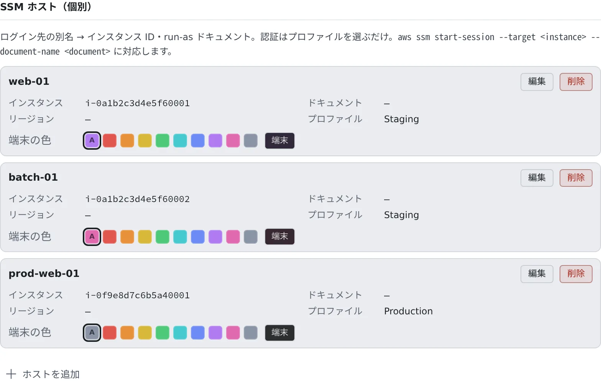
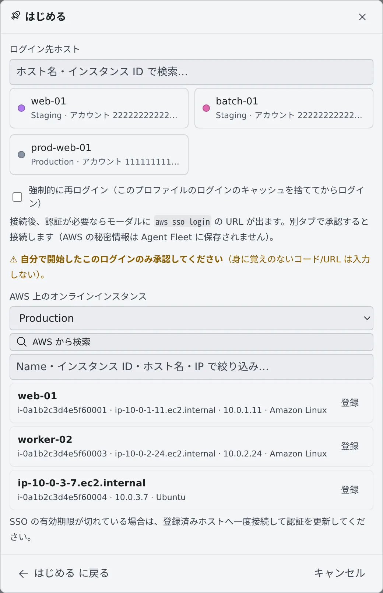

# SSM で EC2 にログインする

[English](aws-ssm.md) | 日本語

AWS SSM Session Manager を使って、EC2 にブラウザの端末からログインできます。SSH の鍵も、開いたポートも要りません。

## 全体像

| あなたがやること | 起きること |
|---|---|
| ホストを登録する | 「はじめる」にログイン先として並ぶ |
| ホストを選んで接続する | そのホストの端末がセッションとして開く |
| ログインを承認する | ログインしていないときだけ、コードの確認を求められる |

SSM のセッションは、あなたが使う端末です。エージェントは SSM のセッションを操作せず、ほかのセッションからメッセージを
送ることもできません。

## 始める前に

ホストは AWS プロファイルのログインで接続します。先に [AWS SSO を使う](aws-sso.ja.md) でプロファイルを 1 つ登録してください。
プロファイルが 1 つもないと、「はじめる」に SSM の項目は出ません。

ログインは `af-aws-exec` と共通です。同じプロファイルでどちらかにログインしていれば、もう一方もそのまま使えます。

## ホストを登録する

**⚙設定 →「AWS プロファイル/SSM」** の下の方にある **SSM ホスト（個別）** で、「**ホストを追加**」を押します。

| 項目 | 入れるもの |
|---|---|
| 使用するプロファイル | このホストに接続するときにログインするプロファイル |
| 別名 | 「はじめる」に出るログイン先の名前 |
| インスタンス ID | EC2 のインスタンス ID（`i-…`） |
| リージョン | 任意。空ならプロファイルの既定リージョン |
| run-as ドキュメント | 任意。決まった Session Manager のドキュメントで開くときだけ入れます |

登録したホストには **端末の色** を選べます。本番のホストを赤にしておくと、どの端末かひと目でわかります。
色は、これから開くセッションに付きます。

### AWS から探して登録する

インスタンス ID がわからないときは、「はじめる」の SSM の画面で探せます。

1. 「**AWS から検索**」を押します。プロファイルが 2 つ以上あるときは、先に **AWS 上のオンラインインスタンス** でプロファイルを選びます
2. 今オンラインのインスタンスが並びます。名前・インスタンス ID・ホスト名・IP で絞り込めます
3. 使うものの「**登録**」を押します

登録したホストは、検索に使ったプロファイルで接続します。インスタンスの Name タグがあれば、それが別名になります。
リージョンはプロファイルの既定リージョンです。
変えたいときは、設定でホストを編集してください。

### 手元の ~/.ssh/config から取り込む

ssh の設定で SSM 越しにつないでいるホストは、「**~/.ssh/config から取り込む**」で登録できます。
ファイルを選ぶか中身を貼り付けると、取り込めるホストと、取り込めないホスト（理由つき）がプレビューに並びます。

> [!WARNING]
> **接続のしかたが変わります。** ssh の設定では SSM のトンネル越しに SSH でつなぎますが、ここで登録したホストは
> Session Manager のシェルを直接開きます。ユーザー・鍵・ポート・転送などの SSH の設定は引き継がれません。

ファイルはブラウザの中で読み、`ProxyCommand` は実行しません。取り込める形は [SSM の仕様](../../ref/aws-ssm.ja.md#ssh-config-の取り込み) にあります。

## 接続する

1. WS バーの「**はじめる**」を押し、「**SSM — 別ホストへログイン**」を選びます
2. ホストのカードを押すと、すぐに接続します

ホストが 9 つ以上あるときは、よく使う 6 つだけがカードになり、ほかは一覧から選んで「**接続**」を押します。
検索欄で別名やインスタンス ID から絞り込めます。

接続すると「**SSM ログイン**」の画面が開きます。ログインしていれば、そのまま端末に切り替わります。
ログインが要るときだけ、コードが出ます。

1. コードを確かめて「**ログインして承認**」を押します
2. 開いたページで、同じコードであることを確かめて承認します

承認するとホストの端末が開きます。接続の直前に、使うプロファイルや接続先のホストが 1 行で出ます。

> [!WARNING]
> 自分で始めたログインのコードだけを承認してください。身に覚えのないコードは承認しないでください。

## 編集・削除する

ホストやプロファイルを変えたいときは、行の「**編集**」を使ってください。削除して登録し直すと、別のものとして扱われます。

- ホストを編集すると、これから開くセッションに反映されます。開いているセッションの接続先は変わりません
- ホストが使っているプロファイルは削除できません。先にホストを編集して別のプロファイルを選ぶか、ホストを削除してください

停止した SSM のセッションは、一覧の「**再開**」で開き直せます。ログインし直してから開くときは「**再ログインして再開**」です。

使い終わった SSM のセッションは、一覧から「**削除**」するとごみ箱へ移ります（[終わったセッションを片付ける](../sessions/cleanup.ja.md#アーカイブする復帰する)）。

## 困ったとき

### 「はじめる」に SSM の項目がない

AWS プロファイルが 1 つもありません。[AWS SSO を使う](aws-sso.ja.md) で登録してください。

### 「AWS から検索」が権限のエラーになる

プロファイルのロールに `ssm:DescribeInstanceInformation` の権限がありません。AWS の管理者に頼んでください。
インスタンスの名前が出ないのは、`ec2:DescribeInstances` の権限がないときです（検索そのものはできます）。

### 「AWS から検索」がほかのエラーになる

プロファイルのログインが切れていることがあります。登録済みのホストに一度接続してログインしてから、もう一度検索してください。

### ログインし直したい

ログインが切れていないのに接続できないときや、別のロールでログインし直したいときは、「**強制的に再ログイン**」にチェックを
付けて接続します。そのプロファイルのログインを破棄してから、ログインし直します。停止したセッションなら「**再ログインして再開**」です。

### ホストの行に「プロファイルが削除されています」と出る

ホストが使っていたプロファイルがありません。ホストを編集して、プロファイルを選び直してください。

## 関連

- [AWS SSO を使う](aws-sso.ja.md)：プロファイルの登録とログイン
- [SSM の仕様](../../ref/aws-ssm.ja.md)：リージョンの決まりかた、取り込みの規則
- [af-aws-exec](../../ref/cli/af-aws-exec.ja.md)：同じプロファイルで AWS のコマンドを実行する
