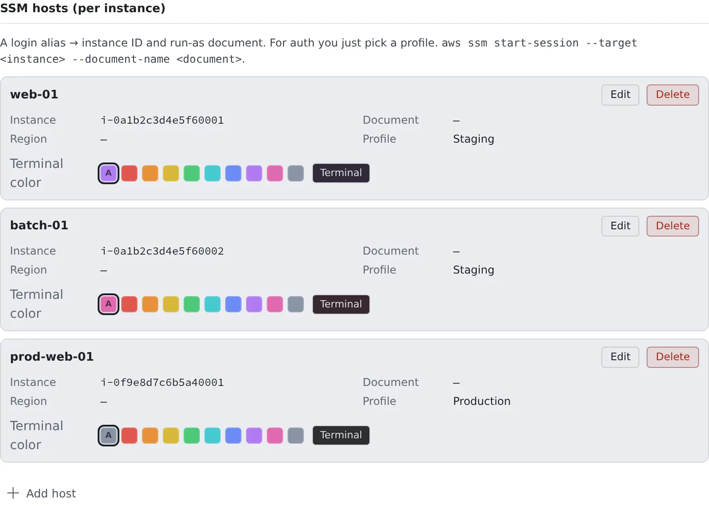
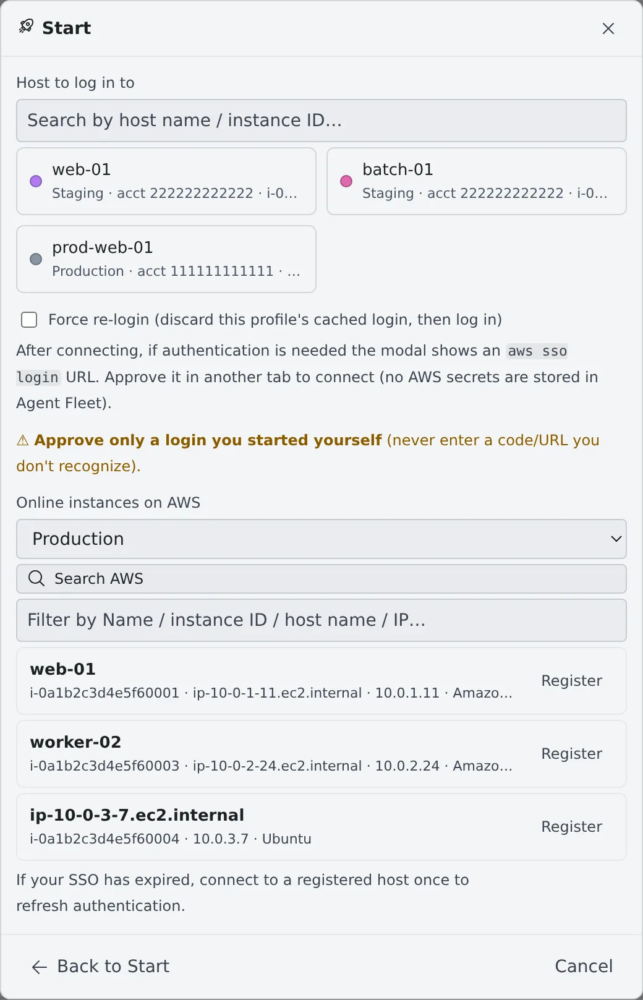

# Log in to EC2 with SSM

English | [日本語](aws-ssm.ja.md)

With AWS SSM Session Manager you can log in to an EC2 host from a terminal in your browser. No SSH keys and no open
ports are needed.

## How it works

| What you do | What happens |
|---|---|
| Register a host | It is listed under Start as a place to log in to |
| Pick the host and connect | The host's terminal opens as a session |
| Approve the login | You are asked to check a code only when you are not logged in |

An SSM session is a terminal for you. Agents do not drive SSM sessions, and other sessions cannot send them messages.

## Before you start

A host connects with the login of an AWS profile. Register a profile first, in [Use AWS SSO](aws-sso.md). Until
there is at least one profile, Start has no SSM entry.

The login is the same one `af-aws-exec` uses. Once you have logged in with a profile for either, the other works too.

## Register a host

Under **SSM hosts (per instance)**, lower down in **⚙ Settings → "AWS profiles/SSM"**, press "**Add host**".

| Field | What to enter |
|---|---|
| Profile to use | The profile to log in with when you connect to this host |
| Alias | The name of the host, as Start lists it |
| Instance ID | The EC2 instance ID (`i-…`) |
| Region | Optional. When empty, the profile's default region |
| run-as document | Optional. Only when the session has to open with a particular Session Manager document |

You can give a registered host a **Terminal color**. Make the production hosts red and you can tell their terminals
apart at a glance. The color goes on the sessions you open from then on.

### Find a host on AWS and register it

If you do not know the instance ID, look it up on the SSM screen of Start.

1. Press "**Search AWS**". With two or more profiles, first pick one under **Online instances on AWS**
2. The instances that are online now are listed. Filter them by name, instance ID, host name or IP
3. Press "**Register**" on the one you want

The registered host connects with the profile you searched with. The instance's Name tag, if it has one, becomes the
alias, and the region is the profile's default. To change them, edit the host in Settings.

### Import from your own ~/.ssh/config

Hosts you reach over SSM through your ssh settings can be registered with "**Import from ~/.ssh/config**". Pick the
file or paste its contents, and the preview lists the hosts it can import and the ones it cannot, with the reason.

> [!WARNING]
> **The way you connect changes.** Your ssh settings open SSH through an SSM tunnel; a host registered here opens a
> Session Manager shell directly. SSH settings such as the user, key, port and forwarding are not carried over.

The file is read inside your browser, and `ProxyCommand` is never run. The forms that can be imported are in
[SSM reference](../../ref/aws-ssm.md#ssh-config-import).

## Connect

1. Press "**Start**" in the WS bar and choose "**SSM — log in to another host**"
2. Press a host's card, and it connects at once

With nine hosts or more, only the six you use most are cards; pick any other from the list and press "**Connect**".
The search box filters by alias or instance ID.

Connecting opens the "**SSM login**" screen. If you are logged in, it switches to the terminal by itself. A code
appears only when you need to log in.

1. Check the code and press "**Sign in and approve**"
2. On the page that opens, check that the code is the same, and approve

Once you approve, the host's terminal opens. Right before it connects, one line shows the profile and the host it uses.

> [!WARNING]
> Approve only the code of a login you started yourself. Never approve a code you do not recognise.

## Edit and delete

To change a host or a profile, use "**Edit**" on its row. Deleting and registering again makes a different one.

- An edited host applies to the sessions you open from then on. Sessions already open keep their host
- A profile that a host uses cannot be deleted. Edit the host to pick another profile first, or delete the host

A stopped SSM session reopens with "**Resume**" in the list, or with "**Re-login and resume**" to log in again first.

When you are done with an SSM session, "**Delete**" in the list moves it to the trash
([stopping and tidying](../../member/05-stopping-and-tidying.md)).

## When it goes wrong

### Start has no SSM entry

You have no AWS profile yet. Register one in [Use AWS SSO](aws-sso.md).

### "Search AWS" fails with a permission error

The profile's role lacks `ssm:DescribeInstanceInformation`. Ask your AWS administrator. Instances without a name mean
the role lacks `ec2:DescribeInstances` (the search itself still works).

### "Search AWS" fails with another error

The profile's login may have expired. Connect to a registered host once to log in, then search again.

### You want to log in again

When you cannot connect although the login has not expired, or you want to log in again under another role, check
"**Force re-login**" and connect. It discards the profile's login and logs in again. For a stopped session, use
"**Re-login and resume**".

### A host's row says "Deleted profile"

The profile the host used is gone. Edit the host and pick a profile again.

## Related

- [Use AWS SSO](aws-sso.md): registering profiles and logging in
- [SSM reference](../../ref/aws-ssm.md): how the region is chosen, and the import rules
- [af-aws-exec](../../ref/cli/af-aws-exec.md): running AWS commands with the same profiles
