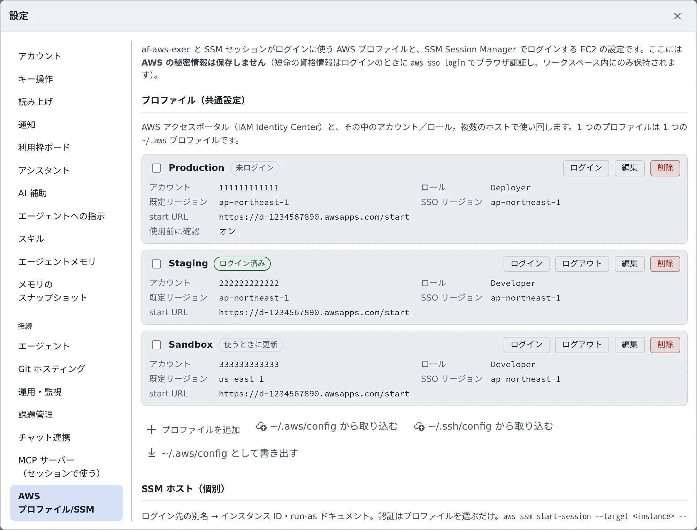
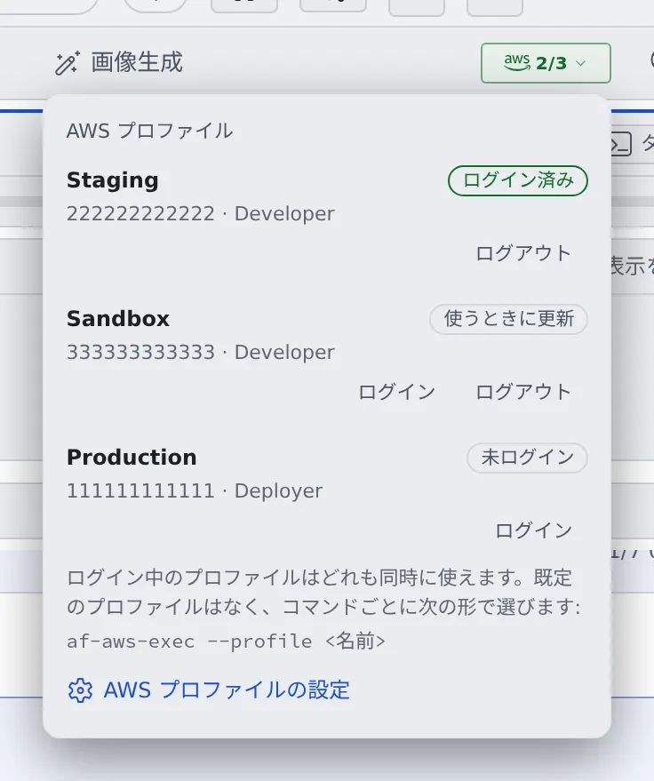
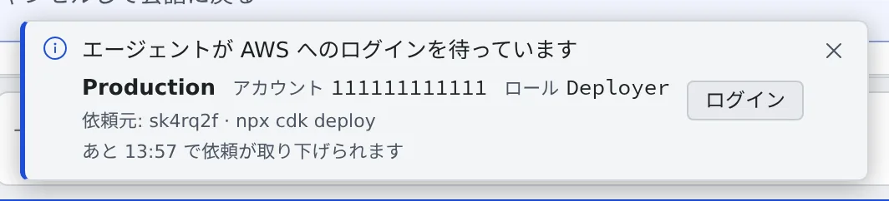

# AWS SSO を使う

[English](aws-sso.md) | 日本語

AWS SSO（IAM Identity Center）のプロファイルを登録してログインしておくと、エージェントがあなたの権限で
AWS のコマンドを実行できます。

## 全体像

| あなたがやること | エージェントがやること |
|---|---|
| プロファイルを登録する | `af-aws-exec` を付けてコマンドを実行する |
| ログインを承認する | ログインが切れていたら、あなたに頼んで待つ |

`af-aws-exec` は、指定したプロファイルの権限でコマンドを 1 つ実行するツールです。
エージェントは最初からこのツールの使い方を知っているので、「staging に cdk deploy して」と頼むだけで使ってくれます。

> [!NOTE]
> **Cursor だけは、このツールのことを知りません。** Cursor に頼むときは
> 「`af-aws-exec --profile Staging` で実行して」のように書き添えてください。

## プロファイルを登録する

**⚙設定 →「AWS プロファイル/SSM」** を開き、「**プロファイルを追加**」を押します。



| 項目 | 入れるもの |
|---|---|
| ラベル | 一覧に出る名前。コマンドで指定する名前にもなります |
| start URL | アクセスポータルの URL（`https://….awsapps.com/start`） |
| SSO リージョン | アクセスポータルのリージョン |
| アカウント ID・ロール名 | 使うアカウントとロール。ログインとコマンドの実行には両方が必要です |
| 既定リージョン | 任意。ふだん使うリージョン |

> [!TIP]
> コマンドで指定する名前は、ラベルの英数字と `. _ @ -` 以外の文字（空白や日本語も）を `-` に置き換えたものです
> （`prod app` なら `prod-app`）。迷ったら `af-aws-exec --list` で確かめられます。

### 手元の ~/.aws/config から取り込む

手元の PC で AWS CLI を使っているなら、打ち直す必要はありません。プロファイルの一覧の下の
「**~/.aws/config から取り込む**」を押して、ファイルを選ぶか中身を貼り付けます。

- 取り込めるプロファイルと、取り込めないプロファイル（理由つき）がプレビューに並びます。チェックを付けたものだけが登録されます
- ファイルはブラウザの中で読みます。アクセスキーなどの秘密は取り込みません
- 手元で 1 つのログインを共有していたプロファイルは、ここでも 1 つのログインを共有するように提案されます
  （[共有サインインで 1 回のログインを複数のプロファイルに使う](#共有サインインで-1-回のログインを複数のプロファイルに使う)）

取り込めない形式の一覧は [AWS プロファイルの仕様](../../ref/aws-profiles.ja.md#取り込みの規則) にあります。

## 別のアカウントのロールを使う

IAM Identity Center のサインインを信頼するロールを経由して別のアカウントに入るときは、
**種類**を「**別のプロファイルからロールを引き受ける**」にしたプロファイルを追加します。長期のアクセスキーは要りません。

| 項目 | 入れるもの |
|---|---|
| 元のプロファイル | ロールを引き受ける元になる SSO プロファイル |
| ロール ARN | 引き受けるロール（`arn:aws:iam::123456789012:role/deploy` など）。アカウントはここから決まります |
| 外部 ID・セッション名・有効期間（秒） | 任意。有効期間は 900〜3600 秒です |
| 既定リージョン | 任意。空なら元のプロファイルのリージョンを使います |

- **ログインは元のプロファイルのものを使います。** このプロファイル自身のログインはありません。
  AWS バッジには「**Staging のログインに従います**」のように、元のプロファイルの名前が表示されます。
- 使い方は SSO のプロファイルと同じです。`af-aws-exec --profile <名前> -- …` で実行できます。
- 引き受けるロールの信頼ポリシーで、元のアカウントにあるあなたの Identity Center のロール
  （`AWSReservedSSO_<権限セット>_…`）を許可しておく必要があります。

## ログインする

プロファイルの行の「**ログイン**」を押すと、ログインの画面が開きます。

1. 画面の「**ログイン**」を押すと、コードが表示されます
2. コードを確かめて「**ログインして承認**」を押します
3. 開いたページで、同じコードであることを確かめて承認します

行のバッジが **ログイン済み** に変わったら完了です。

ログインの状態は、画面上部の WS バーにある **AWS バッジ** でいつでも確かめられます。
押すとプロファイルの一覧が開き、そこからもログイン・ログアウトできます。



| バッジ | 意味 |
|---|---|
| ログイン済み | そのまま使えます |
| 使うときに更新 | ポータルのセッションが続いていれば、次に使うときに自動で更新されます |
| 未ログイン | ログインが必要です |
| 元プロファイルなし | ロールを引き受けるプロファイルの、元のプロファイルが見つかりません。設定で直してください |

ロールを引き受けるプロファイルには、状態の代わりに「**Staging のログインに従います**」のように表示されます。

### ログインが切れたとき

ふだんのログインは、ポータルのセッションが続くかぎり、使うたびに自動で更新されます。ポータルのセッションが終わると、
次にコマンドを実行したときにログインを頼まれます（[エージェントに頼む](#エージェントに頼む)のトースト）。

自動で更新できないログインのときだけ、切れる 10〜15 分ほど前に「**AWS のログインが … に切れます**」というトーストが出ます。
「**ログイン**」を押してログインし直してください。

### ログアウトする

プロファイルの行か、AWS バッジの一覧の「**ログアウト**」を押します。AWS 側のログインも終わり、ワークスペースに残っていた
ログイン情報も消えます。そのプロファイルに従うロールのプロファイルも、一緒にログアウトします。

> [!WARNING]
> ターミナルで `aws sso logout` を使わないでください。`--profile` を付けても、すべてのプロファイルがログアウトします。

## 共有サインインで 1 回のログインを複数のプロファイルに使う

アカウントやロールは違っても、ポータル（start URL）は同じ、ということはよくあります。そういうプロファイルを
1 つの**共有サインイン**に入れると、1 回のログインですべてのプロファイルを使えます。

- **新しく作るとき**：プロファイルの編集画面の **サインイン** で「**新しい共有サインイン…**」を選び、名前とポータルを入れます。
  2 つ目からは、一覧に出るそのサインインを選ぶだけです
- **登録済みのプロファイルをまとめるとき**：一覧で行の先頭のチェックを付けて「**サインインを共有**」を押します。
  今ログインしているプロファイルの名前をサインインの名前にすると、ログインし直さずに済みます

まとめたプロファイルは一覧で 1 つの見出しの下に並び、ログインとログアウトは見出しから行います。
**ログアウトすると、そのサインインのプロファイルがすべてログアウトします。**
サインインから外すには、サインインで「**専用のサインイン**」を選びます。
サインインの名前やポータルを変えると、一覧に **要再ログイン** と出ます。もう一度ログインしてください。

名前の規則や、保存が断られる場合は [AWS プロファイルの仕様](../../ref/aws-profiles.ja.md#共有サインイン) にあります。

## エージェントに頼む

ふだんどおりにお願いするだけです。

> Staging の S3 バケットの一覧を見せて

ログインが切れているときは、画面の下に「**エージェントが AWS へのログインを待っています**」というトーストが出ます。
どのセッションが、どのコマンドのために待っているかも表示されます。`aws` なら CLI が知っているサービスと操作（`aws s3 cp`）まで、
ほかのプログラムは名前だけを出し、引数は出しません。



「**ログイン**」を押すと、上と同じログインの画面が開きます。承認すると、待っていたコマンドがそのまま続きます。
間に合わなかったときは、エージェントがもう一度実行します。

実行の記録は、セッションの会話に残ります（コマンドの引数は記録されません）。
全セッション分は、設定の「**最近の実行**」で見られます。

## 自分で使う

ターミナルからも同じように使えます。

```sh
af-aws-exec --profile Staging -- aws s3 ls
af-aws-exec --list   # 使えるプロファイルの一覧
```

オプションや終了コード、ビルドツールや SDK から使うときの注意は
[af-aws-exec](../../ref/cli/af-aws-exec.ja.md) にあります。

## 手元の PC で同じプロファイルを使う

一覧の下の「**~/.aws/config として書き出す**」を押すと、登録したプロファイルを AWS CLI の設定の形でダウンロードできます。

- **手元の `~/.aws/config` に貼り足すための断片です。** ファイルごと置き換えると、ほかのプロファイルが消えます
- 書き出せないプロファイルは、理由つきでダイアログに並びます

## もっと安全に使う

- **「使用前に確認」をオンにする**：プロファイルの編集画面にあります。オンにすると、セッションがそのプロファイルをはじめて使う前に
  「**このセッションが、確認付きの AWS プロファイルを使おうとしています**」と確認が出ます。
  「**このセッションで許可**」を押すと、8 時間かセッションが終わるまで許可が続きます。本番用のプロファイルに向いています。
  カードには実行するコマンドが出ます。`aws` なら CLI が知っているサービスと操作（`aws s3 cp`）まで出し、引数は出しません。
  通知として出たカードでは、セッション名を押すとそのセッションが開きます。
- **`--account` を付ける**：アカウント ID が違えば何も実行せずに止まります。デプロイの手順書やエージェントへの指示に書いておくと安心です。

  ```sh
  af-aws-exec --profile Production --account 111111111111 -- npx cdk deploy
  ```

## 困ったとき

### 「Unable to locate credentials」と出る

プロファイルを指定せずに実行しています。`af-aws-exec --profile <名前> -- …` で実行し直してください。
`aws configure` で鍵を設定して解決しようとしないでください。

### 「The config profile (…) could not be found」と出る

Terraform や CDK などのツールが、`af-aws-exec` で指定したのとは別のプロファイルを使おうとしています。
ツール側のプロファイル指定を外すか、そのプロファイルを `--profile` で指定してください。

### ログインボタンが押せない

プロファイルに **アカウント ID とロール名** の両方が入っているか確かめてください。

### 設定を変えたのに反映されない

ワークスペースには 5 分以内に反映されます。「ログイン」を押すか、`af-aws-exec` を実行すると、すぐに反映されます。
すでに開いているセッションは古い設定のままです。

## 関連

- [SSM で EC2 にログインする](aws-ssm.ja.md)
- [AWS プロファイルの仕様](../../ref/aws-profiles.ja.md)：取り込み・書き出し・共有サインインの細かい規則
