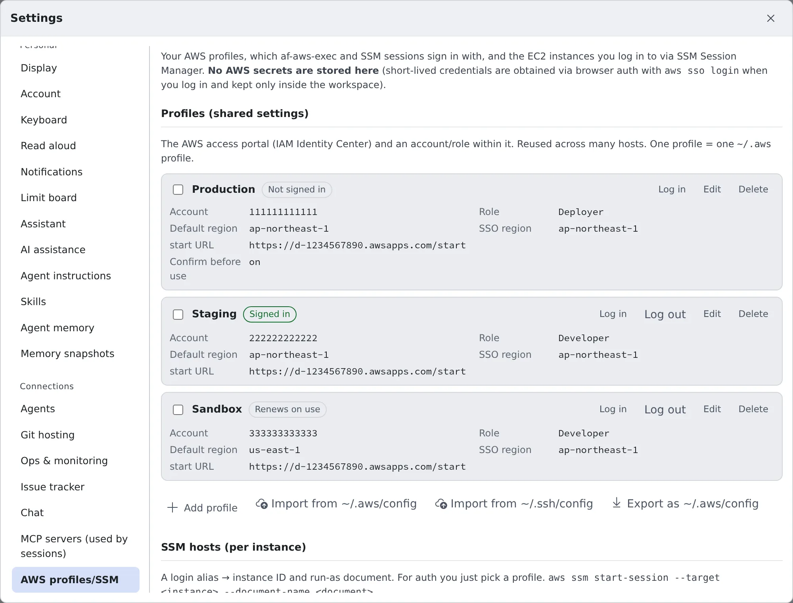
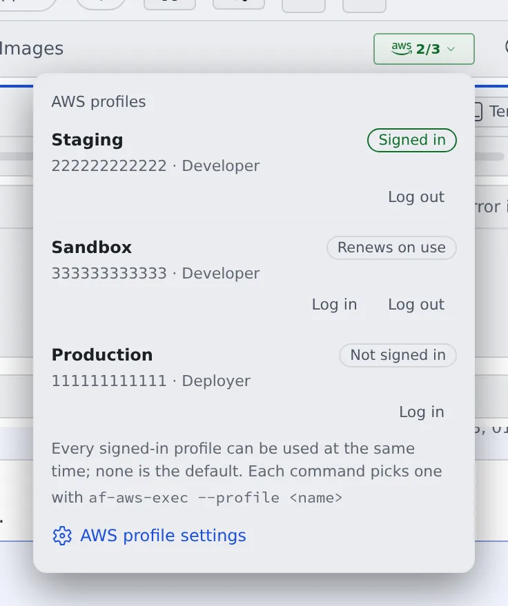
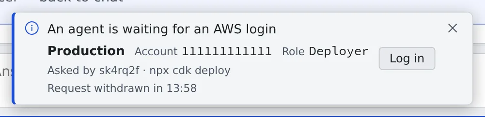

# Use AWS SSO

English | [日本語](aws-sso.ja.md)

Register your AWS SSO (IAM Identity Center) profiles and log in, and agents can run AWS commands with your
permissions.

## How it works

| What you do | What the agent does |
|---|---|
| Register a profile | Runs commands through `af-aws-exec` |
| Approve the login | Asks you and waits when the login has expired |

`af-aws-exec` runs one command with the permissions of the profile you name. Agents already know how to use it, so
asking "cdk deploy to staging" is enough.

> [!NOTE]
> **Cursor is the one agent that does not know this tool.** When you ask Cursor, add something like
> "run it with `af-aws-exec --profile Staging`".

## Register a profile

Open **⚙ Settings → "AWS profiles/SSM"** and press "**Add profile**".



| Field | What to enter |
|---|---|
| Label | The name shown in the list. It is also the name you give to commands |
| start URL | The access portal's URL (`https://….awsapps.com/start`) |
| SSO region | The access portal's region |
| Account ID, Role name | The account and role to use. Logging in and running commands need both |
| Default region | Optional. The region you usually work in |

> [!TIP]
> The name you give to commands is the label with every character other than letters, digits and `. _ @ -` (spaces
> included) replaced by `-`: `prod app` becomes `prod-app`. `af-aws-exec --list` shows the names.

### Import from your own ~/.aws/config

If you already use the AWS CLI on your own computer, there is nothing to retype. Press "**Import from
~/.aws/config**" below the profile list, then pick the file or paste its contents.

- The preview lists the profiles it can import and the ones it cannot, with the reason. Only the checked ones are
  registered
- The file is read inside your browser. Secrets such as access keys are not imported
- Profiles that shared one login on your computer are proposed to share one login here too
  ([Use several profiles with one login](#use-several-profiles-with-one-login))

The formats that cannot be imported are listed in [AWS profiles reference](../../ref/aws-profiles.md#import-rules).

## Use a role in another account

When you reach another account through a role that trusts your IAM Identity Center sign-in, add a profile whose
**Type** is "**Assume a role from another profile**". No long-lived access keys are needed.

| Field | What to enter |
|---|---|
| Source profile | The SSO profile the role is assumed from |
| Role ARN | The role to assume, e.g. `arn:aws:iam::123456789012:role/deploy`. The account comes from it |
| External ID, Session name, Duration (seconds) | Optional. The duration is 900 to 3600 seconds |
| Default region | Optional. When empty, the source profile's region is used |

- **It uses the source profile's login.** The profile has no login of its own. The AWS badge shows the source
  profile's name, e.g. "**Follows Staging's login**".
- Use it like an SSO profile: `af-aws-exec --profile <name> -- …`.
- The trust policy of the role to assume has to allow your Identity Center role in the source account
  (`AWSReservedSSO_<permission set>_…`).

## Log in

Press "**Log in**" on the profile's row. The login screen opens.

1. Press "**Log in**" on that screen. A code appears
2. Check the code and press "**Sign in and approve**"
3. On the page that opens, check that the code is the same, and approve

You are done when the row's badge changes to **Signed in**.

The **AWS badge** in the WS bar at the top shows the login state at any time. Press it to open the profile list,
where you can also log in and out.



| Badge | Meaning |
|---|---|
| Signed in | Ready to use |
| Renews on use | Renewed automatically the next time it is used, as long as the portal session lasts |
| Not signed in | You need to log in |
| Source unavailable | The source profile of a role profile cannot be found. Fix it in Settings |

A profile that assumes a role shows "**Follows Staging's login**" or similar instead of a state.

### When the login expires

A normal login is renewed every time it is used, for as long as the portal session lasts. When the portal session
ends, the next command asks you to log in (the toast in [Ask an agent](#ask-an-agent)).

Only a login that cannot be renewed warns you beforehand: a "**Your AWS login ends at …**" toast appears about 10 to
15 minutes before it ends. Press "**Log in**" to log in again.

### Log out

Press "**Log out**" on the profile's row or in the AWS badge's list. The login also ends on the AWS side, and what was
left of it in the workspace is deleted. Role profiles that follow this profile are logged out with it.

> [!WARNING]
> Do not use `aws sso logout` in a terminal. It logs out every profile, even with `--profile`.

## Use several profiles with one login

Profiles often have different accounts or roles but the same portal (start URL). Put them in one **shared sign-in**,
and one login covers all of them.

- **To create one**: in the profile's form, choose "**New shared sign-in…**" under **Sign-in** and enter a name and
  the portal. For the next profile, pick that sign-in from the list
- **To group profiles you already have**: check the box at the start of their rows and press "**Share one
  sign-in**". Name the sign-in after the profile that is logged in now, and you do not have to log in again

Grouped profiles are listed under one heading, and you log in and out from the heading. **Logging out logs out every
profile in the sign-in.** To take a profile out, choose "**Its own sign-in**" under **Sign-in**. After you rename a
sign-in or change its portal, the list shows **Log in again**: log in once more.

The naming rules and the reasons a save can be refused are in
[AWS profiles reference](../../ref/aws-profiles.md#shared-sign-ins).

## Ask an agent

Ask as you normally would.

> Show me the S3 buckets in Staging

When the login has expired, a toast saying "**An agent is waiting for an AWS login**" appears at the bottom of the
screen, with the session that is waiting and the command it wants to run. For `aws` the command shows the service and
operation when the CLI knows them (`aws s3 cp`); any other program shows its name alone, never its arguments.



Press "**Log in**" to open the same login screen as above. Once you approve, the waiting command carries on. If you
were too late, the agent runs it again.

Each run is recorded in the session's conversation (command arguments are not recorded). Every session's runs are
in "**Recent runs**" in Settings.

## Use it yourself

It works the same way from a terminal.

```sh
af-aws-exec --profile Staging -- aws s3 ls
af-aws-exec --list   # the profiles you can use
```

The options, exit codes, and what to watch for with build tools and SDKs are in
[af-aws-exec](../../ref/cli/af-aws-exec.md).

## Use the same profiles on your own computer

Press "**Export as ~/.aws/config**" below the list to download your profiles in the AWS CLI's config format.

- **It is a fragment to paste into your own `~/.aws/config`.** Replacing the whole file removes your other profiles
- The dialog lists the profiles it could not export, with the reason

## Use it more safely

- **Turn on "Confirm before use"**: it is in the profile's form. When it is on, a session that is about to use the
  profile for the first time asks "**This session wants to use an AWS profile that asks for confirmation**". Press
  "**Allow for this session**", and the permission lasts 8 hours or until the session ends. Suits production
  profiles. The card names the command; for `aws` it shows the service and operation when the CLI knows them
  (`aws s3 cp`), never the arguments. Shown as a notification, the card's session name opens that session.
- **Add `--account`**: if the account ID differs, nothing runs. Put it in deploy runbooks and in instructions to
  agents.

  ```sh
  af-aws-exec --profile Production --account 111111111111 -- npx cdk deploy
  ```

## When it goes wrong

### "Unable to locate credentials"

The command ran without a profile. Run it again as `af-aws-exec --profile <name> -- …`. Do not try to fix it by
setting keys with `aws configure`.

### "The config profile (…) could not be found"

A tool such as Terraform or CDK asks for a different profile than the one you gave `af-aws-exec`. Remove the tool's
own profile setting, or give that profile to `--profile`.

### The Log in button cannot be pressed

Check that the profile has both an **Account ID** and a **Role name**.

### A change in Settings does not take effect

It reaches the workspace within 5 minutes. Pressing "Log in" or running `af-aws-exec` applies it at once. Sessions
that are already open keep the old settings.

## Related

- [Log in to EC2 with SSM](aws-ssm.md)
- [AWS profiles reference](../../ref/aws-profiles.md): the detailed rules for import, export and shared sign-ins
