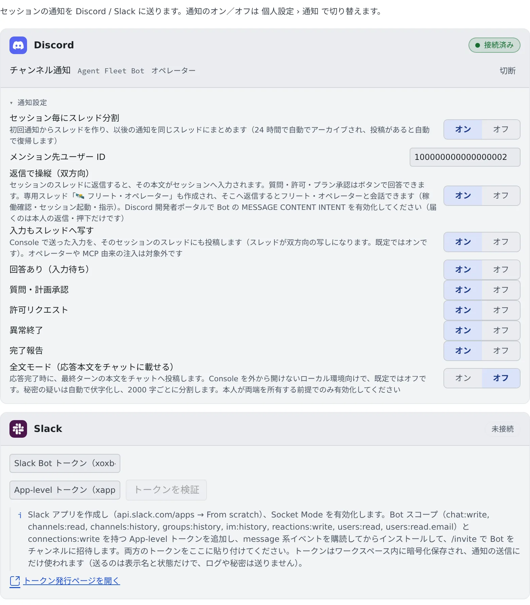

# Discord・Slack とつなぐ

[English](chat-bridge.md) | 日本語

自分の Discord か Slack の Bot を接続しておくと、セッションが入力待ちになったときや質問してきたときに、チャットに通知が届きます。
返信やボタンで、そのままセッションに答えることもできます。

## 全体像

| あなたがやること | 起きること |
|---|---|
| Bot を作って、トークンを貼る | Bot が、選んだチャンネル（または DM）に通知を送る |
| 通知のスレッドに返信する | 返信がそのセッションへの入力になる |
| 質問や許可のボタンを押す | Console で答えたのと同じように、セッションが先へ進む |

Discord と Slack は、両方同時に接続できます。接続はワークスペースの中で動くので、設定するときはワークスペースが起動している必要があります。

## Discord を接続する

**⚙設定 →「チャット連携」** を開きます。



1. [Discord Developer Portal](https://discord.com/developers/applications) で New Application → Bot → Reset Token と進み、Bot のトークンを取得します
2. Discord のカードにトークンを貼り、「**トークンを検証**」を押します
3. 「**サーバーへ招待**」を押して、Bot を自分のサーバーに追加します。カードは Bot が加わるのを待って、自動で先へ進みます
4. 通知先のチャンネルを選んで「**接続**」を押します

接続すると、テスト通知が届きます。届いていれば設定は完了です。

- チャンネルではなく自分あての DM に送りたいときは、「**上級者向け: DM に送る（ユーザー ID 手入力）**」を押して、自分の Discord ユーザー ID を入れます
- 返信で操作したいときは、Developer Portal で Bot の **MESSAGE CONTENT INTENT** を有効にしておきます

## Slack を接続する

1. [Slack のアプリ](https://api.slack.com/apps)を From scratch で作り、Socket Mode を有効にします
2. Bot のスコープを付け、message 系のイベントを購読してから、ワークスペースにインストールします
3. 返信で操作したいときは、`connections:write` を持つ App-level トークンも作ります
4. `/invite` で Bot を通知先のチャンネルに招待します
5. Slack のカードに Bot トークン（`xoxb-…`）と、要るなら App-level トークン（`xapp-…`）を貼り、「**トークンを検証**」を押します
6. チャンネルを選んで「**接続**」を押します

Bot のスコープは次のとおりです。

```text
chat:write, channels:read, channels:history, groups:history, im:history,
reactions:write, users:read, users:read.email
```

- 自分の Slack メンバー ID は、メールアドレスから自動で入ります。メンションされるのも、返信やボタンを受け付けるのも、この人だけです
- 通知だけなら Bot トークン 1 つで足ります。返信で操作するには、App-level トークンとメンバー ID が要ります

## 届く通知を決める

接続したカードの「**通知設定**」を開くと、細かい設定が並びます。変えるとすぐに保存されます。

| 設定 | 既定 | 内容 |
|---|---|---|
| 「**セッション毎にスレッド分割**」 | オン | セッションごとにスレッドを作り、通知をまとめます |
| 「**メンション先ユーザー ID**」 | サーバーのオーナー | 空にするとメンションしません（Discord だけ） |
| 「**返信で操縦（双方向）**」 | オフ | [チャットから答える](#チャットから答える)を使えるようにします |
| 「**入力もスレッドへ写す**」 | オン | Console で送った入力も、セッションのスレッドに投稿します |
| 「**全文モード（応答本文をチャットに載せる）**」 | オフ | 応答の本文そのものを投稿します |

届く通知の種類は、1 つずつオン・オフできます。既定ではすべてオンです。

| 通知 | 届くとき |
|---|---|
| 回答あり（入力待ち） | セッションが答え終わって、次の入力を待っている |
| 質問・計画承認 | エージェントが質問している、または計画の承認を待っている |
| 許可リクエスト | ツールの実行の許可を待っている |
| 異常終了 | セッションが異常終了した |
| 完了報告 | エージェントが作業の完了を報告した |

- スレッド、メンション先、返信、入力の写しは、チャンネルに送るときだけの設定です。DM にはスレッドがありません
- スレッドに分けているときは、完了報告をスレッドには送りません。その前に「入力待ち」の通知が届いているからです
- 質問・計画・許可・異常終了は、いつもメンションします。それ以外は、スレッドが 10 分以上静かだったときだけメンションします
- 全文モードでは、秘密らしい文字列を自動で伏字にし、長い本文は分けて投稿します。Console を外から開けない環境向けの設定なので、
  チャットのサーバーやワークスペースが自分のものであるときだけオンにしてください

## チャットから答える

「**返信で操縦（双方向）**」をオンにすると、セッションのスレッドへの返信が、そのままそのセッションへの入力になります。
受け付けた返信には 👀 のリアクションが付きます。

質問・計画・許可には、ボタンでも答えられます。

| 届いたもの | ボタン | 使えるセッション |
|---|---|---|
| 質問 | 選択肢ごとのボタン | ターミナル（CLI）の Claude と、マネージドのセッション |
| 計画の承認 | 承認 / 却下 | ターミナル（CLI）の Claude |
| 許可リクエスト | 許可 / 拒否 | ターミナル（CLI）の Claude |

- 複数選択の質問や、選択肢が 26 個以上ある質問にはボタンが付きません。Console で答えてください
- シェルや SSM のセッションには、チャットから返信できません。スレッドに断りが返り、端末には何も入力されません
- 受け付けるのは、接続した本人の返信とボタンだけです

## セッションの開始とスレッドの付け替え

「**返信で操縦（双方向）**」をオンにすると、セッションのスレッドの中で次の 2 つのコマンドが使えます。
`!` で始まる普通のメッセージとして書きます。`!start` や `!attach` で始まるメッセージは必ずコマンドとして扱われます。
その文字のまま送りたいときは、前に何か（たとえばバッククォート）を付けてください。

| コマンド | 動作 |
|---|---|
| `!start <最初の指示>` | スレッドのセッションと同じ種類・モデル・実行方式・作業コピーで新しいセッションを開始し、指示を渡します。最初の通知が届くとき、そのセッション専用のスレッドができます |
| `!attach <セッション名>` | **このスレッド**を、既存の別のセッションに付け替えます。以降ここへの返信はそのセッションに届きます |

- `!attach` はスレッドを移します。元のセッションはスレッドを失い、次の通知で新しいスレッドを作ります。付け替え先がもともと持っていたスレッドは、返信を受け付けなくなります。1 つのスレッドは同時に 1 つのセッションにしか紐づきません
- 送信の瞬間にすでに処理中だった返信や通知は、付け替え前のセッションに届くことがあります。確認メッセージのあとに書いたものは新しいセッションに届きます
- `!start` はすぐ 👀 を付け、セッションが立ち上がったら結果を投稿します。同じメッセージが数秒内に二重に届いても、2 つ目は作らず「開始中」と返します。Agent の再起動をまたいだ再配信では、二重に開始することがあります
- `!attach` で対象から取り上げたスレッドには、置き換えられて返信を受け付けなくなったことが投稿されます
- 返信と同じ条件です。使えるのは接続した本人だけで、セッションのスレッドの中に限ります。シェルや SSM のセッションは、開始元にも付け替え先にもできません
- `!start` はメッセージからリポジトリ・種類・ホストを受け取りません。別のものを始めるときは Console かフリート・オペレーターのスレッドを使ってください

## フリート・オペレーターと話す

「**返信で操縦（双方向）**」をオンにすると、常設のスレッド「🛰 フリート・オペレーター」もできます。
ここに書き込むと、Console と同じ[フリート・オペレーター](../fleet/operator.ja.md)と会話できます。稼働の確認や、セッションの起動・指示を頼めます。

チャットから頼んだ削除などの操作は、実行の前に「承認 / 却下」のボタンで止まります。

| 押したあとの返事 | 意味 |
|---|---|
| 「✓ 承認しました（実行します）」 | 操作を実行します |
| 「この承認は期限切れ、または処理済みです」 | 何もしません。約 4 分の期限が切れたか、すでに一度押されています |
| 「⚠ 承認を受け付けましたが確定できませんでした（実行しません）。…」 | 何もしません。もう一度頼んでください |

「期限切れ、または処理済み」は、すでに承認したものをもう一度押したときにも出ます。最初の押下で実行済みのことがあるので、
結果を確かめてから頼み直してください。

## 通知だけ止める

接続を切らずに送信だけを止めるには、**⚙設定 →「通知」** の「サービス通知」で、Discord や Slack をオフにします。
接続そのものをやめるときは、カードの「**切断**」を押します。

## 困ったとき

### テスト通知が届かない

「接続は保存しましたがテスト送信に失敗しました: …」と出たときは、Bot がそのチャンネルに投稿できていません。
Bot がサーバーやチャンネルに加わっているか、投稿の権限があるかを確かめてください。

### 「Discord がトークンを拒否しました」「Slack がトークンを拒否しました」と出る

トークンが違うか、作り直されて古くなっています。Developer Portal や Slack のアプリで、トークンを取り直して貼ってください。

### 返信してもセッションに届かない

- 「**返信で操縦（双方向）**」がオンかを確かめます
- Discord では MESSAGE CONTENT INTENT が、Slack では App-level トークンが要ります
- 返信はセッションのスレッドに書きます。チャンネルに直接書いても届きません
- セッションが止まっているときは「⚠️ セッションが停止しています。開始してから返信してください」と返ります

### 「返信の受信には App-level トークン（xapp-）が必要です」と出る

Slack で返信を受け付けるには、App-level トークンが要ります。カードを切断して、2 つのトークンを貼り直してください。

## 関連

- [フリート・オペレーターに任せる](../fleet/operator.ja.md)
- [設定](../settings/notifications.ja.md)：Console とブラウザの通知
