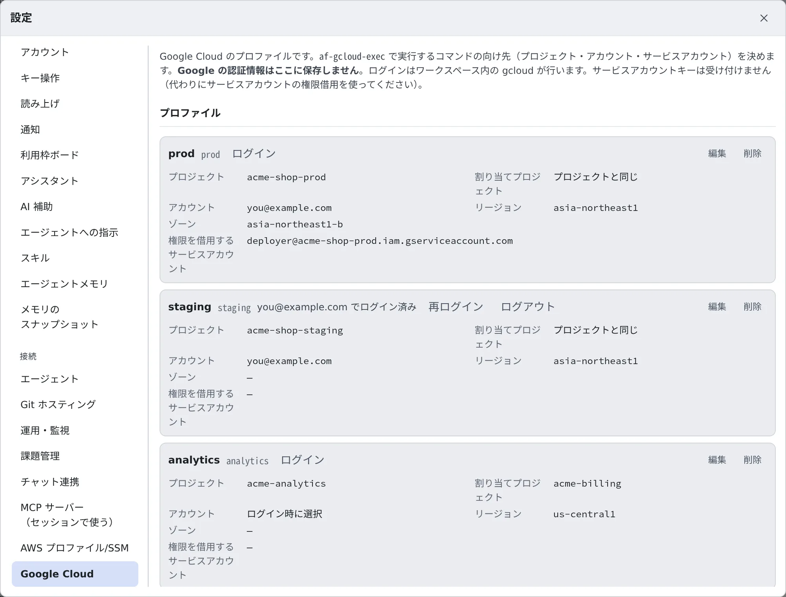
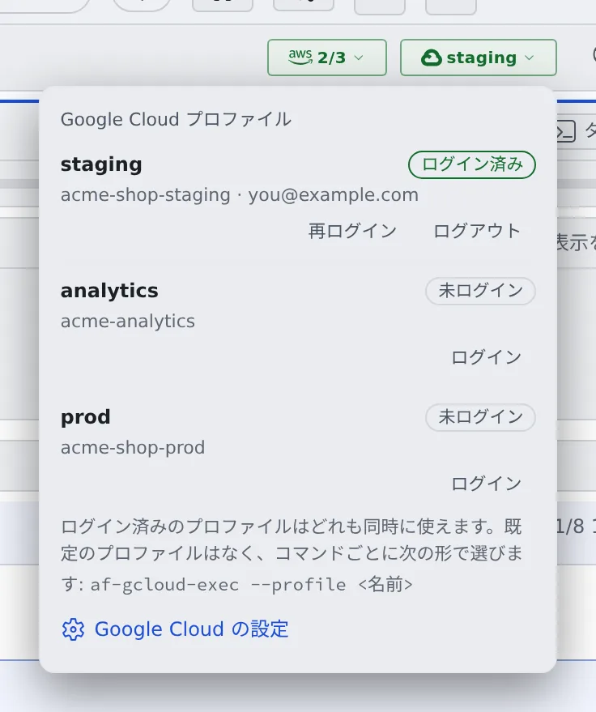
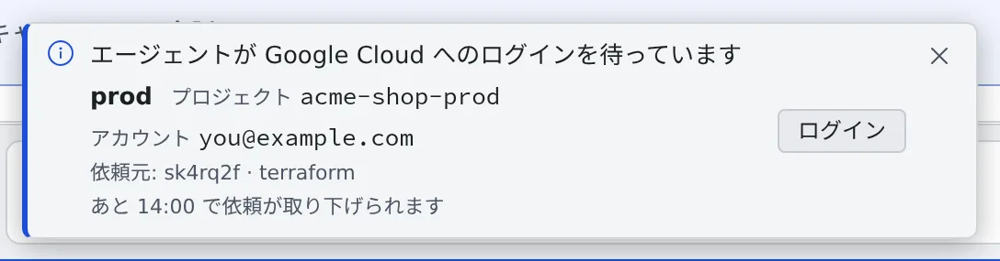

# Google Cloud を使う

[English](gcloud.md) | 日本語

Google Cloud のプロファイルを登録してログインしておくと、エージェントがあなたの Google アカウントの権限で
`gcloud`・`kubectl`・Terraform などのコマンドを実行できます。

## 全体像

| あなたがやること | エージェントがやること |
|---|---|
| プロファイルを登録する | `af-gcloud-exec` を付けてコマンドを実行する |
| Console でログインする | ログインが要るときは、あなたに頼んで待つ |

`af-gcloud-exec` は、指定したプロファイルの有効期限の短いトークンでコマンドを 1 つ実行するツールです。
エージェントは最初からこのツールの使い方を知っているので、「staging の Cloud Run のサービスを一覧して」と頼むだけで使ってくれます。

> [!NOTE]
> **Cursor だけは、このツールのことを知りません。** Cursor に頼むときは
> 「`af-gcloud-exec --profile staging --project acme-shop-staging` で実行して」のように書き添えてください。

## プロファイルを登録する

**⚙設定 →「Google Cloud」** を開き、「**プロファイルを追加**」を押します。



| 項目 | 入れるもの |
|---|---|
| ラベル | 一覧に出る名前。コマンドで指定する名前はここから作られ、ラベルの横に表示されます |
| ログイン方法 | Google アカウント（Google Workspace・Cloud Identity のアカウントを含みます） |
| プロジェクト | コマンドが既定で向くプロジェクト ID（プロジェクト番号ではありません） |
| 割り当てプロジェクト | 任意。API の割り当てを課金するプロジェクトです。空欄ならプロジェクトと同じです |
| アカウント | 任意。ログインする Google アカウントです。ほかのアカウントではログインできません。空欄ならログインのときに選びます |
| 権限を借用するサービスアカウント | 任意。コマンドは、ログインしたアカウントを通じてこのサービスアカウントとして動きます |
| リージョン・ゾーン | 任意 |

- **サービスアカウントキーは受け付けません。** サービスアカウントとして動かしたいときは、権限の借用を使います。
  あなたのアカウントに、そのサービスアカウントの「サービス アカウント トークン作成者」のロールが必要です
- 個人のアカウントでは、割り当てプロジェクトがないと使えない API があります。あなたのアカウントには、割り当てプロジェクトでサービスを使う権限が必要です
- 変更は 5 分ほどでワークスペースに届きます。`af-gcloud-exec` を実行すると、すぐに届きます
- アカウントを指定し直す、ラベルを変えてコマンド用の名前が変わる、削除して作り直す、のどれかをすると、使うアカウントの選択はリセットされます。そのアカウントでまだログインしていなければ、次の実行でログインを頼まれます

> [!TIP]
> コマンドで指定する名前は、ラベルを英小文字・数字・`-` だけにしたものです（`Prod App` なら `prod-app`）。
> 2 つのラベルが同じ名前になると（`Prod` と `prod`）、**どちらも**使えません。行にそう表示されるので、片方の名前を変えてください。
> 迷ったら `af-gcloud-exec --list` で確かめられます。

### 手元の gcloud の構成から取り込む

手元の PC で gcloud を使っているなら、打ち直す必要はありません。プロファイルの一覧の下の
「**gcloud の構成から取り込む**」を押して、`~/.config/gcloud/configurations` にある `config_<名前>` のファイルを選びます。
1 つだけなら、中身を貼り付けて名前を入れてもかまいません。

- プレビューに、構成ごとに「**作成**」「**登録済み**」「**取り込めません**」（理由つき）が並びます。チェックを付けたものだけが登録されます
- ラベルは構成の名前になります。取り込む前に変えられます
- ファイルはブラウザの中で読むだけで、送信しません。gcloud の認証情報やキーファイルは読みません
- 取り込んでもログインはされません。プロファイルごとに「**ログイン**」を押してください

| 引き継ぐもの | 取り込めない構成 |
|---|---|
| `core/project`・`core/account`・`billing/quota_project`・`compute/region`・`compute/zone`、1 つだけの `auth/impersonate_service_account` | プロジェクトがない、`core/account` がサービスアカウント、サービスアカウントを並べた委任チェーン、ほかの `auth/` の設定（認証情報ファイルなど）、プロキシや API エンドポイントの上書き、universe domain |

取り込めない構成をそのまま作ると、手元とは別の相手に向くプロファイルになってしまうため、理由を付けて対象外にしています。

## ログインする

プロファイルの行の「**ログイン**」を押すと、ログインの画面が開きます。

1. 画面の「**ログイン**」を押します。ここではじめてログインが始まります
2. 「**Google ログインを開く**」を押すと、Google のログインページが新しいタブで開きます（アドレスは必ず `accounts.google.com` です）。ログインします
3. Google に表示された確認コードを、同じ画面の「**確認コード**」に貼り付けて「**コードを送信**」を押します

「**ログインしました**」と出て、行に「**… でログイン済み**」と表示されたら完了です。

> [!WARNING]
> **コードは、いまここで自分で始めたログインにだけ貼り付けてください。** 誰がログインを始めたかを証明するものはありません。
> ほかの誰か（エージェントを含む）が目の前に出した欄・ターミナル・チャットのメッセージには、貼り付けないでください。

- ワークスペースがそのアカウントのログインをすでに持っていれば、ログインのページなしですぐ終わります
- 15 分以内に終わらなかったログインは止まります。「**やり直す**」で新しく始めます
- 別の画面でもう一度「ログイン」を押すと、先のログインは止まり、そのコードは使えなくなります
- ログインはワークスペース専用の gcloud に保存されます。ターミナルで使う自分の `gcloud` とは別物で、片方でログインしても、もう片方はログインしません

### ワークスペース操作バーの Google Cloud バッジ

ワークスペースが動いていて、プロファイルが 1 つ以上あると、画面上部のワークスペース操作バーに Google Cloud のバッジが出ます。
押すとプロファイルの一覧が開き、そこからもログイン・ログアウトできます。



| バッジの表示 | 意味 |
|---|---|
| プロファイルの名前（緑） | ログイン済みのプロファイルが 1 つだけ |
| 「1/3」のような数（緑） | 3 つのうち 1 つがログイン済み |
| 「0/3」のような数（枠だけで塗りなし） | ログイン済みのプロファイルがない |
| 琥珀色 | エージェントがログインを待っている。その行に「**このログインを待っているエージェントがあります**」と出ます |

既定のプロファイルはありません。ログイン済みのプロファイルはどれも同時に使え、コマンドごとに選びます。
一覧のいちばん下の「**Google Cloud の設定**」から、設定のタブを開けます。

> [!NOTE]
> 「**ログイン済み**」は、ログインがワークスペースに保存されている、という意味です。ワークスペースは Google に確かめないので、
> Google 側で取り消されたログインも「ログイン済み」のまま残ります。コマンドが断られたら「**再ログイン**」を押してください。

### ログインし直す

「**再ログイン**」は、保存済みのログインを使わずに必ずログインし直します。ログインが取り消されたとわかっているときに使います。

Google は、取り消されたときや、組織が一定時間ごとのログインし直しを求めているときに、保存したログインを断ります。
ワークスペースはその時刻を**前もって知らせられません**。次にコマンドを実行したときに、ログインを頼まれます
（[エージェントに頼む](#エージェントに頼む)のトースト）。

ただし、すでに渡したトークンの残りが 10 分を切るまでは実行が通ります。ログインを頼まれるのは、ログインが切れてから
最長でおよそ 50 分後になることがあります。

### ログアウトする

プロファイルの行か、バッジの一覧の「**ログアウト**」を押します。

- ログインは Google アカウントごとに 1 つです。**同じアカウントを使うプロファイルは、すべて一緒にログアウトします。**
  確認の画面に、一緒にログアウトするプロファイルが並びます
- Google 側のサインインと、ほかのマシンの gcloud には影響しません
- 実行中のコマンドがすでに受け取ったトークンは、期限（最長 1 時間）まで有効です
- それらのプロファイルのログインの画面でコードを待っているログインも止まります

## エージェントに頼む

ふだんどおりにお願いするだけです。

> staging の GKE クラスターの Pod を一覧して

ログインが要るときは、画面の下に「**エージェントが Google Cloud へのログインを待っています**」というトーストが出ます。
どのプロファイルを、どのセッションが、どのコマンドのために待っているかも表示されます。



「**ログイン**」を押すと、上と同じログインの画面が開きます。

- エージェントのコマンドは 1 分半ほど待ち、その間にログインが済めばそのまま続きます
- 間に合わなかったときは、コマンドは終了コード 3 で終わります。ログインしてから「済んだ」と伝えれば、エージェントがもう一度実行します
- ログインしないときは、ログインの画面の「**依頼を取り消す**」を押します。「**閉じる**」やトーストを閉じるだけなら、依頼は残ります
- 設定のプロファイルの行や、バッジの一覧からログインしても、待っている依頼は片付きます

実行の記録は、セッションの会話に残ります（コマンドの引数は記録されません）。
全セッション分は、設定の「Google Cloud」タブの「**最近の実行**」で見られます。

## 自分で使う

ターミナルからも同じように使えます。

```sh
af-gcloud-exec --list   # 使えるプロファイルの一覧
af-gcloud-exec --profile staging --project acme-shop-staging -- gcloud run services list
```

- `--project` には、プロファイルのプロジェクトを指定します。違うと断られます
- ワークスペースのターミナルでは、ログインが要ると Console に頼んで最大 10 分待ちます。`--login` を付けると、そのターミナルでログインします
- はじめて使うときに、Google Cloud SDK（約 85 MB）をダウンロードしてホームディレクトリに入れます。ターミナルで素の `gcloud` を実行すると、プロファイルではなく自分のログインで動きます

オプション、終了コード、`kubectl`・Terraform・`bq`・クライアントライブラリで使うときの注意は
[af-gcloud-exec](../../ref/cli/af-gcloud-exec.ja.md) にあります。

## 困ったとき

### コマンドが終了コード 3 で終わる

終了コード 3 は、いつもログインのことです。メッセージで見分けます。

| メッセージ | すること |
|---|---|
| `the login was requested in the Agent Fleet Console and is waiting …` | トーストか設定からログインして、もう一度実行してもらいます |
| `the login request was cancelled in the Agent Fleet Console` | 依頼を取り消しています。ログインするなら設定から行います |
| `Google Cloud login required … log in from a terminal with:` | Console に頼めませんでした（`--no-login`、ワークスペースの外）。表示されたコマンドを自分のターミナルで実行します |

### 「is for project X, not Y」と出る

このプロジェクト用のプロファイルではありません。`af-gcloud-exec --list` で、プロジェクトとアカウントを見て選び直してください。

### 「gcloud could not mint a token」と出る

ログインの問題ではありません。権限がない（借用するサービスアカウントへの権限を含む）、API が有効でない、ネットワークの問題、のどれかです。
理由はメッセージに書いてあります。

### 「no Google Cloud profile」「not exported」と出る

その名前のプロファイルは使えません。設定で追加するか、行の警告を見て直してください。

### 長い `terraform apply` が途中で失敗する

Terraform は、起動したときのトークンを使い続けます。トークンが切れると（最長でおよそ 1 時間）失敗するので、短い実行に分けてください。
詳しくは [af-gcloud-exec](../../ref/cli/af-gcloud-exec.ja.md#トークンの期限) にあります。

### Compute Engine の VM でログインが終わらない

Google Cloud の VM の上で直接動くワークスペースでは、gcloud が VM で個人アカウントを使うかを尋ねます。Console のログインは
これに答えられないので、ワークスペースのターミナルで次のコマンドを実行してログインしてください。

```sh
af-gcloud-exec --profile <名前> --project <プロジェクト ID> --login -- true
```

表示される URL をブラウザで開いてログインし、ページに出る確認コードを**その**ターミナルに貼り付けます。

## 関連

- [af-gcloud-exec](../../ref/cli/af-gcloud-exec.ja.md)：オプション・終了コード・トークンが届くツール・止まったときのメッセージ
- [AWS SSO を使う](aws-sso.ja.md)
