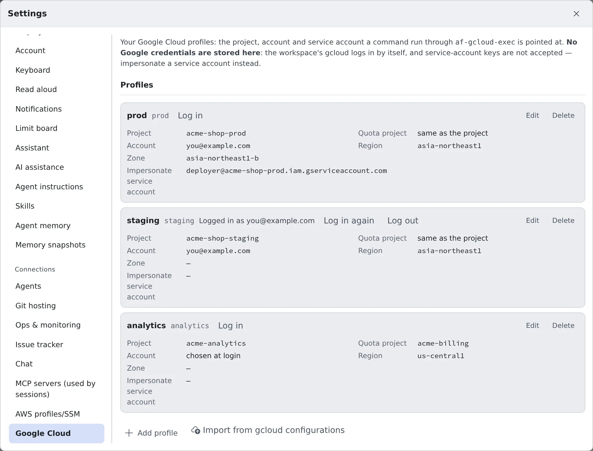
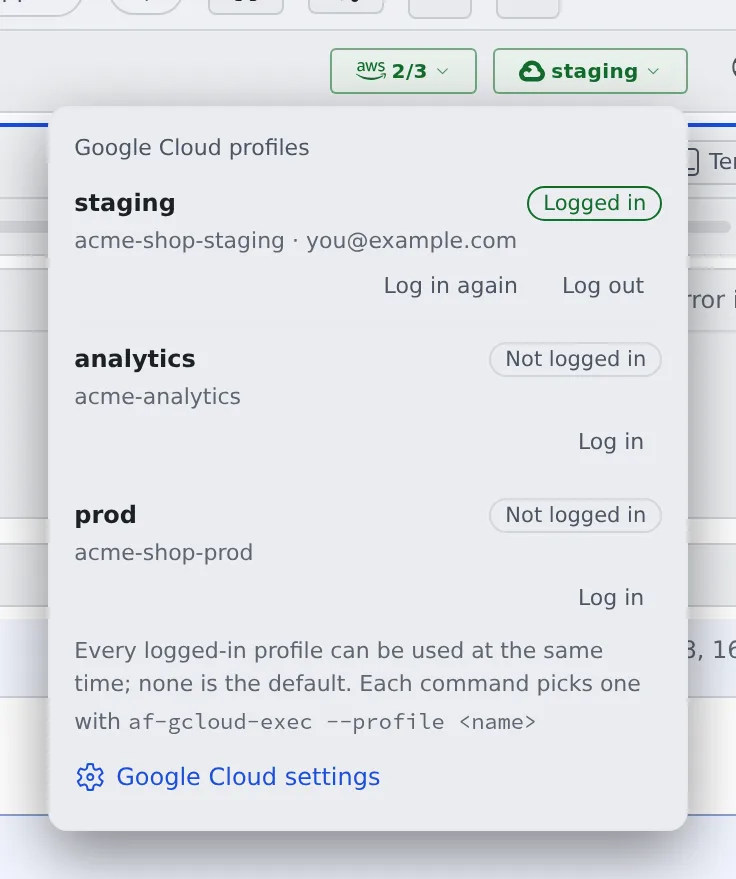
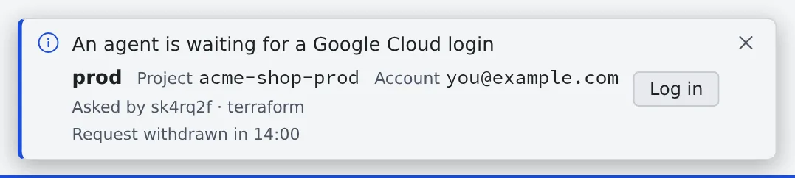

# Use Google Cloud

English | [日本語](gcloud.ja.md)

Register a Google Cloud profile and log in, and agents can run `gcloud`, `kubectl`, Terraform and other commands with
the permissions of your Google account.

## How it works

| What you do | What the agent does |
|---|---|
| Register a profile | Runs commands through `af-gcloud-exec` |
| Log in in the Console | Asks you and waits when a login is needed |

`af-gcloud-exec` runs one command with a short-lived token of the profile you name. Agents already know how to use it,
so asking "list the Cloud Run services in staging" is enough.

> [!NOTE]
> **Cursor is the one agent that does not know this tool.** When you ask Cursor, add something like
> "run it with `af-gcloud-exec --profile staging --project acme-shop-staging`".

## Register a profile

Open **⚙ Settings → "Google Cloud"** and press "**Add profile**".



| Field | What goes in |
|---|---|
| Label | The name shown in the list. The name you give commands is made from it and shown beside it |
| Login method | A Google account (including Google Workspace and Cloud Identity accounts) |
| Project | The project ID commands are pointed at by default (not the project number) |
| Quota project | Optional. The project billed for API quota. Left blank, it is the project |
| Account | Optional. The Google account to log in as; any other is refused. Left blank, you pick it at login |
| Impersonate service account | Optional. Commands act as this service account through the account you logged in with |
| Region, Zone | Optional |

- **Service-account keys are not accepted.** To act as a service account, impersonate it. Your account needs the
  Service Account Token Creator role on that service account
- Some APIs need a quota project when you use a personal account. Your account needs permission to use services in the
  quota project
- A change reaches the workspace within about five minutes. Running `af-gcloud-exec` brings it over at once

> [!TIP]
> The name you give commands is the label reduced to lowercase letters, digits and `-` (`Prod App` becomes `prod-app`).
> When two labels make the same name (`Prod` and `prod`), **neither** can be used. The row says so; rename one of them.
> If in doubt, check with `af-gcloud-exec --list`.

### Import from your own gcloud configurations

If you use gcloud on your own computer, there is no need to type it all again. Press
"**Import from gcloud configurations**" under the profile list and pick the `config_<name>` files in
`~/.config/gcloud/configurations`. For a single one, you can paste its contents and give its name instead.

- The preview lists each configuration as "**Create**", "**Already registered**" or "**Not importable**" (with the
  reason). Only the ones you tick are registered
- The label is the configuration's name. You can change it before importing
- The files are read inside the browser and never sent. gcloud credentials and key files are not read
- Importing does not log you in. Press "**Log in**" on each profile

| Carried over | Not importable |
|---|---|
| `core/project`, `core/account`, `billing/quota_project`, `compute/region`, `compute/zone`, and a single `auth/impersonate_service_account` | no project; a service account as `core/account`; a list of service accounts (a delegation chain); other `auth/` settings (a credential file and the like); a proxy or an API endpoint override; a universe domain |

A configuration like that, imported without those settings, would point at something other than what it points at on
your computer, so it is left out with the reason.

## Log in

Press "**Log in**" on the profile's row to open the login window.

1. Press "**Log in**" in the window. This is when the login starts
2. Press "**Open Google sign-in**": Google's sign-in page opens in a new tab. Sign in
3. Paste the verification code Google shows into "**Verification code**" in the same window, and press "**Submit code**"

You are done when the window says "**Logged in.**" and the row shows "**Logged in as …**".

> [!WARNING]
> **Paste a code only into a login you started yourself, just now.** Nothing proves who started a login. Never paste
> a code into a field, a terminal or a chat message that someone else (an agent included) put in front of you.

- If the workspace already holds a login for that account, the login finishes at once, with no sign-in page
- A login not finished within 15 minutes stops. "**Start again**" starts a new one
- Pressing "Log in" again in another window stops the earlier login, and its code no longer works
- The login is kept in the workspace's own gcloud. It is separate from the `gcloud` you use in a terminal: logging in
  to one does not log in the other

### The Google Cloud badge in the WS bar

While the workspace runs and has at least one profile, a Google Cloud badge appears in the WS bar at the top of the
screen. Press it to open the profile list; you can log in and out from there too.



| The badge shows | Meaning |
|---|---|
| A profile's name (green) | Exactly one profile is logged in |
| A count such as "1/3" (green) | One of three is logged in |
| An outline only | No profile is logged in |
| Amber | An agent is waiting for a login. Its row says "**An agent is waiting for this login**" |

There is no default profile. Every logged-in profile can be used at the same time, and each command picks one.

> [!NOTE]
> "**Logged in**" means a login is stored in the workspace. The workspace does not check it with Google, so a login
> Google revoked still shows as "Logged in". If a command is refused, press "**Log in again**".

### Log in again

"**Log in again**" always signs in afresh, without the stored login. Use it when you know the login was revoked.

Google refuses a stored login when it was revoked, or when your organisation requires signing in again after a set
time. The workspace **cannot warn you in advance** when that is. The next command asks you to log in (the toast in
[Ask an agent](#ask-an-agent)).

### Log out

Press "**Log out**" on the profile's row or in the badge's list.

- There is one login per Google account. **Every profile that uses the same account is logged out with it.** The
  confirmation lists them
- Your sign-in at Google and gcloud on other machines are not affected
- A token a running command already received stays valid until it expires (at most an hour)

## Ask an agent

Just ask as you normally would.

> List the pods in the staging GKE cluster

When a login is needed, a toast "**An agent is waiting for a Google Cloud login**" appears at the bottom of the
screen. It shows which profile, and which session is waiting for which command.



Press "**Log in**" to open the same login window as above.

- The agent's command waits about a minute and a half, and continues if the login is done by then
- If not, the command ends with exit status 3. Log in, tell the agent you are done, and it runs the command again
- If you do not want the login, press "**Cancel the request**" in the login window. "**Close**", or closing the toast,
  leaves the request open

Each run is recorded in the session's conversation (without the command's arguments). Runs from every session are
under "**Recent runs**" on the "Google Cloud" tab of Settings.

## Use it yourself

It works the same from a terminal.

```sh
af-gcloud-exec --list   # the profiles you can use
af-gcloud-exec --profile staging --project acme-shop-staging -- gcloud run services list
```

- Give `--project` the profile's project. Anything else is refused
- At a terminal in the workspace, a needed login is asked for in the Console and waited for up to ten minutes. With
  `--login`, you log in in that terminal instead
- The first run downloads the Google Cloud SDK (about 85 MB) into your home. A bare `gcloud` in a terminal runs with
  your own login, not the profile's

Options, exit statuses, and what to watch for with `kubectl`, Terraform, `bq` and client libraries are in
[af-gcloud-exec](../../ref/cli/af-gcloud-exec.md).

## When it goes wrong

### A command ends with exit status 3

Exit status 3 is always about a login. Tell the cases apart by the message.

| Message | What to do |
|---|---|
| `the login was requested in the Agent Fleet Console and is waiting …` | Log in from the toast or from Settings, and have the command run again |
| `the login request was cancelled in the Agent Fleet Console` | You cancelled the request. To log in, do it from Settings |
| `Google Cloud login required … log in from a terminal with:` | The Console could not be asked (`--no-login`, or outside a workspace). Run the command shown in your own terminal |

### "is for project X, not Y"

That profile is for another project. Check the project and account in `af-gcloud-exec --list` and pick again.

### "gcloud could not mint a token"

This is not a login problem. It is a missing permission (including on the service account to impersonate), an API
that is not enabled, or the network. The message says which.

### "no Google Cloud profile" or "not exported"

No usable profile has that name. Add it in Settings, or fix it as the row's warning says.

### A long `terraform apply` fails partway

Terraform keeps the token it started with. When that token ends (after about an hour at most), it fails, so split the
work into shorter runs. The details are in [af-gcloud-exec](../../ref/cli/af-gcloud-exec.md#token-lifetime).

### The login does not finish on a Compute Engine VM

On a workspace that runs directly on a Google Cloud VM, gcloud asks whether to use a personal account on that VM. The
Console login cannot answer that, so run this in a terminal of the workspace to log in:

```sh
af-gcloud-exec --profile <name> --project <project-id> --login -- true
```

Open the URL it prints in your browser, sign in, and paste the verification code from the page into **that**
terminal.

## Related

- [af-gcloud-exec](../../ref/cli/af-gcloud-exec.md): options, exit statuses, which tools the token reaches, and what
  the messages mean
- [Use AWS SSO](aws-sso.md)
