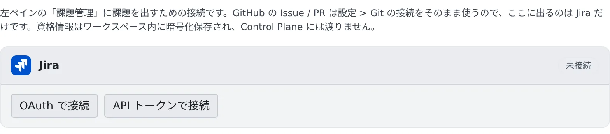

# 課題管理サービスを接続する

[English](issue-tracker.md) | 日本語

Jira を接続してクエリを保存すると、左ペインの「**課題管理**」に課題やプルリクエストが並び、行からそのままセッションを始められます。
同じ接続で、エージェントが `jira` と `confluence` の CLI を使えるようになります。

## 全体像

| あなたがやること | エージェントがやること |
|---|---|
| Jira を接続する | セッションの中で `jira` と `confluence` を、ログインなしで使う |
| クエリを保存し、一覧の行からセッションを始める | 課題の本文とコメントを読んで、作業を始める |

一覧の取得は Agent Fleet が行います。エージェントが一覧を見に行くことはありません。

| 取得元 | 接続する場所 |
|---|---|
| Jira | ⚙設定 →「課題管理」 |
| GitHub の Issue とプルリクエスト | ⚙設定 →「Git ホスティング」の GitHub の接続をそのまま使います |
| Bitbucket のプルリクエスト | ⚙設定 →「Git ホスティング」の Bitbucket の接続をそのまま使います |

## Jira を接続する

**⚙設定 →「課題管理」** を開きます。ワークスペースが止まっているときは、先に「**ワークスペースを起動**」を押します
（接続の情報はワークスペースの中に保存されるためです）。

接続のしかたは 2 つあります。

| ボタン | やること |
|---|---|
| OAuth で接続 | 別のタブで Atlassian の画面が開きます。承認すると、カードが **接続済み** に変わります |
| API トークンで接続 | サイトの URL（`https://….atlassian.net`）、Atlassian アカウントのメール、API トークンを入れて「**接続**」を押します |

- API トークンは、Atlassian のアカウント設定で発行します
- 「OAuth で接続」が押せないときは、テナントに Jira の OAuth アプリが登録されていません。テナント管理者に頼むか、API トークンで接続してください
- 1 回の承認で複数のサイトに入れるときは、カードの「**対象のサイト**」で、課題があるサイトを選びます
- 接続をやめるときは、カードの「**切断**」を押します。保存された認証情報はワークスペースから削除されます

### カードに注意が出たとき

OAuth の接続では、Atlassian アプリに許可されている範囲によって、カードに次の注意が出ることがあります。
どれもテナント管理者がアプリの設定を直したあとで、あなたが **Jira をつなぎ直す** と消えます。

| カードの表示 | 使えないもの |
|---|---|
| ボード・スプリント・エピック: 利用できません。 | `jira` のボード・スプリント・エピックのコマンドと `jira init` |
| Confluence: 利用できません。 | `confluence` のすべてのコマンド |
| Confluence: 検索とコメントは使えますが… | `confluence` のページの閲覧・作成・更新 |

テナント管理者の手順は [管理者ガイドのアクセス](../../admin/05-access.ja.md#bitbucket-と-jira) にあります。

## 一覧に出すものを決める

左ペインの「**課題管理**」の見出しにある「**保存したクエリ**」を押し、「**クエリを追加**」で取得元・表示名・検索クエリを入れます。

- **クエリを保存するまで、何も取得しません。** 一覧に出るのはクエリに一致したものだけで、全件は取り込みません
- 検索クエリは、取得元の書き方をそのまま使います

| 取得元 | 書き方 | 例 |
|---|---|---|
| Jira | JQL | `assignee = currentUser() AND statusCategory != Done` |
| GitHub | GitHub の検索構文 | `is:open (is:issue OR is:pull-request) involves:@me` |
| Bitbucket | 接続済みのリポジトリから選んで組み立てるか、自分で書く | 「何を出すか」で「レビュー待ち」などを選び、対象のリポジトリ（自分が作った PR ならワークスペース）を選ぶ |

### GitHub のクエリのコツ

- `assignee:@me` だけでは、プルリクエストは 1 件も出ません。GitHub はプルリクエストの作者を担当者にしないためです
- 種別（`is:issue` か `is:pull-request`）を必ず入れてください。入れないと検索を断られるアカウントがあります
- 既定の `involves:@me` は、自分が作成・担当・メンション・コメントした項目を拾います。**自分へのレビュー依頼は含まれない**ので、
  `is:open review-requested:@me` をもう 1 本足してください。両方に当たった項目は 1 行にまとまります

### ブランチ名を決める

「保存したクエリ」の「**ブランチ名テンプレート**」で、行から始めたセッションのブランチ名を決められます。

- 空欄なら `{prefix}{ref}-{slug}` です（`feature/45-empty-list`、`fix/PROJ-123` など）
- 使えるのは `{ref}` `{num}` `{key}` `{project}` `{type}` `{prefix}` `{slug}` です。欄の下に、実際にできる名前の例が出ます
- リポジトリに独自の規則（git-flow など）があれば、そちらが優先されます

## 一覧からセッションを始める

一覧の読みかたと、行からセッションを始める手順は [セッションを始める](../../member/03-starting-sessions.ja.md#課題管理から始める) にあります。
最初の指示には課題のキー・タイトル・URL が入り、エージェントは本文とコメントを `jira`、`gh`、`bkt` で読みます。

## 困ったとき

### 一覧に何も出ない

- クエリを保存したか確かめてください。保存するまで何も取得しません
- 「…の取得に失敗しました」と出るときは、クエリの書き方を確かめてください。GitHub が断ったクエリは、その理由が行に出ます

### 「OAuth で接続」を押しても接続済みにならない

- 別のタブの Atlassian の画面で承認したか確かめてください。5 分ほど待っても変わらないと
  「承認を確認できませんでした。もう一度お試しください。」と出ます
- 接続は、ボタンを押した本人の Console でだけ完了します。Console に別のアカウントでサインインしているときや、
  Console のサインインが切れているときは保存されません。本人としてサインインし直して、もう一度接続してください

## 関連

- [Jira を使う](jira.ja.md)：エージェントに Jira の課題を扱ってもらう
- [Confluence を使う](confluence.ja.md)：エージェントに Confluence のページを扱ってもらう
- [セッションを始める](../../member/03-starting-sessions.ja.md#課題管理から始める)：一覧の読みかたと、行からセッションを始める手順
