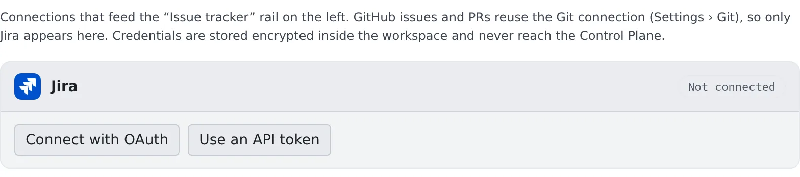

# Connect an issue tracker

English | [日本語](issue-tracker.ja.md)

Connect Jira and save a query, and the left rail's **Issue tracker** lists your issues and pull requests, ready to start
a session from a row. The same connection lets agents use the `jira` and `confluence` CLIs.

## How it works

| What you do | What the agent does |
|---|---|
| Connect Jira | Uses `jira` and `confluence` in a session, with no login |
| Save a query and start a session from a row of the list | Reads the issue's description and comments, and starts on the work |

Agent Fleet fetches the list itself. Agents never go and read it.

| Source | Where it is connected |
|---|---|
| Jira | ⚙ Settings → "Issue tracker" |
| GitHub issues and pull requests | Reuses the GitHub connection in ⚙ Settings → "Git hosting" |
| Bitbucket pull requests | Reuses the Bitbucket connection in ⚙ Settings → "Git hosting" |

## Connect Jira

Open **⚙ Settings → "Issue tracker"**. If the workspace is stopped, press "**Start workspace**" first (the connection
is stored inside the workspace).

There are two ways to connect.

| Button | What you do |
|---|---|
| Connect with OAuth | An Atlassian page opens in another tab. Once you approve, the card turns **Connected** |
| Use an API token | Enter the site URL (`https://….atlassian.net`), your Atlassian account email and an API token, then press "**Connect**" |

- Create the API token in your Atlassian account settings
- If "Connect with OAuth" cannot be pressed, the tenant has no Jira OAuth app registered. Ask a tenant administrator, or connect with an API token
- If one approval covers several sites, pick the one that holds your issues under "**Site**" on the card
- To stop using the connection, press "**Disconnect**" on the card. The stored credentials are removed from the workspace

### When the card shows a warning

With an OAuth connection, the card can show one of these warnings, depending on what the Atlassian app is allowed to do.
Each one goes away once the tenant administrator has fixed the app and you **reconnect Jira**.

| What the card says | What does not work |
|---|---|
| Boards, sprints and epics: not available. | The board, sprint and epic commands of `jira` |
| Confluence: not available. | Every `confluence` command |
| Confluence: search and comments work, but … | Reading, creating and updating pages with `confluence` |

The tenant administrator's steps are in [the admin guide's Access chapter](../../admin/05-access.md#bitbucket-and-jira).

## Choose what the list shows

Press "**Saved queries**" in the header of the left rail's **Issue tracker**, then "**Add a query**", and fill in the
source, a display name and the search query.

- **Nothing is fetched until you save a query.** The list shows only what the query matches; nothing is synced in bulk
- The search query is written in the source's own syntax

| Source | Syntax | Example |
|---|---|---|
| Jira | JQL | `assignee = currentUser() AND statusCategory != Done` |
| GitHub | GitHub search syntax | `is:open (is:issue OR is:pull-request) involves:@me` |
| Bitbucket | Built by picking from your connected repositories | Pick "For my review" or another option under "What to list", then the repository |

### Tips for GitHub queries

- `assignee:@me` alone lists no pull requests, because GitHub does not make a pull request's author its assignee
- Always name a type (`is:issue` or `is:pull-request`). Some accounts have their searches rejected without one
- The default `involves:@me` covers what you authored, are assigned, were mentioned in or commented on. **Reviews
  requested of you are not in it**, so add `is:open review-requested:@me` as a second query. An item matched by both still takes one row

### Choose the branch name

The "**Branch name template**" in "Saved queries" sets the branch name of a session started from a row.

- Empty means `{prefix}{ref}-{slug}` (`feature/45-empty-list`, `fix/PROJ-123` and so on)
- The placeholders are `{ref}` `{num}` `{key}` `{project}` `{type}` `{prefix}` `{slug}`. The example under the field shows the name yours produces
- A repository's own rules (git-flow and the like) take precedence

## Start a session from the list

How to read the list and start a session from a row is in [Starting sessions](../../member/03-starting-sessions.md#starting-from-the-issue-tracker).
The first instruction carries the issue's key, title and URL, and the agent reads the description and comments with `jira` or `gh`.

## When it goes wrong

### The list is empty

- Check that you saved a query. Nothing is fetched until you do
- If the row says "Couldn't fetch …", check how the query is written. A query GitHub rejects shows the reason on its row

### "Connect with OAuth" never turns Connected

- Check that you approved on the Atlassian page in the other tab. After about five minutes without a change the card says
  "Couldn't confirm the authorization. Please try again."
- The connection completes only in the Console of the member who pressed the button. If the Console is signed in as
  someone else, or its sign-in has expired, nothing is saved. Sign in as yourself and connect again

## Related

- [Use Jira](jira.md): have agents work with Jira issues
- [Use Confluence](confluence.md): have agents work with Confluence pages
- [Starting sessions](../../member/03-starting-sessions.md#starting-from-the-issue-tracker): reading the list and starting a session from a row
