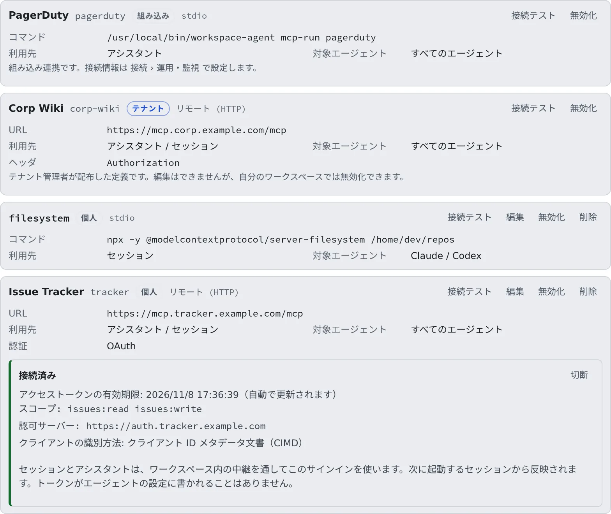

# セッションに MCP サーバーを追加する

[English](mcp-servers.md) | 日本語

MCP サーバーを登録すると、セッションとアシスタントがそのサーバーのツールを使えるようになります。
社内 Wiki、課題管理、ドキュメント検索など、Agent Fleet が最初から持っていないツールを足す場所です。

## 全体像

| あなたがやること | エージェントがやること |
|---|---|
| MCP サーバーを登録する | 次に起動したセッションから、そのサーバーのツールを使う |
| OAuth のサーバーにサインインする | ワークスペースの中の中継を通してサーバーを呼ぶ。トークンそのものは見ない |
| 使わないサーバーを無効にする | 無効にしたサーバーは受け取らない |

> [!NOTE]
> ここに登録するのは、**あなたのセッションが使う**サーバーです。外部のアプリからこのワークスペースを操作させるときは、
> **外部からのアクセス**の [MCP トークン・接続アプリ](../outside/external-claude.ja.md) を使います。

## サーバーを登録する

**⚙設定 →「MCP サーバー（セッションで使う）」** を開き、「**MCP サーバーを追加**」を押します。
設定の内容はワークスペースの中にあるので、ワークスペースが止まっているときは先に起動してください。

| 項目 | 入れるもの |
|---|---|
| 表示名 | 一覧に出る名前。省略できます |
| ID | 各エージェントの設定に書かれるサーバー名。自分で書き換えるまでは、表示名か URL のホスト名から自動で入ります |
| 接続方式 | 「**リモート (HTTP)**」（既定）か「**stdio**」 |
| URL | リモートのとき。MCP エンドポイントの URL です |
| コマンド・引数・環境変数 | stdio のとき。ワークスペースの中で起動する実行ファイルと、その引数（1 行に 1 つ）・環境変数です |
| 認証 | リモートのとき。[認証を選ぶ](#認証を選ぶ) を見てください |

- ID は英数字・ハイフン・アンダースコアで 48 文字以内、先頭は英数字です。登録したあとは変わりません
- リモートは Streamable HTTP だけに対応しています
- 環境変数とヘッダーの値は暗号化して保存され、画面には二度と表示されません。ただし、サーバーを動かすエージェントに渡す設定ファイルには、値がそのまま書かれることがあります（ホームディレクトリの中の本人しか読めないファイルで、リポジトリには置きません）
- このマシン以外への `http://` の URL も登録できますが、トークンもリクエストも暗号化されずに流れるため警告が出ます

> [!WARNING]
> トークンなどの認証情報は URL に入れず、**認証**に入れてください。URL にユーザー名とパスワードを埋め込むと、保存が断られます。

### 認証を選ぶ

| 認証 | 使うとき |
|---|---|
| なし | 認証の要らないサーバー |
| Bearer トークン | トークンを 1 つ渡すサーバー。`Authorization: Bearer <トークン>` として送られます |
| カスタムヘッダ | 好きな名前と値のヘッダーを送るサーバー |
| OAuth | OAuth のサインインでしか使えないサーバー。フォームには何も入力しません（[OAuth のサーバーにサインインする](#oauth-のサーバーにサインインする)） |

- Bearer トークンは、先頭に `Bearer ` を付けて貼り付けても大丈夫です
- 保存したトークンは表示されません。欄を空のままにすれば変わらず、新しく入力すると置き換わります
- OAuth には固定のヘッダーを付けられません
- 保存されている `Authorization` ヘッダーが Bearer トークンでないサーバー（`Token …` など）は、カスタムヘッダで開きます

### 詳細設定

「**詳細設定**」は最初は閉じていて、見出しの横に今の値が 1 行で出ます（例：「アシスタント, セッション · すべてのエージェント · タイムアウトは既定」）。既定と違う値を持つサーバーを編集するときは、自動で開きます。

| 項目 | 決めること |
|---|---|
| 利用先 | 「**アシスタント**」と「**セッション**」のどちらに渡すか、そして「**ウォッチのソース**」にするか（[後述](#サーバーをウォッチのソースにする)）。すべて外すと、登録は残りますがどこにも渡されません |
| 対象エージェント | 渡すエージェントの種類。何も選ばなければすべてのエージェントです |
| タイムアウト (ms) | 1000〜120000 の範囲で指定します。空欄なら各エージェントの既定に従います |
| 有効 | 外すと、定義を残したままどこにも渡されなくなります |

## 接続テストで確かめる

フォームか一覧の行の「**接続テスト**」を押すと、保存する前でもサーバーにつながるか確かめられます。

- つながると「**接続できました: example-mcp 1.2.0・ツール 3 件（214ms）**」のように、サーバーの名前・バージョン・ツールの数・応答時間が出ます
- 失敗すると理由が出ます。サーバー自身のエラー出力や応答があれば、それもそのまま表示されます
- サーバーが OAuth のサインインを求めたときは、失敗ではなく「**OAuth のサインインが必要です**」と出て、
  見つかった認可サーバー・クライアントの登録方法・スコープが並びます。認証が OAuth の保存済みサーバーなら、そこから「**サインイン**」できます

## OAuth のサーバーにサインインする

1. **認証**で「**OAuth**」を選んで、サーバーを保存します
2. 一覧の行の「**サインイン**」を押します。認可サーバーが新しいタブで開きます（ブラウザが新しいタブをブロックしたときは、お知らせを出してからこのタブで開きます）
3. 開いたタブで、あなた自身のアカウントでサインインして許可します
4. タブに「**このタブは閉じて構いません**」と出たら閉じます。元の Console の行が自動で更新されます

行に「**接続済み**」と出たら完了です。アクセストークンの有効期限（自動で更新されます）、許可したスコープ、
クライアントの識別方法も表示されます。

| 行の状態 | 意味 |
|---|---|
| 未サインイン | まだサインインしていません。このサーバーはまだどのセッションにも渡されません |
| 接続済み | そのまま使えます |
| 再サインインが必要 | 保存されたサインインを更新できなくなりました。「**もう一度サインイン**」を押してください |
| 追加の権限が必要 | サーバーが、まだ許可していない権限を求めました。「**追加の権限を許可する**」を押すと、今の権限に足してサインインし直します |

- **サインインしている間だけ**、このサーバーはセッションとアシスタントに渡されます。ほかのサーバーと同じく、次に起動するセッションから効きます
- セッションは、ワークスペースの中の中継を通してこのサインインを使います。トークンがエージェントの設定に書かれることはありません
- 認可サーバーに自動の登録がないときは、「**クライアント ID が必要です**」と出ます。認可サーバーで手動登録したクライアント ID
  （あればシークレットも）を入れて「**保存してサインイン**」を押します
- 「**切断**」を押すと、保存されたサインインを削除します。認可サーバーが対応していれば、そちらでも取り消されます

## 出自ごとにできること

一覧の行には、誰が登録したかを示すラベルが付きます。

| ラベル | どんなサーバーか | ここでできること |
|---|---|---|
| 個人 | あなたが登録したサーバー | 接続テスト・編集・無効化・削除 |
| テナント | 管理者がテナント全員に配ったサーバー | 接続テスト・自分のワークスペースでの無効化。編集と削除はできません |
| 組み込み | Agent Fleet 自身のサーバーと、運用・監視の連携 | 接続テストだけ。編集・無効化・削除はできません |

- **テナント**のサーバーで、認証の値を各自で入れる形のものには「**値を入力**」が出ます。値はあなたのワークスペースに暗号化して保存され、テナントには渡りません
- **テナント**のサーバーが OAuth なら、自分のサーバーと同じく「**サインイン**」が出ます。サインインはあなただけのものです
- テナントの配布は 5 分以内にワークスペースへ届きます。すぐに取り込みたいときは「**テナント配布を取得**」を押します
- テナントのサーバーと同じ名前の個人の登録は使われません。一覧の上に「**テナント配布と名前が重なるため使われていない個人登録があります**」と、その名前が出ます
- **組み込み**の Agent Fleet のサーバーは、設定なしですべてのセッションに渡されます。セッションが完了を報告したり、引き継ぎを提案したりするのに使います
- PagerDuty・Grafana・CloudWatch・AWS の連携は、**運用・監視**のタブで接続すると一覧に出ます

テナントへの配り方は、管理者向けの [MCP サーバーを全員に配る](../../admin/mcp-distribute.ja.md) にあります。

## サーバーをウォッチのソースにする

自分の MCP サーバーは、`watch` ツールの情報源にもできます。ワークスペースがサーバーの `watch_resolve(ref)` と
`watch_poll(subjects, cursors)` を自分で呼び出し、頼んだセッションは、ポーリングする代わりに変化があったときに知らされます。
**詳細設定 → 利用先**で「**ウォッチのソース**」をオンにします。「**セッション**」とは独立していて、セッションからサーバーに届く必要はありません。

- 先にテナント管理者の許可が必要です（テナント設定 → **ウォッチのソース**）。許可がない間は保存が断られます
- セッションは `source` に `ext.<ID>`（ID を小文字にして `-` を `_` にしたもの。数字で始まる ID は使えません）、型に `ext.<ID>.` で始まるものを指定してウォッチします
- サーバーに渡るのは対象の参照とサーバー自身のカーソルだけで、セッションの文章は渡りません。`ref` は 1 行の ASCII で 200 文字までです
- サーバーの答えは引用されたデータとしてセッションに届き、指示としては扱われません。イベントは自分のセッションにだけ届きます
- ローカル（stdio）のサーバーは、絞った環境（`PATH`・`HOME`・`LANG`・`TMPDIR` と設定した変数）で起動します
- ワークスペースは 1 回に 20 件の対象を問い合わせ、同じ対象を問い合わせるのは 1 分に 1 回までです。5 回続けて失敗するか、不正な応答が 20 回続くとソースは一時停止し、理由は `list_watches` に出ます。サーバーを編集するか有効化し直すと再開します

## どのエージェントに渡るか

- **セッション**：**次に起動するセッションから**渡ります。起動中のセッションには効きません。
  受け取れるのはエージェントのセッションで、シェルや SSM のターミナルには渡りません。種類ごとの違いは
  [エージェント — 種別ごとにできること](../../ref/agents.ja.md) の「連携（MCP）サーバーが届く」の行にあります
- **アシスタント**：アシスタントの編集画面の「**MCP サーバー（任意）**」で、使うサーバーを選びます
- **対象エージェント**を選んだサーバーは、選んだ種類のエージェントにだけ渡ります

リポジトリに置いた MCP の定義（`.mcp.json` など）はこのタブでは扱いません。リポジトリの右クリックメニューの
「**プロジェクト設定…**」で、エージェントごとの効き方と警告を確かめられます。

## 困ったとき

### 登録したのにセッションで使えない

- 起動中のセッションには効きません。新しいセッションを始めてください
- 行に「**必要な値が揃っていないため、有効でも実際には渡されません（未入力のヘッダがあります）。**」と出ていないか確かめてください。テナントのサーバーで認証の値を入れていないときは、代わりに「**認証の値が未入力のため、有効でも実際には渡されません。**」と出ます。「**値を入力**」から入れてください
- OAuth のサーバーは、行が「**接続済み**」になるまで渡されません
- **詳細設定**の利用先と対象エージェントを確かめてください

### 接続先が外部通信の許可リストにない

ワークスペースから外への通信が制限されている環境です。行の「**許可を申請**」を押し、理由を書いて「**申請する**」を押します。
管理者が承認すると使えるようになります。「記録のみ」の環境では今は使えますが、遮断に切り替わると使えなくなります。

### サインインが最後まで終わらない

行に、サインインが終わっていないという案内が出ます。

1. もう一度「**サインイン**」を押します
2. 「**動的登録でやり直す**」が出ていれば押します
3. それでも進まないときは、サーバーの運営者に、この配備のホストを信頼するよう頼みます。
   相手が別の Agent Fleet の配備なら、その管理者の「信頼するクライアントのホスト」の設定です

### 「このデプロイ自身の /mcp エンドポイントです」と出て保存できない

この Agent Fleet 自身の `/mcp` はセッションに登録できません。セッションにあなたの全権限が渡ってしまうためです。
`/mcp/memory` も登録できません。セッションは組み込みの Agent Fleet のサーバーで、メモリをすでに使えるからです。別の Agent Fleet の配備なら登録できます。

### タイムアウトが効かない

opencode と Cursor には対応する設定がないため、タイムアウトを指定しても無視されます。

## 関連

- [エージェント — 種別ごとにできること](../../ref/agents.ja.md)：どのエージェントに MCP サーバーが届くか
- [MCP サーバーを全員に配る](../../admin/mcp-distribute.ja.md)：管理者がテナント全員にサーバーを配る
- [MCP トークン・接続アプリ](../outside/external-claude.ja.md)：外部のアプリからこのワークスペースを操作させる
